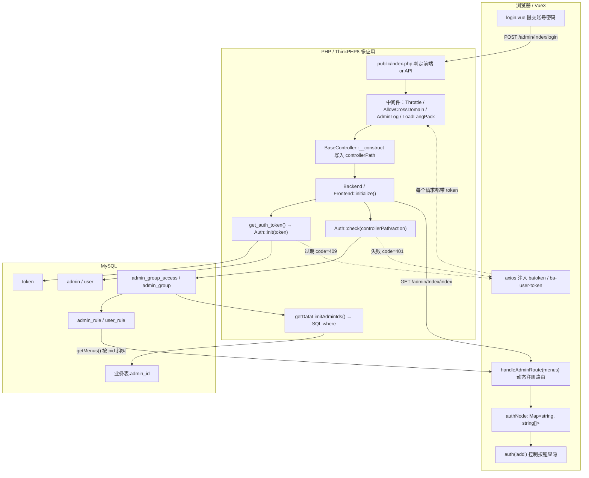
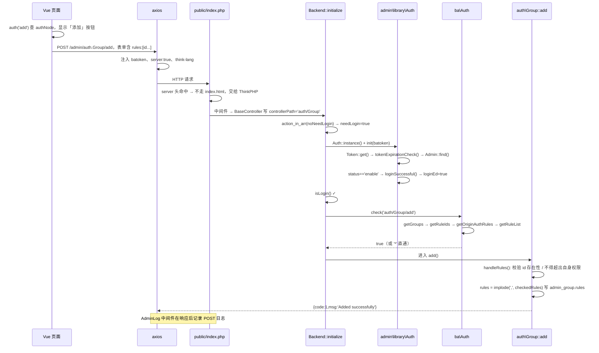
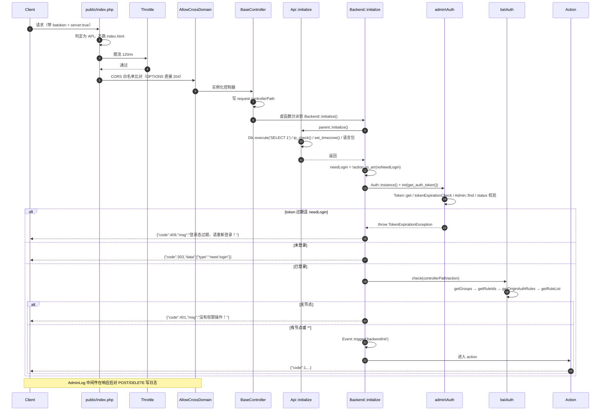
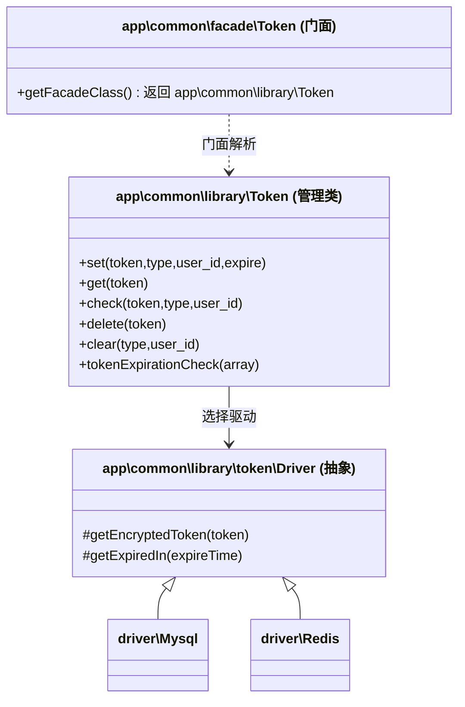
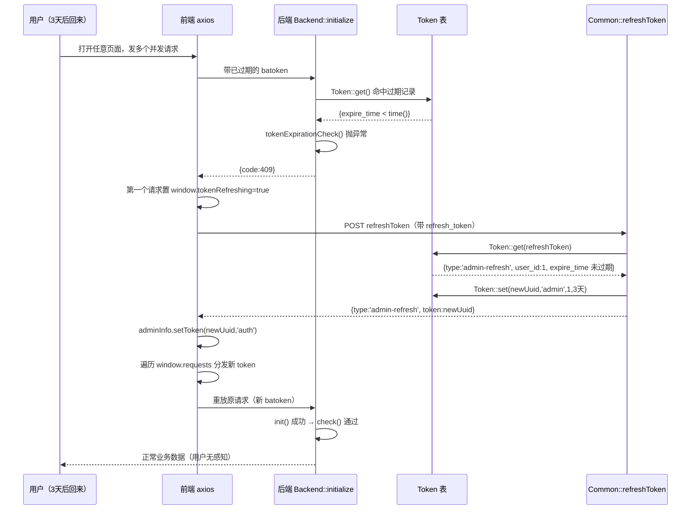

# BuildAdmin 权限系统：设计思路与代码实现逐行详解

> **适用代码库**：`F:/Develop/buildadmin`（BuildAdmin v2.3.9，PHP 8 + ThinkPHP 8 多应用 + Vue 3 + Element Plus + TypeScript + Pinia）
> **文档口径**：全栈全量 —— 后台 RBAC、数据权限、菜单规则树、前端路由/菜单/按钮权限、会员端鉴权、WEB 终端/安装器/CRUD 生成器等特殊入口、安全边界与越权防护。
> **行号说明**：文中所有 `文件:行号` 均对应当前工作区的实际文件；代码块内的 `135→` 前缀是源码行号，为便于逐行对照而保留。
> **阅读约定**：标注「★」的是权限判定的关键行；标注「设计意图」的段落解释「为什么这样写」而不只是「写了什么」。

---

## 目录

| 章 | 内容 | 侧重 |
|---|---|---|
| 第 0 章 | 全景、分层、术语、七个最容易搞错的事实 | 建立正确心智模型 |
| 第 1 章 | 设计思路（八项核心决策 + 五层安全边界） | Why |
| 第 2 章 | 数据模型：表结构、迁移演进、88 条初始规则节点 | What |
| 第 3 章 | 后端鉴权主链路逐行：入口 → 中间件 → 基类 → `initialize()` | How（逐行） |
| 第 4 章 | 身份与令牌逐行：Token 驱动、登录、续期、409 闭环 | How（逐行） |
| 第 5 章 | 权限判定内核 `ba\Auth` 逐行：`check()` 与规则列表生成 | How（逐行） |
| 第 6 章 | 数据权限逐行：`getDataLimitAdminIds()` 到 SQL `where` | How（逐行） |
| 第 7 章 | 授权管理逐行：角色组授权、规则树、防提权、前端勾选树 | How（逐行） |
| 第 8 章 | 前端权限逐行：动态路由、`authNode`、`auth()`、axios 重放 | How（逐行） |
| 第 9 章 | 会员端逐行：双通道差异、游客规则、二次校验 | How（逐行） |
| 第 10 章 | 特殊入口与边界：安装器、终端、CRUD 生成器、跨域、审计 | How |
| 第 11 章 | 安全审计：风险点 R1–R8、防护矩阵、加固方案选项 | Review |
| 第 12 章 | 实操手册：新增一个受权限控制的接口/页面 | Practice |
| 附录 | 精确名称速查、全量免鉴权清单、文件索引、行号索引 | Reference |

---

# 第 0 章 全景与心智模型

## 0.1 一张图看完整链路



**读图要点**：

1. **服务端每个请求都要重新走一遍鉴权**：没有 Session、没有服务端登录态缓存，只有 `token → 数据库查 admin/user → 查分组 → 查规则` 这条链。
2. **前端拿到的 `menus` 和后端用来判权限的 `admin_rule` 是同一份数据**，只是被 `getMenus()` 按 `pid` 组了树。
3. **前端的 `authNode` 是显示层**，不是安全边界；真正拦住越权请求的是 `Backend::initialize()` 里的 `$this->auth->check($routePath)`。

## 0.2 五层安全边界

| 层 | 位置 | 拦什么 | 失败表现 |
|---|---|---|---|
| L0 网络层 | `Throttle`、`AllowCrossDomain`、`ip_check()` | 高频请求、非白名单跨域源、黑名单 IP | HTTP 429 / 无 CORS 头 / HTTP 403 |
| L1 身份层 | `Auth::init($token)` | 无效/过期/类型不符/账号禁用 | `code=303`（未登录）、`code=409`（过期） |
| L2 路由 RBAC | `Backend::initialize()` / `Frontend::initialize()` | 已登录但无 `controllerPath/action` 节点 | 业务 `code=401` |
| L3 行级数据权限 | `getDataLimitAdminIds()` + trait CRUD | 有节点但越权访问他人数据 | `code=0`「没有权限操作」 |
| L4 二次校验与审计 | `isSuperAdmin()`、`Token::check()`、`handleRules()`、`AdminLog`、`Security` 事件 | 提权、敏感操作、事后追溯 | `code=0` / 写日志 |

> **设计意图**：这五层是「纵深防御」，不是「一层包打天下」。任何一层被绕过（例如前端 `auth()` 被篡改、或某个方法被错误地放进 `$noNeedPermission`），下一层仍然应该能拦住。第 11 章会逐条检验这个假设在哪些地方没有成立。

## 0.3 术语与精确命名表

写文档、改代码、查数据库时最容易出错的是名字。下表是本代码库中**真实存在**的拼写。

| 概念 | 精确拼写 | 常见误写 |
|---|---|---|
| 后台规则表 | `admin_rule`（安装时叫 `menu_rule`，version200 改名） | `admin_rules`、`menu_rule`（仅旧迁移） |
| 后台分组表 | `admin_group` | `admin_groups` |
| 分组关系表 | `admin_group_access`，字段 `uid` / `group_id` | `admin_group_accesses`、字段 `admin_id` |
| 会员规则表 | `user_rule` | `user_rules` |
| 会员分组表 | `user_group`（**无 `pid`**） | — |
| 权限载体字段 | `admin_group.rules`，`text`，值为 `'*'` 或逗号分隔 id | `rule_ids`、`auth` |
| 权限标识字段 | `admin_rule.name`，如 `auth/group/add` | `url`、`route`、`path` |
| 路由路径字段 | `admin_rule.path`，如 `auth/group` | — |
| 请求对象上的控制器路径 | `$request->controllerPath`，如 `auth/Admin` | `controller_path` |
| 后台鉴权实例 | `$request->adminAuth`（`app\admin\library\Auth`） | `$request->auth` |
| 会员鉴权实例 | `$request->userAuth`（`app\common\library\Auth`） | — |
| 后台 token 头 | `batoken`（也兼容 `ba-token` / `ba_token` / `http_ba_token`） | `ba-token`（只是兼容项之一） |
| 会员 token 头 | `ba-user-token` | `bausertoken`（只是兼容项之一） |
| 超管判定 | `isSuperAdmin()` = `in_array('*', getRuleIds())` | `super` 字段（前端有，但只用于 UI） |
| 会员全权限 | `isSuperUser()` | `isSuperAdmin()` |
| 数据权限字段 | `$dataLimit`、`$dataLimitField`、`$dataLimitFieldAutoFill` | `$dataLimitFieldAuth`（**不存在**） |
| 角色组鉴权模式 | `Group.php::$authMethod = 'allAuthAndOthers'` | `$dataLimit` |
| 业务 `code` | `1` 成功 / `0` 失败 / `303` 需登录 / `409` 过期 / `401` 无权限 / `302` 跳转 | HTTP 状态码 |
| 事件标签位 | `backendInit`（已绑定 `Security`）、`frontendInit`（**无监听者**） | `adminInit` |

## 0.4 七个最容易写错、也最容易改错代码的事实

这一节来自对全库的实际检索，建议在动手改权限相关代码前先确认：

1. **`admin_rule` 在安装迁移里叫 `menu_rule`**。`database/migrations/20230620180908_install.php:240` 建的是 `menu_rule`，`20230622221507_version200.php:68` 才 `$menuRule->rename('admin_rule')->save();`。所以查旧迁移时不要以为没有规则表。
2. **没有 `app/admin/controller/auth/Menu.php`**。`auth/` 目录下只有 `Admin.php`、`AdminLog.php`、`Group.php`、`Rule.php`。菜单规则管理就是 `Rule.php`；version200 把节点 `auth/menu` 批量改名为 `auth/rule`（`version200.php:69-80`）。英文语言包里仍残留 `en/auth/menu.php`，中文包已是 `zh-cn/auth/rule.php`。
3. **没有 `AdminGroupAccess` 模型类**。全库通过 `Db::name('admin_group_access')` 直接读写这个中间表（约 10 处）。
4. **`queryBuilder()` / `getDataLimitAdminIds()` 不在 trait 里**，而在基类 `app/common/controller/Backend.php:176` 与 `:338`；`app/admin/library/traits/Backend.php` 只提供 `index/add/edit/del/sortable/select/excludeFields`，并 `use` 进基类（`Backend.php:129`）。
5. **本版本的权限/菜单树没有缓存**。`extend/ba/Auth.php` 的 `getMenus/getRuleList/getOriginAuthRules/getGroups` 全部实时查库，任何 `Cache` 都不涉及权限。唯一的权限邻近缓存是配置缓存标签 `sys_config`（`app/admin/model/Config.php:18`）。因此每次请求至少 3 次权限相关查询。
6. **`user_rule` 与 `admin_rule` 结构不同**：`user_rule.type` 枚举多 `route` / `nav_user_menu` / `nav`，且独有 `no_login_valid` 字段；`admin_rule` 独有 `keepalive`。
7. **前端 `router.beforeEach` 不做权限校验**。`web/src/router/index.ts:17-55` 的守卫只做语言包按需加载与进度条；登录态检查在 `layouts/backend/index.vue:44`，动态路由注册在 `:71` 的 `handleAdminRoute()`。前端也**没有路由级 `meta.auth` 校验**。`v-auth` 指令虽已定义（`utils/directives.ts:25-32`），但模板中**没有任何实际使用**，按钮权限实际走 `auth()` / `baTable.auth()`。

> 补充一条：`checkLogin` / `checkPermission` 这两个方法名在本代码库中完全不存在，登录与权限检查统一由 `isLogin()` / `check()` / `action_in_arr()` 完成。

## 0.5 一次典型请求的完整时序（先有整体，再看逐行）

以「管理员点击『角色组管理 → 添加』」为例：



---

# 第 1 章 设计思路

这一章只回答「为什么」。理解了这八项决策，后面所有代码都只是它们的实现细节。

## 1.1 设计目标与约束

| 目标 | 落地手段 |
|---|---|
| 一套代码同时服务「后台管理员」与「前台会员」两套身份体系 | 双 `Auth` 子类 + 双 token 头 + 构造参数覆盖三张表名 |
| 可视化配置权限，不需要改代码就能加菜单/按钮 | 权限节点入库 `admin_rule`，后台有图形化规则管理 + CRUD 生成器 |
| 权限粒度到「控制器方法」和「页面按钮」 | 权限标识 `controllerPath/action`，`button` 类型节点 |
| 除了「能不能访问接口」，还要能管「能看哪些数据」 | `$dataLimit` 数据权限，推导出管理员 id 白名单拼进 `where` |
| 前后台分离、无 Session、支持刷新续期 | `token` 表 + `refresh token` + 业务码 `409` 续期协议 |
| 可扩展：新增业务控制器零鉴权代码 | 全部控制器继承 `Backend`，鉴权在基类 `initialize()` 完成 |

约束也很明确：ThinkPHP 多应用模式、前端 hash 路由 + 运行时动态注册、MySQL 为主要存储（token 可选 Redis）。

## 1.2 决策一：菜单与权限节点同源（最核心的决策）

**做法**：目录（`menu_dir`）、菜单项（`menu`）、按钮（`button`）全部存在**一张表** `admin_rule`，用 `pid` 自关联成一棵树；角色组 `admin_group.rules` 存的是这棵树里**节点 id 的逗号串**。

**为什么**：

- 如果菜单和权限分开存，新增一个页面就要同时维护「菜单表」「权限表」「菜单-权限关联表」三处，极易出现「菜单看得见但接口 401」或「接口能调但菜单不显示」。
- 同源之后，「勾选授权树」这一个动作同时决定了：① 侧边栏显示什么；② 动态注册哪些路由；③ 哪些接口能调；④ 页面上哪些按钮显示。
- 证据在 schema 注释里：`install.php:242` 表注释就是「菜单和权限规则表」，`:249` 的 `type` 枚举 `menu_dir,menu,button` 三类混在一张表，索引只有 `pid` BTREE（`:264`）。
- 初始数据 88 个节点里 64 个是 `button`（见 2.4 节），说明「按钮」是这棵树的一等公民，不是外挂。

**代价**：`admin_group.rules` 是逗号串而非关联表，查询要用 `find in set`（`version202.php:39`），且节点增删时要写「自动补权限」的补偿逻辑（`Rule::autoAssignPermission()`、`Helper::createMenu()`），这是典型的**用一点范式换大量开发效率**。

## 1.3 决策二：权限标识 = `controllerPath/action`

**做法**：`BaseController` 把 `controller(true)` 结果里的 `.` 换成 `/` 写进 `$request->controllerPath`；`Backend::initialize()` 拼上 `action(true)` 得到 `auth/Group/add`；`ba\Auth::check()` 与 `admin_rule.name` 全小写比对。

**为什么**：

- 权限标识不需要额外发明一套命名空间，直接复用框架已有的控制器/方法名，新增方法时**自动**产生一个天然的权限键。
- 大小写不敏感（`check()` 内 `strtolower($name)`）避免 `auth/Admin` 与 `auth/admin` 的踩坑。
- 前端路由 `name` 也复用同一个字符串（`addRouteItem()` 的 `name: route.name`），于是「接口权限」「路由名」「菜单名」三者统一。
- 这套约定被写进 UI 提示文案：`web/src/lang/backend/zh-cn/auth/rule.ts:37`「将注册为 WEB 端路由名称，同时作为服务端方法名验权」。

**隐含约束（很重要）**：前端 `auth()` 用运行时路由 **path** 作为 `authNode` 的 key，而 `authNode` 的 key 是用规则 **name** 拼出来的（见 8.7 节）。所以 **`admin_rule.name` 必须和 `admin_rule.path` 填成同一个值**，否则按钮权限会静默失效。这是规则表单里两个字段都要求填 `auth/xxx` 的根本原因。

## 1.4 决策三：`rules` 用逗号串 + `'*'` 表示超级管理员

**做法**：`admin_group.rules` 是 `text`，值为 `'1,21,22,...'` 或 `'*'`；`ba\Auth::getRuleIds()` 用 `explode(',', trim($g['rules'], ','))` 拆开；`getRuleList()` 里若出现 `'*'` 就把 `'*'` 塞进规则名列表；`check()` 第 97 行 `if (in_array('*', $ruleList)) return true;`。

**为什么**：

- `'*'` 是一个**哨兵值**，让「超管」不需要真的拥有全表所有节点 id，未来新增菜单时超管天然拥有（否则每次新增节点都要给超管组补 id）。
- 超管的第二处绕过在 `getOriginAuthRules():177-179`：`if (!in_array('*', $ids)) $where[] = ['id','in',$ids];` —— 超管直接取启用状态的**全表**规则，菜单全量。
- 超管的第三处绕过在数据权限：`getDataLimitAdminIds():340` `if (!$this->dataLimit || $this->auth->isSuperAdmin()) return [];`，返回空数组表示不追加任何 `where`。
- 超管的第四处用途是 `isSuperAdmin()`，散落在终端、CRUD 生成器、日志可见范围等位置（见 5.8 节）。

**代价**：`admin_group.rules` 无法用索引做集合查询，`getAllAuthGroups()` 只能把**所有启用分组**拉到内存里逐组 `explode` + `in_array` 比较（`:464-484`）。分组数量大时是性能热点，代码注释 `:471` 甚至专门写了「及时 break，array_diff 等没有 in_array 快」——这是为性能做的微优化。

## 1.5 决策四：鉴权放在控制器 `initialize()`，而不是中间件

**做法**：`app/admin/middleware.php` 只有 `AllowCrossDomain`、`AdminLog`、`LoadLangPack` 三个中间件，**没有鉴权中间件**；登录与 RBAC 全在 `Backend::initialize()`（`Frontend::initialize()`）。

**为什么**：

- 鉴权需要用到 `$this->noNeedLogin` / `$this->noNeedPermission` 这两个**每个控制器可覆盖的属性**。放在中间件里就得反查控制器配置，别扭且容易漏。
- `initialize()` 由 `BaseController::__construct` 自动调用，在**任何** action 之前执行，等价于 AOP 前置通知，且子类可以 `parent::initialize()` 后追加逻辑（例如 `crud/Log.php:29-37` 在父类鉴权之后做二次节点校验）。
- `$this->auth` 是 protected 属性，控制器方法内可直接 `$this->auth->id`、`$this->auth->check(...)`，无需再从容器取。
- 事件标签位 `Event::trigger('backendInit', $this->auth)`（`:169`）给了插件/模块一个统一的挂载点。

**代价**：只有继承 `Backend` / `Frontend` 的控制器才受保护。直接继承 `Api` 的 `Common.php`、`Install.php` 是**整类免鉴权**（第 10 章详述）。此外 `initialize()` 里任何 `$this->error(...)` 都会抛 `HttpResponseException` 中断（`Api::result():114`），保证「鉴权失败不会继续进入 action」。

## 1.6 决策五：双身份体系靠「配置覆盖表名」而非两套实现

**做法**：`extend/ba/Auth.php:17-21` 定义三张表的默认名；`app/admin/library/Auth.php` 直接用默认值；`app/common/library/Auth.php:95-101` 在构造时传入：

```php
'auth_group'        => 'user_group',
'auth_group_access' => '',          // 空 = 不用中间表
'auth_rule'         => 'user_rule',
```

`ba\Auth::getGroups():220-237` 依据 `auth_group_access` 是否为空走两个分支：非空走 `admin_group_access` 多对多 JOIN；为空走 `user.group_id` 单字段 JOIN。

**为什么**：

- 后台管理员需要**多角色**（一人可属多个组，权限取并集），所以有中间表；会员只有**一个组**（`user.group_id`），没必要中间表。
- 把差异压缩成一个配置数组，`check()` / `getRuleIds()` / `getMenus()` 这些算法完全共用，避免两套 RBAC 实现漂移。
- 双 token 通道 `batoken` / `ba-user-token` 彻底隔离，`Auth::init()` 还会强校验 `$tokenData['type'] == self::TOKEN_TYPE`（`admin` / `user`），管理员 token 拿去会员端用不了，反之亦然。

## 1.7 决策六：数据权限用「权限集合比较」推导管理员白名单

这是整个系统里最不直观、也最值得单独讲的设计。

**问题**：管理员 A 能不能看管理员 B 创建的数据？传统做法是「按组织架构层级」判断（A 是 B 的上级就能看）。但 BuildAdmin 的组织层级 `admin_group.pid` 被明确声明为**仅供参考**（语言包 `auth/group.php:12` 的 `Remark lang`）：

> 「为保障系统安全，角色组本身的上下级关系仅供参考，系统的实际上下级划分是根据**权限多寡**来确定的，两位管理员的权限节点：相同被认为是**同级**、包含且有额外权限才被认为是**上级**，同级不可管理同级，上级可为下级分配自己拥有的权限节点。」

**做法**：不看组织树，看**权限集合的包含关系**：

1. `getAllAuthGroups($dataLimit)`：遍历所有启用分组，若「该组的全部规则 id」⊆「我拥有的规则 id」，说明我至少和它平级；`allAuthAndOthers` 还要求 `array_diff($rules, $groupRules)` 非空（我还有额外权限）才算严格上级。
2. `getGroupAdmins($groups)`：由 `admin_group_access` 反查这些组里的所有管理员 id。
3. `getDataLimitAdminIds()`：把白名单加上 `$this->auth->id`（永远含自己），返回。
4. `queryBuilder():302`：`$where[] = [$mainTableAlias . $this->dataLimitField, 'in', $dataLimitAdminIds];` → `WHERE 业务表.admin_id IN (...)`。

**为什么**：权限是系统里唯一不可伪造的「能力凭证」。组织树可以被管理员随意编辑（改 `pid`），但一个人能分配出去的权限永远不能超过自己（`Group::handleRules():299`），所以用权限集合推导层级是**自洽且防篡改**的。

**代价**：每次列表查询都要做一次「全量分组扫描 + 集合比较」，且要求业务表有 `admin_id`（或自定义 `$dataLimitField`）。

## 1.8 决策七：前端不设路由级守卫，只做「不注册 + 按钮隐藏」

**做法**：后端只下发「该管理员有权看到的规则树」，`handleAdminRoute()` 只把其中 `menu` 类型注册成 vue-router 路由；`button` 类型进 `authNode` Map，供 `auth('add')` 控制按钮显隐。前端**没有** `meta.auth`、没有 `beforeEach` 里的权限判断。

**为什么**：

- 既然「能看到的菜单」和「能调的接口」同源，把无权页面**根本不注册**就足以让用户在 UI 上无法到达；手输 URL 会命中 catch-all → loading 中转 → 落回第一个有权限的菜单（`static.ts:56-65`）。
- 避免前后端维护两套权限表达式。
- 前端 `authNode` 的定位被写死为「显示层」：`AdminInfo` 接口注释明确 `super` 字段「用于判定是否显示终端按钮等，**不做任何权限判断**」（`stores/interface/index.ts:152`）。

**代价与边界**：这不是安全边界。攻击者可以直接构造 HTTP 请求调用未注册的后端接口，所以 **L2 的 `check()` 必须始终存在**。第 11 章 R7 会再次强调。

## 1.9 决策八：双 token + 业务码 409 的续期协议

**做法**：登录时签发 `auth token`（默认 3 天，`admin_token_keep_time`）；勾选「保持登录」时额外签发 `refresh token`（30 天，`refreshTokenKeepTime = 2592000`）。`auth token` 过期时后端返回业务码 `409`（HTTP 仍是 200），前端 `axios` 拦截后调用匿名接口 `/api/common/refreshToken` 换新 token，并把并发请求排队重放。

**为什么**：

- 不用 Session，服务端无状态（token 存 `token` 表但只作校验），便于横向扩展。
- `refresh token` 独立且长期有效，避免用户每 3 天被踢出。
- **过期 token 不在过期瞬间删除**：MySQL 驱动每 48 小时清理一次（`Mysql.php:57-63`），Redis 驱动 `expiredHold = 2 天`（`Redis.php:23`）。`Common.php:64` 注释解释：「无需主动删除原 token，由 token 驱动自行实现过期 token 清理，可避免并发场景下无法获取到过期 token 数据」—— 因为必须先读到过期的 token 记录，才能抛 `TokenExpirationException` 返回 409；如果过期即删，`Token::get()` 返回空数组，就只会得到「请先登录」而不是「可续期」。

## 1.10 与「教科书 RBAC」的差异

| 教科书 RBAC | BuildAdmin | 差异原因 |
|---|---|---|
| 用户-角色-权限三张关联表 | 用户-组用中间表，组-权限用 `rules` 逗号串 | 减少 join、便于一次性授权树提交 |
| 权限 = 资源 + 操作，独立表 | 权限节点 = 菜单树节点，含 `component` / `icon` / `path` | 菜单与权限同源 |
| 角色继承/层级用显式关系 | 层级由权限集合包含关系推导 | 防篡改、防同级越权 |
| 有 `super admin` 角色 | 用哨兵值 `'*'` | 新增节点自动拥有 |
| 权限判断在中间件/网关 | 在控制器 `initialize()` | 便于每控制器覆盖免检名单 |
| 前端路由守卫校验 `meta.roles` | 不注册无权路由 + 按钮级 `auth()` | 数据源唯一 |
| Session / JWT 单 token | 双 token + 409 续期协议 | 无状态 + 长期登录 |

## 1.11 设计上的取舍总结

| 得到 | 付出 |
|---|---|
| 加菜单/按钮零代码、可视化授权 | `rules` 逗号串、`find in set`、节点增删要写补偿逻辑 |
| 前后台共用一套 RBAC 算法 | 会员端差异被压缩成「配置 + 分支」，可读性略差 |
| 超管天然拥有未来新增节点 | `'*'` 需要散落在 4 处绕过判断，容易漏 |
| 数据权限防篡改 | 每次查询多轮 SQL + 全量分组内存比较 |
| 前端零权限表达式维护 | 前端完全不是安全边界，后端必须兜住 |
| 无状态 + 长期登录 | token 表/缓存保留过期数据 2 天，续期接口是匿名入口 |

---

# 第 2 章 数据模型

## 2.1 权限相关表关系图

```mermaid
erDiagram
    admin ||--o{ admin_group_access : "uid"
    admin_group ||--o{ admin_group_access : "group_id"
    admin_group ||--o{ admin_group : "pid 自关联(仅供参考)"
    admin_rule ||--o{ admin_rule : "pid 自关联(菜单/按钮树)"
    admin_group }o--..--o{ admin_rule : "rules 逗号串存 admin_rule.id"
    admin ||--o{ admin_log : "admin_id"
    user ||--o| user_group : "user.group_id 单组"
    user_group }o--..--o{ user_rule : "rules 逗号串"
    user_rule ||--o{ user_rule : "pid 自关联"
    token }o--..--|| admin : "type=admin / user_id"
    token }o--..--|| user : "type=user / user_id"
```

## 2.2 逐表字段说明

### 2.2.1 `admin` 管理员表

`database/migrations/20230620180908_install.php:34-64` 建表，`version200.php:11-22` 与 `version222.php:37-44` 改字段。

| 字段 | 类型 | 说明 / 权限相关性 |
|---|---|---|
| `id` | int unsigned, PK, 自增 | `$this->auth->id` 的来源；数据权限白名单的元素 |
| `username` | varchar(20), **unique** | 登录唯一凭据（`Auth::login():170`） |
| `nickname` / `avatar` / `email` / `mobile` / `motto` | varchar | 展示信息 |
| `password` | varchar(255) | `password_hash()` 结果；`version222` 从 32 位扩到 255 以兼容 bcrypt |
| `salt` | varchar(30) | 「废弃待删」，仅为兼容旧 md5 密码保留（`verify_password()` 的 else 分支） |
| `login_failure` | tinyint | 登录失败次数，配合 `admin_login_retry` 锁定 |
| `last_login_time` | bigint | 失败次数重置的时间基准（`time() - last_login_time >= 86400`） |
| `last_login_ip` | varchar(50) | 审计 |
| `status` | varchar(30) | **`enable` / `disable` 字符串**（version222 从 enum `'0','1'` 改来），`Auth::init():146` 与 `login():175` 都校验 |

**模型** `app/admin/model/Admin.php`：

```php
27→    protected $autoWriteTimestamp = true;
32→    protected $append = ['group_arr', 'group_name_arr'];
37→    public function getGroupArrAttr($value, $row): array
38→    {
39→        return Db::name('admin_group_access')
40→            ->where('uid', $row['id'])
41→            ->column('group_id');
42→    }
```

- `group_arr` / `group_name_arr` 是 **append 追加属性**，不是数据库字段。前端 `auth/admin/popupForm.vue` 的 `group_arr` 多选值正是写回这里（实际由 `auth/Admin.php::add/edit` 手工同步中间表）。
- `resetPassword()`（`:68-70`）用 `hash_password()` 并把 `salt` 置空。

### 2.2.2 `admin_group` 管理分组表

`install.php:66-85`：

| 字段 | 类型 | 说明 |
|---|---|---|
| `id` | int unsigned PK | 分组 id |
| `pid` | int unsigned, default 0 | **上级分组**，构成 1→2→3→4 的层级；`parent` 数据权限依赖它，但官方声明「仅供参考」 |
| `name` | varchar(100) | 组名 |
| `rules` | text, nullable | **权限载体**：`'*'` 或逗号分隔的 `admin_rule.id` |
| `status` | boolean (version222 改) | `1` 启用；`getGroups()` 硬编码 `ag.status='1'` |
| `create_time` / `update_time` | bigint | 时间戳 |

初始数据 `install_data.php:45-86`：

| id | pid | name | rules |
|---|---|---|---|
| 1 | 0 | 超级管理组 | `'*'` |
| 2 | 1 | 一级管理员 | `1,21,...,76` 共长串（含控制台、会员管理、常规管理等） |
| 3 | 2 | 二级管理员 | `21,...,43`（会员管理部分） |
| 4 | 3 | 三级管理员 | `55,...,75`（数据安全管理部分） |

> **注意**：id=1 之外的组**不含**后加的 78–88 号节点（模块市场、CRUD、配置删除等）。只有 `'*'` 超管天然拥有新增节点；普通组要靠 `Rule::autoAssignPermission()` 或手工补授权。这正是 1.2 节所说「节点增删要写补偿逻辑」的具体体现。

模型 `app/admin/model/AdminGroup.php` 只有一行 `$autoWriteTimestamp = true`。

### 2.2.3 `admin_group_access` 分组映射表

`install.php:87-106`：`'id' => false`（**无主键**），字段 `uid`、`group_id`，两个独立 BTREE 索引。管理员↔分组**多对多**，权限取并集（`getRuleIds()` 用 `array_merge` 累加所有组）。

> 全库**没有对应的模型类**，一律 `Db::name('admin_group_access')`。

### 2.2.4 `admin_rule` 菜单和权限规则表（原名 `menu_rule`）

`install.php:237-269` 建表，`version200.php:60-86` 改名并修正节点名。

| 字段 | 类型 | 说明 / 权限语义 |
|---|---|---|
| `id` | int unsigned PK | 节点 id，被 `admin_group.rules` 引用 |
| `pid` | int unsigned, default 0 | 上级节点，**BTREE 索引**；菜单/按钮树的唯一结构字段 |
| `type` | enum `menu_dir,menu,button` | **节点类型**，见下表 |
| `title` | varchar(50) | 菜单/按钮显示名；`AdminLog::record():140-141` 用它做日志标题 |
| `name` | varchar(50) | **权限标识 / 路由 name**，格式 `controllerPath` 或 `controllerPath/action` |
| `path` | varchar(100) | 前端路由 path，通常**必须与 `name` 相同**（见 1.3 节隐含约束） |
| `icon` | varchar(50) | 图标 |
| `menu_type` | enum `tab,link,iframe`, nullable | 菜单渲染方式 |
| `url` | varchar(255) | link / iframe 目标地址 |
| `component` | varchar(100) | 组件路径，如 `/src/views/backend/auth/group/index.vue` |
| `keepalive` | tinyint | 是否缓存页面；**下发给前端时若为 1 会被替换成 `name` 字符串**（`getOriginAuthRules():187-189`） |
| `extend` | enum `none,add_rules_only,add_menu_only` | 只加路由 / 只加菜单 的特殊节点 |
| `remark` | varchar(255) | 备注；`get_route_remark()` 取它做表格页说明 |
| `weigh` | int | 排序权重 |
| `status` | boolean | `1` 启用；`getOriginAuthRules():175` 只取启用节点 |
| `create_time` / `update_time` | bigint | 时间戳 |

**`type` 取值语义**：

| type | 含义 | 是否有 `path`/`component` | 是否注册路由 | 是否进菜单 | 是否进 `authNode` |
|---|---|---|---|---|---|
| `menu_dir` | 菜单目录/容器 | 有 `path`，无 `component` | 否 | 是（无子级时前端跳过） | 否 |
| `menu` | 菜单项/页面 | 有 | 是 | 是 | 否 |
| `button` | 页面按钮 / 接口权限节点 | **无**（只有 `title` + `name`） | 否 | 否 | **是** |

> 这里有个容易误解的点：`button` 类型的 `name`（如 `auth/group/add`）**既是前端按钮权限节点，也是后端接口验权的依据**。后端 `check()` 比对的是「规则名列表」（由全部有权限节点的 `name` 组成），不区分 type。所以一个节点被勾选后，它能让接口通过，也能让按钮显示。

模型 `app/admin/model/AdminRule.php` 只有一个修改器 `setComponentAttr()`，把 `\` 换成 `/`（兼容 Windows 路径）。

### 2.2.5 `admin_log` 管理员日志表

`install.php:108-129`，字段 `id / admin_id / username / url / title / data / ip / useragent / create_time`。**没有任何角色或权限字段**——日志只记「谁在哪个 URL 做了什么」，不记「当时他是什么角色」。权限侧唯一关联是 `record():140-141` 用 `admin_rule.name` 反查 `title` 生成日志标题。

### 2.2.6 `user` / `user_group` / `user_rule` 会员侧

| 表 | 关键差异 |
|---|---|
| `user` | 用单字段 `group_id` 关联分组（**不是**中间表）；`status` 同为 `enable`/`disable`；`username`/`email`/`mobile` 唯一索引在 `version201.php:9-14` 被移除后两个 |
| `user_group` | **没有 `pid`**（扁平分组），`rules` 同为逗号串 / `'*'` |
| `user_rule` | `type` 枚举 `route,menu_dir,menu,nav_user_menu,nav,button`；**没有 `keepalive`**；**独有 `no_login_valid`**（游客可见开关） |

`no_login_valid` 的语言包解释（`web/src/lang/backend/zh-cn/user/rule.ts:16-19`）：「游客没有会员分组，通过本选项设置当前规则是否对游客有效（可见）」。这是会员端支持「游客也能看到某些导航/按钮」的关键。

### 2.2.7 `token` 表

`install.php:399-411`：`primary_key => 'token'`，字段 `token`(varchar50) / `type`(varchar15) / `user_id`(int) / `createtime` / `expiretime`（后改名 `create_time` / `expire_time`）。

**关键**：表里存的是 `hash_hmac('ripemd160', 明文token, buildadmin.token.key)`，**不是明文**（`token/Driver.php:78-82`）。因此数据库泄露不会直接导致 token 泄露（但 `token.key` 在配置文件里，同环境泄露则失效）。

## 2.3 迁移演进史（理解「为什么字段叫这个名」）

| 迁移 | 权限相关改动 |
|---|---|
| `20230620180908_install.php` | 建 20 张表；`menu_rule` 建表；字段是驼峰风格 `loginfailure` / `createtime` |
| `20230620180916_install_data.php` | 写入 1 个管理员、4 个组、1 条组关系、88 条 `admin_rule` 节点、6 条 `user_rule` 节点 |
| `20230622221507_version200.php` | **字段下划线化**（`login_failure` / `last_login_time` / `create_time`…）；`menu_rule` → `admin_rule`；`auth/menu*` → `auth/rule*`；`user_rule.type` 扩展枚举并补 `no_login_valid` |
| `20230719211338_version201.php` | 移除 `user.email` / `user.mobile` 唯一索引 |
| `20230905060702_version202.php` | 把 `dashboard/dashboard` 改名为 `dashboard`，新增 `type=button` 的 `dashboard/index` 节点，并用 `where('rules','find in set',$dashboardId)` 给所有已拥有控制台的组补上新节点 id —— **「新增节点要补偿授权」的实证** |
| `20231112093414_version205.php` | 快捷入口配置里的 `/admin/xxx` 路径改成 `admin_rule.name` |
| `20231229043002_version206.php` | 新增 `backend_entrance` 配置（后台入口可改），影响 axios URL 重写 |
| `20250412134127_version222.php` | `admin` / `user` 的 `status` 改字符串 `enable`/`disable`，`password` 扩到 255；`admin_group` / `admin_rule` / `user_group` / `user_rule` 的 `status` 改 boolean |
| `20260916091309_version239.php` | 仅 AI 配置组，与权限无关 |

## 2.4 `admin_rule` 初始 88 节点完整对照表

来源 `install_data.php:232-1162`。`path` 一般与 `name` 一致；`menu` 型带 `component` + `keepalive=1`；`button` 型不填 `path/component/icon/menu_type`。

| id | pid | type | name | title |
|---|---|---|---|---|
| 1 | 0 | menu | `dashboard/dashboard` | 控制台 |
| 2 | 0 | menu_dir | `auth` | 权限管理 |
| 3 | 2 | menu | `auth/group` | 角色组管理 |
| 4–7 | 3 | button | `auth/group/index` / `add` / `edit` / `del` | 查看/添加/编辑/删除 |
| 8 | 2 | menu | `auth/admin` | 管理员管理 |
| 9–12 | 8 | button | `auth/admin/index` / `add` / `edit` / `del` | 查看/添加/编辑/删除 |
| 13 | 2 | menu | `auth/menu` → 后改 `auth/rule` | 菜单规则管理 |
| 14–18 | 13 | button | `auth/menu/index` / `add` / `edit` / `del` / `sortable` → 后改 `auth/rule/*` | 查看/添加/编辑/删除/快速排序 |
| 19 | 2 | menu | `auth/adminLog` | 管理员日志管理 |
| 20 | 19 | button | `auth/adminLog/index` | 查看 |
| 21 | 0 | menu_dir | `user` | 会员管理 |
| 22 | 21 | menu | `user/user` | 会员管理 |
| 23–26 | 22 | button | `user/user/index` / `add` / `edit` / `del` | 查看/添加/编辑/删除 |
| 27 | 21 | menu | `user/group` | 会员分组管理 |
| 28–31 | 27 | button | `user/group/index` / `add` / `edit` / `del` | 查看/添加/编辑/删除 |
| 32 | 21 | menu | `user/rule` | 会员规则管理 |
| 33–37 | 32 | button | `user/rule/index` / `add` / `edit` / `del` / `sortable` | 查看/添加/编辑/删除/快速排序 |
| 38 | 21 | menu | `user/moneyLog` | 会员余额管理 |
| 39–40 | 38 | button | `user/moneyLog/index` / `add` | 查看/添加 |
| 41 | 21 | menu | `user/scoreLog` | 会员积分管理 |
| 42–43 | 41 | button | `user/scoreLog/index` / `add` | 查看/添加 |
| 44 | 0 | menu_dir | `routine` | 常规管理 |
| 45 | 44 | menu | `routine/config` | 系统配置 |
| 46–47 | 45 | button | `routine/config/index` / `edit` | 查看/编辑 |
| 48 | 44 | menu | `routine/attachment` | 附件管理 |
| 49–51 | 48 | button | `routine/attachment/index` / `edit` / `del` | 查看/编辑/删除 |
| 52 | 44 | menu | `routine/adminInfo` | 个人资料 |
| 53–54 | 52 | button | `routine/adminInfo/index` / `edit` | 查看/编辑 |
| 55 | 0 | menu_dir | `security` | 数据安全管理 |
| 56 | 55 | menu | `security/dataRecycleLog` | 数据回收站 |
| 57–60 | 56 | button | `.../index` / `del` / `restore` / `info` | 查看/删除/还原/查看详情 |
| 61 | 55 | menu | `security/sensitiveDataLog` | 敏感数据修改记录 |
| 62–65 | 61 | button | `.../index` / `del` / `rollback` / `info` | 查看/删除/回滚/查看详情 |
| 66 | 55 | menu | `security/dataRecycle` | 数据回收规则管理 |
| 67–70 | 66 | button | `.../index` / `add` / `edit` / `del` | 查看/添加/编辑/删除 |
| 71 | 55 | menu | `security/sensitiveData` | 敏感字段规则管理 |
| 72–75 | 71 | button | `.../index` / `add` / `edit` / `del` | 查看/添加/编辑/删除 |
| 76 | 0 | menu | `buildadmin/buildadmin` → 后改 `buildadmin` | BuildAdmin（外链，`status=0`） |
| 77 | 45 | button | `routine/config/add` | 添加 |
| 78 | 0 | menu | `moduleStore/moduleStore` | 模块市场 |
| 79–83 | 78 | button | `moduleStore/moduleStore/index` / `install` / `changeState` / `uninstall` / `update` | 查看/安装/调整状态/卸载/更新 |
| 84 | 0 | menu | `crud/crud` | CRUD 代码生成 |
| 85–87 | 84 | button | `crud/crud/index` / `generate` / `delete` | 查看/生成/删除 |
| 88 | 45 | button | `routine/config/del` | 删除 |

统计：`menu_dir` 4 个（2/21/44/55），`menu` 20 个，其余 64 个是 `button`。带 `remark='Remark lang'` 的节点：1、3、48、66、71（以及 version200 补写的 dashboard、routine/attachment），对应语言包里那条解释「权限多寡决定上下级」的说明。

`user_rule` 初始只有 6 条：id=1 `menu_dir`「我的账户」`name=account`，id 2–6 是 `pid=1` 的 `menu`（`account/overview` / `profile` / `changePassword` / `integral` / `balance`），**没有 button 节点**。

## 2.5 敏感字段登记（权限变更的审计入口）

`install_data.php:1263-1270` 往 `security_sensitive_data` 写入一条：

```php
1263→    [ 'id'=>3, 'name'=>'管理员权限', 'controller'=>'auth/Group.php',
1266→      'controller_as'=>'auth/group', 'data_table'=>'admin_group',
1268→      'primary_key'=>'id', 'data_fields'=>'{"rules":"权限规则ID"}', ... ],
```

**含义**：`admin_group.rules` 被登记为**敏感字段**，任何通过 `auth/group/edit` 修改它的操作都会额外写一条 `security_sensitive_data_log`（由 `app/common/event/Security.php` 的 `backendInit` 监听器处理）。这是「授权变更可追溯」的实现，属于 L4 审计层。

## 2.6 模型层小结

| 模型 | 关键内容 |
|---|---|
| `app/admin/model/Admin.php` | `$append = ['group_arr','group_name_arr']`；`resetPassword()` |
| `app/admin/model/AdminGroup.php` | 仅 `$autoWriteTimestamp = true` |
| `app/admin/model/AdminRule.php` | `setComponentAttr()` 反斜杠转正斜杠 |
| `app/admin/model/AdminLog.php` | `instance()` 请求级单例；`record()`；脱敏正则 `/(password|salt|token)/i`；URL 忽略正则 `/^(.*)\/(select|index|logout)$/i` |
| `app/admin/model/UserRule.php` | 唯一有事件钩子的权限模型：`onAfterInsert` 把 `weigh` 设为自身 id |
| `app/common/model/User.php` | `getMoneyAttr/setMoneyAttr` 分↔元换算 |

> 所有权限模型都**没有显式 `$name` / `$pk` / `belongsToMany`**，走 ThinkPHP 默认约定；`admin_group_access` 全程 `Db::name()` 操作；`Ba\Auth` 也全程 `Db::name()`，不经过模型层—— 这是权限查询与业务模型解耦的刻意选择（避免模型获取器/事件影响鉴权）。

# 第 3 章 后端鉴权主链路（逐行）

本章沿着「一个 HTTP 请求从进入 PHP 到进入控制器 action」的顺序，把每一道与权限相关的代码逐行拆开。

## 3.1 入口：`public/index.php` 判定「前端页面」还是「API 请求」

`public/index.php:15-36`：

```php
15→$server = isset($_REQUEST['server']) || isset($_SERVER['HTTP_SERVER']) || substr($_SERVER['REQUEST_URI'], 1, 9) == 'index.php' || $_SERVER['REQUEST_METHOD'] == 'OPTIONS';
16→if (!$server) {
21→    $rootPath = $_SERVER['DOCUMENT_ROOT'] . DIRECTORY_SEPARATOR;
24→    if (!is_file($rootPath . 'install.lock') && is_file($rootPath . 'install' . DIRECTORY_SEPARATOR . 'index.html')) {
25→        header("location:" . DIRECTORY_SEPARATOR . 'install' . DIRECTORY_SEPARATOR);
26→        exit();
27→    }
31→    if (is_file($rootPath . 'index.html')) {
32→        header("location:" . DIRECTORY_SEPARATOR . 'index.html');
33→        exit();
34→    }
36→}
38→require __DIR__ . '/../vendor/autoload.php';
```

| 行 | 逐行解释 |
|---|---|
| 15 | 判定「这是服务端/API 请求」的四个条件，**任一成立**即 `$server=true`：① GET/POST 参数里有 `server`；② 有 `HTTP_SERVER` 请求头；③ URI 前 9 个字符是 `index.php`；④ 是 `OPTIONS` 预检。前端 axios 固定带 `server: true` 头（`web/src/utils/axios.ts:54`），所以所有前端 API 请求都走这里。 |
| 16 | 只有**判定为浏览器直接访问页面**时才进入这段跳转逻辑，API 请求一律跳过。注释说明「不在 tp 加载后判断，为了安全的使用 `exit()`」。 |
| 21 | `$rootPath` = 网站根目录（`public/`）。 |
| 24–27 | **安装锁第一道**：无 `install.lock` 且存在 `public/install/index.html` → 302 到安装向导并 `exit()`。注意这只是前端跳转，不阻止直接访问安装器 API（真正的锁在 `Install::isInstallComplete()`，见 10.1）。 |
| 31–34 | 有编译产物 `public/index.html` → 跳到前端 SPA 入口并 `exit()`。 |
| 38 | 加载 Composer 自动加载，交给 ThinkPHP 处理。 |

**设计意图**：把「API 请求」与「SPA 页面请求」在**框架加载之前**分流，是为了让 `exit()` 生效且不浪费框架初始化；同时 `OPTIONS` 被强制视为服务端请求，保证跨域预检能进入中间件拿到 CORS 头。

> 常驻内存运行时（Workerman 模块）不走本文件，这一点在 `AGENTS.md` 里也有说明。

## 3.2 中间件链

### 3.2.1 三层中间件定义

```php
// app/middleware.php（全局）
10→    \think\middleware\Throttle::class,

// app/admin/middleware.php（后台应用）
 3→    \app\common\middleware\AllowCrossDomain::class,
 4→    \app\common\middleware\AdminLog::class,
 5→    \think\middleware\LoadLangPack::class,

// app/api/middleware.php（会员应用）
 3→    \app\common\middleware\AllowCrossDomain::class,
 4→    \think\middleware\LoadLangPack::class,
```

| 差异 | 含义 |
|---|---|
| 全局只有 `Throttle` | 限流 `120/m`（`config/throttle.php:18`），对所有请求生效，在鉴权之前 |
| admin 多 `AdminLog` | 后台 POST/DELETE 自动写操作日志；会员端不写 |
| 两者都有 `AllowCrossDomain` | 缺了它前端会跨域失败（`AGENTS.md` 特别提示：新增应用时首先添加此中间件） |
| **都没有鉴权中间件** | 印证 1.5 节决策：鉴权在控制器 `initialize()` |

### 3.2.2 `AllowCrossDomain::handle()` 逐行

`app/common/middleware/AllowCrossDomain.php:41-65`：

```php
41→public function handle(Request $request, Closure $next, ?array $header = []): Response
42→{
43→    $header = !empty($header) ? array_merge($this->header, $header) : $this->header;
45→    $origin = $request->header('origin');
46→    if ($origin && !isset($header['Access-Control-Allow-Origin'])) {
47→        $info = parse_url($origin);
50→        $corsDomain   = explode(',', Config::get('buildadmin.cors_request_domain'));
51→        $corsDomain[] = $request->host(true);
53→        if (in_array("*", $corsDomain) || in_array($origin, $corsDomain) || (isset($info['host']) && in_array($info['host'], $corsDomain))) {
54→            $header['Access-Control-Allow-Origin'] = $origin;
55→        }
56→    }
58→    if ($request->isOptions()) {
59→        return response('', 204, $header);
60→    }
62→    $request->allowCrossDomainHeaders = $header;
64→    return $next($request)->header($header);
65→}
```

| 行 | 逐行解释 |
|---|---|
| 43 | 允许调用方通过第三个参数注入/覆盖响应头；默认使用类属性 `$header`（`Credentials=true`、`Max-Age=1800`、`Allow-Methods=*`、`Allow-Headers=*`）。 |
| 45 | 只处理带 `Origin` 头的跨域请求。 |
| 46 | 若外部已显式指定 `Access-Control-Allow-Origin`，尊重之，不再覆盖。 |
| 47 | 解析 Origin，取出 `host` 部分用于白名单比对。 |
| 50–51 | 白名单 = 配置 `buildadmin.cors_request_domain`（默认 `localhost,127.0.0.1`，逗号分隔）**加上当前请求 host**（自访问天然放行）。 |
| 53 | 三个放行条件：配置了 `*`；Origin 完整字符串在白名单；Origin 的 host 在白名单。 |
| 54 | **回显具体 Origin，而不是 `*`**。因为响应里有 `Access-Control-Allow-Credentials: true`，按 CORS 规范此时 `Allow-Origin` 不能为 `*`，否则浏览器拒绝携带凭证。 |
| 58–60 | **OPTIONS 预检直接返回 204**，不进入控制器，因此预检不会触发任何鉴权，也不会写日志。 |
| 62 | 把计算好的头挂到 `$request` 上，供后续代码（如限流失败响应）复用。 |
| 64 | 执行后续中间件与控制器，再把 CORS 头合并到最终响应。 |

**安全含义**：`Allow-Methods` / `Allow-Headers` 虽然是 `*`，但 `Allow-Origin` 只对白名单回显，所以第三方站点无法带着凭证跨域调 API。`config/throttle.php:39` 的限流失败响应里写了 `Allow-Origin: '*'`，那是无凭证的兜底响应。

### 3.2.3 `AdminLog::handle()` 逐行

`app/common/middleware/AdminLog.php:16-23`：

```php
16→public function handle($request, Closure $next)
17→{
18→    $response = $next($request);
19→    if (($request->isPost() || $request->isDelete()) && Config::get('buildadmin.auto_write_admin_log')) {
20→        AdminLogModel::instance()->record();
21→    }
22→    return $response;
23→}
```

| 行 | 逐行解释 |
|---|---|
| 18 | **先执行后续链、后记录**（后置中间件），因此能拿到最终响应，但即使鉴权失败抛异常，这里也不会执行到 `record()`。 |
| 19 | 只记录 `POST` / `DELETE`（写操作），GET 的 `index` / `select` 不记；开关 `buildadmin.auto_write_admin_log`，默认 `true`。 |
| 20 | 请求级单例 `AdminLog::instance()` 调 `record()`。 |

`record()` 的关键行（`app/admin/model/AdminLog.php:117-154`）：

```php
119→    $auth     = Auth::instance();
120→    $adminId  = $auth->isLogin() ? $auth->id : 0;
121→    $username = $auth->isLogin() ? $auth->username : request()->param('username', __('Unknown'));
123→    $controller = str_replace('.', '/', request()->controller(true));
124→    $action     = request()->action(true);
125→    $path       = $controller . '/' . $action;
126→    if ($this->urlIgnoreRegex) {
127→        foreach ($this->urlIgnoreRegex as $item) {
128→            if (preg_match($item, $path)) return;
129→        }
130→    }
134→    if (!$data) $data = request()->param('', null, 'trim,strip_tags,htmlspecialchars');
137→    $data  = $this->desensitization($data);
140→    $controllerTitle = AdminRule::where('name', $controller)->value('title');
141→    $title           = AdminRule::where('name', $path)->value('title');
145→    self::create([... 'admin_id'=>$adminId, 'username'=>$username, 'url'=>..., 'title'=>$title,
150→                  'data'=> !is_scalar($data) ? json_encode($data) : $data, 'ip'=>..., 'useragent'=>... ]);
```

- `119-121`：登录态来自同一个 `Auth` 单例；**未登录时 `admin_id=0`**，用户名取提交的 `username` 字段（所以登录失败尝试也会留痕，值为「未知」或用户填的名字）。
- `123-125`：再次用 `controller` + `action` 拼路径 —— 与 `Backend::initialize()` 的 `$routePath` 是同一个拼接公式，这不是巧合，而是为了能拿它去 `admin_rule` 反查标题。
- `126-130`：`$urlIgnoreRegex = ['/^(.*)\/(select|index|logout)$/i']`，默认忽略查询类与登出请求。
- `134`：请求参数过滤 `trim,strip_tags,htmlspecialchars`；`137` 再用 `/(password|salt|token)/i` 脱敏（注意 **`rules` 不在脱敏列表**，授权请求提交的规则 id 数组会被完整记入 `data`，这其实是审计需要的）。
- `140-141`：**用 `admin_rule.name` 反查 `title` 作为日志标题**，这是「菜单与权限节点同源」的又一处复用。

## 3.3 `BaseController::__construct()`：权限键的诞生地（逐行）

`app/BaseController.php:39-54`：

```php
39→public function __construct(protected App $app)
40→{
41→    $this->request                 = $this->app->request;
42→    $this->request->controllerPath = str_replace('.', '/', $this->request->controller(true));
44→    // 控制器初始化
45→    $this->initialize();
46→}
48→protected function initialize(): void
49→{
50→}
```

| 行 | 逐行解释 |
|---|---|
| 39 | 构造器属性提升：`protected App $app` 同时声明属性并赋值。ThinkPHP 在实例化控制器时注入 App 容器。 |
| 41 | 把 Request 对象存到 `$this->request`，后续所有控制器都用这个引用。 |
| 42 ★ | **`controller(true)` 返回带层级的控制器名**，如 `auth.Group` / `auth.Admin`；`str_replace('.', '/', ...)` 得到 `auth/Group`。这个动态属性 `$request->controllerPath` 是整条鉴权链的「路径基准」。`Backend::initialize():161`、`Frontend::initialize():63`、`AdminLog::record():123`、`Api::initialize():60` 都读它。 |
| 45 | 调用 `initialize()`。因为 PHP 的方法重写是虚函数分派，实际执行的是**子类** `Backend::initialize()` / `Frontend::initialize()` —— 这就是「无需中间件即可强制鉴权」的语言层机制。 |
| 48–50 | 顶层空实现，作为可被覆盖的扩展点。`Api` / `Backend` / `Frontend` 都把它从 `protected` 提升为 `public` 并重写。 |

**设计意图**：把「控制器路径」写进 Request 动态属性，而不是在鉴权时重新计算，是为了让**所有**需要知道「当前是哪个控制器」的地方（鉴权、语言包路径、日志标题、路由备注）共用同一个值，避免各处 `str_replace` 写法不一致。

> `Api::initialize():60` 用它拼控制器语言包路径：`app_path() . 'lang/' . $langSet . '/' . str_replace('/', DIRECTORY_SEPARATOR, $request->controllerPath) . '.php'`。

## 3.4 `Api` 基类：统一响应与「抛异常式中断」

### 3.4.1 `initialize()` 逐行

`app/common/controller/Api.php:40-62`：

```php
40→protected function initialize(): void
41→{
42→    // 系统站点配置
43→    if ($this->useSystemSettings) {
45→        try {
46→            Db::execute("SELECT 1");
47→        } catch (PDOException $e) {
48→            $this->error(mb_convert_encoding($e->getMessage(), 'UTF-8', 'UTF-8,GBK,GB2312,BIG5'));
49→        }
51→        ip_check(); // ip检查
52→        set_timezone(); // 时区设定
53→    }
55→    parent::initialize();
57→    // 加载控制器语言包
58→    $langSet = $this->app->lang->getLangSet();
59→    $this->app->lang->load([
60→        app_path() . 'lang' . DIRECTORY_SEPARATOR . $langSet . DIRECTORY_SEPARATOR . (str_replace('/', DIRECTORY_SEPARATOR, $this->app->request->controllerPath)) . '.php'
61→    ]);
62→}
```

| 行 | 逐行解释 |
|---|---|
| 43 | `$useSystemSettings` 默认 `true`；安装器 `Install.php:30` 把它设为 `false`，因为安装前还没配置数据库。 |
| 46 | 探活数据库；失败时 `48` 直接 `error()` 中断。 |
| 51 ★ | **`ip_check()` 在鉴权之前**：命中 `no_access_ip` 黑名单会抛 `HttpResponseException` 返回 HTTP 403（`app/common.php:406-415`）。这是 L0 网络层。 |
| 52 | 按站点配置 `time_zone` 设置时区。 |
| 55 | 调用顶层空 `initialize()`（无实际逻辑，但保持继承链完整）。 |
| 58–61 | 加载**当前控制器**的语言包，路径复用 `controllerPath`。所以「没有权限操作！」这类文案能按应用（admin/api）分别定义。 |

### 3.4.2 `success()` / `error()` / `result()` 逐行

`app/common/controller/Api.php:73-115`：

```php
73→protected function success(string $msg = '', mixed $data = null, int $code = 1, ...): void
75→    { $this->result($msg, $data, $code, ...); }
87→protected function error(string $msg = '', mixed $data = null, int $code = 0, ...): void
89→    { $this->result($msg, $data, $code, ...); }
101→public function result(string $msg, mixed $data = null, int $code = 0, ?string $type = null, array $header = [], array $options = [])
102→{
103→    $result = [
104→        'code' => $code,
105→        'msg'  => $msg,
106→        'time' => $this->request->server('REQUEST_TIME'),
107→        'data' => $data,
108→    ];
110→    $type = $type ?: $this->responseType;
111→    $code = $header['statusCode'] ?? 200;
113→    $response = Response::create($result, $type, $code)->header($header)->options($options);
114→    throw new HttpResponseException($response);
115→}
```

| 行 | 逐行解释 |
|---|---|
| 73 / 87 | `success` 默认业务码 `1`，`error` 默认 `0`。`protected` 意味着只有控制器及其子类能调用。 |
| 103–108 | 统一响应体 `{code, msg, time, data}`，前端 axios 只认 `code !== 1` 为失败。 |
| 110 | `$type` 默认 `'json'`（`Api::$responseType`）。 |
| 111 ★ | **把局部变量 `$code` 重新赋值为 HTTP 状态码**（默认 200）。也就是说业务码 `401` / `409` / `303` **只存在于 JSON body**，HTTP 层几乎总是 200。这是理解前端 `axios` 拦截逻辑的前提。 |
| 113 | 构造 Response。 |
| 114 ★ | **抛 `HttpResponseException` 而不是 `return`**。这一点极其关键：`Backend::initialize()` 里所有 `$this->error(...)` 都会立刻终止整个请求，绝不会「鉴权失败了还继续执行 action」。 |

**设计意图**：用异常做短路，让鉴权代码可以写成线性的 `if (...) error();` 而无需层层 `return`。代价是 `try/catch(Throwable)` 的代码要小心别误吞它（`Backend::initialize()` 只捕获 `TokenExpirationException`，不会吞 `HttpResponseException`）。

## 3.5 四个公共函数逐行

### 3.5.1 `action_in_arr()` —— 免登录/免权限判定的根

`app/common.php:268-287`：

```php
275→function action_in_arr(array $arr = []): bool
276→{
277→    $arr = is_array($arr) ? $arr : explode(',', $arr);
278→    if (!$arr) {
279→        return false;
280→    }
281→    $arr = array_map('strtolower', $arr);
282→    if (in_array(strtolower(request()->action()), $arr) || in_array('*', $arr)) {
283→        return true;
284→    }
285→    return false;
286→}
```

| 行 | 逐行解释 |
|---|---|
| 275 | 参数声明为 `array`，所以 `277` 的 `is_array` 判断**永远为真**，`explode` 分支实际是历史遗留的防御代码。 |
| 278–280 | 空数组 → `false`，即「没有任何免检方法」（基类默认行为）。 |
| 281 | 配置值统一转小写。 |
| 282 ★ | 两个放行条件：① 当前 action 名（小写）在数组里；② 数组含 `'*'`。`request()->action()` **不带参数**，返回的是框架规范化后的动作名。 |
| 285 | 其余一律 `false`。 |

> **易踩的坑**：`Backend::initialize()` 拼权限键用的是 `$this->request->action(true)`（带参数，取原始动作名），而 `action_in_arr()` 用的是 `request()->action()`（不带参数）。两者在绝大多数情况下一致，但严格来说是两个不同来源。写 `$noNeedPermission` 时按**小写方法名**填写即可（如 `['index']`）。

### 3.5.2 `get_auth_token()` —— token 到底从哪来

`app/common.php:461-486`：

```php
468→function get_auth_token(array $names = ['ba', 'token']): string
469→{
470→    $separators = [
471→        'header' => ['', '-'],  // batoken、ba-token
472→        'param'  => ['', '-', '_'], // batoken、ba-token、ba_token
473→        'server' => ['_'], // http_ba_token
474→    ];
476→    $tokens  = [];
477→    $request = request();
478→    foreach ($separators as $fun => $sps) {
479→        foreach ($sps as $sp) {
480→            $tokens[] = $request->$fun(($fun == 'server' ? 'http_' : '') . implode($sp, $names));
481→        }
482→    }
483→    $tokens = array_filter($tokens);
484→    return array_values($tokens)[0] ?? '';
485→}
```

| 行 | 逐行解释 |
|---|---|
| 468 | 默认 `$names = ['ba','token']`，即后台 token；会员端传 `['ba','user','token']`。 |
| 470–474 | 定义三种取值渠道及各自允许的连接符。`header` 不含 `_` 是因为 `ba_token` 形式在部分 Web 服务器下会被丢弃（注释原文），改用 `server` 的 `http_ba_token`。 |
| 478–482 | 双重循环组合出候选键，**顺序即优先级**：header 的 `batoken` → `ba-token`；param 的 `batoken` → `ba-token` → `ba_token`；server 的 `http_ba_token`。`$request->$fun(...)` 是动态方法调用（`header()` / `param()` / `server()`）。 |
| 483 | 过滤空值。 |
| 484 ★ | **取第一个非空值**。也就是说如果请求同时带了 header 和 param 的 token，以 header 为准（header 优先级最高）。 |

**实际键名全表**：

| 身份 | 调用 | header | param | server |
|---|---|---|---|---|
| 后台 | `get_auth_token()` | `batoken`、`ba-token` | `batoken`、`ba-token`、`ba_token` | `http_ba_token` |
| 会员 | `get_auth_token(['ba','user','token'])` | `bausertoken`、`ba-user-token` | `bausertoken`、`ba-user-token`、`ba_user_token` | `http_ba_user_token` |

**为什么 param 也能传 token**：WEB 终端用 `EventSource`（SSE）无法自定义请求头，只能把 `batoken` 拼在 URL 上（`web/src/api/common.ts:186`）。这就是 param 通道存在的理由。

### 3.5.3 `ip_check()` —— 鉴权前的黑名单

`app/common.php:406-415`：

```php
406→function ip_check($ip = null): void
407→{
408→    $ip       = is_null($ip) ? request()->ip() : $ip;
409→    $noAccess = get_sys_config('no_access_ip');
410→    $noAccess = !$noAccess ? [] : array_filter(explode("\n", str_replace("\r\n", "\n", $noAccess)));
411→    if ($noAccess && IpUtils::checkIp($ip, $noAccess)) {
412→        $response = Response::create(['msg' => 'No permission request'], 'json', 403);
413→        throw new HttpResponseException($response);
414→    }
415→}
```

- `409`：站点配置 `no_access_ip`，多行文本（支持 CIDR / 通配符，`IpUtils::checkIp`）。
- `410`：统一 `\r\n` → `\n`，按行切分并去掉空行。
- `411-414` ★：命中则构造 **HTTP 403**（注意这里不是业务码，是真 HTTP 状态）并抛异常中断。

### 3.5.4 `verify_password()` —— 兼容新旧密码

`app/common.php:221-230`：

```php
221→function verify_password(string $password, string $hash, array $extend = []): bool
222→{
224→    if (str_starts_with($hash, '$') || password_get_info($hash)['algoName'] != 'unknown') {
225→        return password_verify($password, $hash);
226→    } else {
228→        return encrypt_password($password, $extend['salt'] ?? '') === $hash;
229→    }
230→}
```

- `224`：`$2y$...` / `$argon2...` 这类现代 hash 以 `$` 开头 → 走 `password_verify()`；否则（32 位 md5 形态）走 `228` 的旧算法 `md5(md5($password) . $salt)`。
- **设计意图**：version222 把 `password` 列从 32 位扩到 255 位并引入 `hash_password()`，但老库里已有 md5 密码，所以需要双算法兼容；`salt` 列被标注「废弃待删」但暂时保留。

### 3.5.5 `get_route_remark()` —— 同源设计的又一个消费者

`app/common.php:132-143`：

```php
132→function get_route_remark(): string
133→{
134→    $controllerName = request()->controller(true);
135→    $actionName     = request()->action(true);
136→    $path           = str_replace('.', '/', $controllerName);
138→    $remark = Db::name('admin_rule')
139→        ->where('name', $path)
140→        ->whereOr('name', $path . '/' . $actionName)
141→        ->value('remark');
142→    return __((string)$remark);
143→}
```

- 用 `controllerPath` 或 `controllerPath/action` 去 `admin_rule` 查 `remark`，经 `__()` 翻译后作为表格页的说明文字返回（`traits/Backend::index():55` 的 `'remark' => get_route_remark()`）。
- 这就是第 2.4 节里 `remark='Remark lang'` 那些节点的作用：把「权限多寡决定上下级」的说明显示在角色组管理页顶部。

## 3.6 ★ `Backend::initialize()` —— 后台鉴权主函数（逐行精解）

`app/common/controller/Backend.php:135-170`，这是全系统最重要的一段代码。

```php
135→public function initialize(): void
136→{
137→    parent::initialize();
138→
139→    $needLogin = !action_in_arr($this->noNeedLogin);
140→
141→    try {
142→
143→        // 初始化管理员鉴权实例
144→        $this->auth = Auth::instance();
145→        $token      = get_auth_token();
146→        if ($token) $this->auth->init($token);
147→
148→    } catch (TokenExpirationException) {
149→        if ($needLogin) {
150→            $this->error(__('Token expiration'), [], 409);
151→        }
152→    }
153→
154→    if ($needLogin) {
155→        if (!$this->auth->isLogin()) {
156→            $this->error(__('Please login first'), [
157→                'type' => $this->auth::NEED_LOGIN
158→            ], $this->auth::LOGIN_RESPONSE_CODE);
159→        }
160→        if (!action_in_arr($this->noNeedPermission)) {
161→            $routePath = ($this->app->request->controllerPath ?? '') . '/' . $this->request->action(true);
162→            if (!$this->auth->check($routePath)) {
163→                $this->error(__('You have no permission'), [], 401);
164→            }
165→        }
166→    }
167→
168→    // 管理员验权和登录标签位
169→    Event::trigger('backendInit', $this->auth);
170→}
```

| 行 | 代码 | 逐行含义 / 设计意图 |
|---|---|---|
| 135 | `public function initialize()` | 可见性从基类 `protected` 提升为 `public`，与 `Api::initialize()` 的 `protected` 不同（PHP 允许放宽，不允许收紧）。 |
| 137 | `parent::initialize();` | **先执行 `Api::initialize()`**：数据库探活 → `ip_check()` → 时区 → 控制器语言包。也就是说 IP 黑名单在鉴权之前。 |
| 139 ★ | `$needLogin = !action_in_arr($this->noNeedLogin);` | 用 3.5.1 的函数判断当前 action 是否在免登录数组里。取反存成布尔，后面复用两次（149、154）。基类默认 `[]` → `needLogin = true`。 |
| 141–152 | `try { ... } catch (TokenExpirationException)` | **只捕获「token 已过期」这一种异常**。其余异常（数据库连接失败等）照常向上抛，不会被误吞。 |
| 144 | `$this->auth = Auth::instance();` | 取请求级单例 `app\admin\library\Auth`（挂在 `$request->adminAuth`）。**注意：即使免登录也会创建实例**，因为登录接口自己要用它。 |
| 145 | `$token = get_auth_token();` | 从 header/param/server 取 `batoken`（见 3.5.2）。 |
| 146 | `if ($token) $this->auth->init($token);` | 有 token 才尝试恢复登录态；无 token 则 `$auth` 保持「未登录」状态。 |
| 148–152 ★ | 过期处理 | `Auth::init()` 内 `Token::tokenExpirationCheck()` 会抛 `TokenExpirationException`。**只有需要登录的方法**才转成业务码 `409`（前端据此触发刷新续期）；免登录方法（如 `login()`）**静默吞掉异常**继续往下走 —— 否则用户拿着过期 token 访问登录页会被 409 卡住。 |
| 154 | `if ($needLogin)` | 第二道总开关。 |
| 155–159 ★ | 未登录拦截 | `isLogin()` 返回 `$loginEd`。失败时返回 `code = LOGIN_RESPONSE_CODE = 303`、`data.type = 'need login'`。前端 axios 看到 303 + `need login` 就清 token 并跳登录页。 |
| 160 ★ | `if (!action_in_arr($this->noNeedPermission))` | RBAC 总开关：仍要登录，但可以跳过节点校验。典型用途：后台初始化 `Index::index`、AJAX 基础设施接口。 |
| 161 ★ | `$routePath = controllerPath . '/' . action(true)` | **权限键的构造式**。例如控制器 `auth.Group` → `controllerPath='auth/Group'`，action `add` → `auth/Group/add`。`?? ''` 是对动态属性不存在的兜底。 |
| 162–164 ★ | `if (!$this->auth->check($routePath)) error(..., 401)` | 调用 `ba\Auth::check()`（第 5 章逐行）。失败返回业务码 `401`「没有权限操作！」。**HTTP 状态仍是 200**。 |
| 169 | `Event::trigger('backendInit', $this->auth)` | 事件标签位。`app/admin/event.php:12` 把它绑定到 `app\common\event\Security::class`，用于敏感字段变更记录与删除数据回收（只监听 `edit` / `del`）。 |

### 3.6.1 三条「跳过」路径的完整真值表

| `$noNeedLogin` 命中 | `$noNeedPermission` 命中 | 是否检查登录态 | 是否检查 RBAC | 过期 token 如何处理 |
|---|---|---|---|---|
| 否 | 否 | 是 | 是 | 返回 409 |
| 否 | 是（如 `['index']`） | 是 | **否** | 返回 409 |
| 是（如 `['login','logout']`） | 任意 | **否** | **否** | **静默吞掉**，继续进入 action |
| 是 + `['*']` 通配 | 任意 | 否 | 否 | 静默吞掉 |

> **常见误解**：`$noNeedLogin` 命中的方法**并不是「不解析 token」**——`144-146` 仍会执行，`init($token)` 仍会跑。所以 `login()` 里可以 `$this->auth->isLogin()` 判断「已经登录过了」（`Index::login():61`）。这是「免登录 ≠ 免身份解析」。

### 3.6.2 为什么用 `action(true)` 而不是 `action()`

`action(true)` 取的是「原始动作名」，`action()` 取框架转换后的名字。权限键必须与 `admin_rule.name` 一致，而 `name` 是人工按控制器方法名填的（如 `auth/group/add`），所以用原始形态更可预期。`action_in_arr()` 用 `action()` 则是因为它只做「方法名是否在数组里」的集合判断，大小写已被 `strtolower` 抹平。

### 3.6.3 一次失败请求的响应体

```
POST /admin/auth.Group/add   （无 add 权限）
→ HTTP/1.1 200 OK
→ {"code":401,"msg":"没有权限操作！","time":1763088000,"data":[]}
```

前端 `axios.ts:173-179` 弹出 `ElNotification` 错误提示，`:200` `Promise.reject(response.data)` 阻止业务 `then()` 执行。**注意业务 `code=401` 在前端没有专门分支**（`axios.ts:240` 的 401 分支处理的是 HTTP `status=401`，两者不是一回事）。

## 3.7 后台鉴权完整时序



## 3.8 免登录 / 免权限机制与全量清单

### 3.8.1 机制

- 基类 `Backend.php:17,23` 与 `Frontend.php:18,24` 默认都是空数组 `[]` → 全部方法都要登录 + 都要 RBAC。
- 子类覆盖属性即可开洞，例如：

```php
// app/admin/controller/Index.php:17-18
protected array $noNeedLogin      = ['logout', 'login'];
protected array $noNeedPermission = ['index'];

// app/admin/controller/Ajax.php:18,24
protected array $noNeedPermission = ['*'];   // 整个控制器免 RBAC
protected array $noNeedLogin      = ['terminal'];  // 终端内部自带验权
```

- `'*'` 通配由 `action_in_arr():282` 实现。

### 3.8.2 「免权限 ≠ 免校验」的四种补偿写法

| 补偿方式 | 代码位置 | 说明 |
|---|---|---|
| 显式超管校验 | `Ajax.php:192` `changeTerminalConfig()`、`crud/Crud.php:79,427` | `if (!$this->auth->isSuperAdmin()) $this->error(__('You have no permission'));` |
| 显式节点校验 | `crud/Log.php:34`、`Crud.php:317,329` | `$this->auth->check('crud/crud/index')` / `check('crud/crud/generate')` |
| 内部自带验权 | `Ajax.php:221` → `Terminal::exec()` | `exec(true)` 内 `isLogin()` + `isSuperAdmin()` + 命令白名单 |
| 归属校验 | `Index::logout():128-133`、`Account::changeBind():126` | `Token::check($token, $type, $user_id)` 或比对 `user_id` |

### 3.8.3 全量清单（速查版，附录 B 有完整表）

**后台 `app/admin/controller/`**：

| 文件:行 | 属性 | 值 |
|---|---|---|
| `Index.php:17` | `$noNeedLogin` | `['logout','login']` |
| `Index.php:18` | `$noNeedPermission` | `['index']` |
| `Ajax.php:18` | `$noNeedPermission` | `['*']` |
| `Ajax.php:24` | `$noNeedLogin` | `['terminal']` |
| `crud/Log.php:27` | `$noNeedPermission` | `['index']` |
| `crud/Crud.php:65` | `$noNeedPermission` | `['aiConfig','aiStream','logStart','getFileData','parseFieldData','generateCheck','uploadCompleted']` |
| `Module.php:15` | `$noNeedPermission` | `['state','dependentInstallComplete']` |

**会员 `app/api/controller/`**：

| 文件:行 | 属性 | 值 |
|---|---|---|
| `Account.php:19` | `$noNeedLogin` | `['retrievePassword']` |
| `Account.php:21` | `$noNeedPermission` | `['verification','changeBind']` |
| `Ems.php:21` | `$noNeedLogin` | `['send']` |
| `User.php:16` | `$noNeedLogin` | `['checkIn','logout']` |
| `Index.php:14` | `$noNeedLogin` | `['index']` |
| `Ajax.php:12` | `$noNeedLogin` | `['area','buildSuffixSvg']` |
| `Ajax.php:14` | `$noNeedPermission` | `['upload']` |
| `Common.php` / `Install.php` | **继承 `Api`** | **整类免鉴权** |

## 3.9 业务码协议（PHP 定义 ↔ 前端消费）

| 业务码 | 常量/来源 | PHP 产生位置 | `data` | 前端 `axios.ts` 行为 |
|---|---|---|---|---|
| `1` | `success()` 默认 | 所有成功 | 业务数据 | 正常 resolve |
| `0` | `error()` 默认 | 普通业务错误 | 任意 | 弹错误提示 + reject |
| `303` | `Auth::LOGIN_RESPONSE_CODE` | `Backend.php:158`、`Frontend.php:60`、`Index::login():64`、`api/Index.php:56` | `type: 'need login'` 或 `'logged in'` | `:184-198` 清 token（need login 时）并跳 `/admin/login` 或 `/user/login`；`logged in` 则跳基础路由 |
| `409` | `TokenExpirationException::$code` | `Backend.php:150`、`Frontend.php:52`、`api/Index.php:51` | `[]` | `:114-171` 调 `refreshToken()` 换新 token 并重放并发队列 |
| `401` | 字面量 | `Backend.php:163`、`Frontend.php:65`、`crud/Log.php:35` | `[]` | **无专门分支**，只走通用错误提示 + reject |
| `302` | **PHP 侧无产生点** | — | `routePath` / `routeName` | `:181-183` `router.push()`，为后端预留的跳转协议 |
| HTTP 403 | `ip_check()` | `common.php:412` | `{msg}` | 走 `httpErrorStatusHandle()` 的 403 分支 |
| HTTP 204 | `AllowCrossDomain` | `AllowCrossDomain.php:59` | 空 | OPTIONS 预检 |

> **两套 401/409 不要混淆**：业务 body 的 `code=401` 是「无权限」、`code=409` 是「登录态过期」；HTTP `status=401` 是「您没有权限操作！」提示，`status=409` 在 `axios.ts:252` 被解释为「系统中已存在相同数据」。它们完全无关。

**语言包**（`app/admin/lang/zh-cn.php`）：

```php
 3→ 'Please login first'       => '请先登录！',
 4→ 'You have no permission'   => '没有权限操作！',
61→ 'Token expiration'         => '登录态过期，请重新登录！',
34→ 'Account not exist'        => '帐户不存在',
35→ 'Account disabled'         => '帐户已禁用',
39→ 'Password is incorrect'    => '密码不正确',
38→ 'Please try again after 1 day' => '登录失败次数超限，请在1天后再试',
```

# 第 4 章 身份与令牌（逐行）

## 4.1 Token 子系统类层次



调用方（两个 `Auth` 类、`Common::refreshToken()`、`Account::verification()`）一律写 `Token::set(...)` / `Token::get(...)`，走的是 ThinkPHP 门面，实际解析到 `app\common\library\Token`。

## 4.2 门面与管理类逐行

### 4.2.1 门面

`app/common/facade/Token.php:8-24`：

```php
 8→/**
 9→ * Token 门面类
11→ * @method array get(string $token) static 获取 token 的数据
12→ * @method bool set(string $token, string $type, int $userId, int $expire = null) static 设置 token
13→ * @method bool check(string $token, string $type, int $userId) static 检查token是否有效
14→ * @method bool delete(string $token) static 删除一个token
15→ * @method bool clear(string $type, int $userId) static 清理一个用户的所有token
16→ * @method void tokenExpirationCheck(array $token) static 检查一个token是否过期，过期则抛出token过期异常
17→ */
18→class Token extends Facade
19→{
20→    protected static function getFacadeClass(): string
21→    {
22→        return 'app\common\library\Token';
23→    }
24→}
```

- `11-16` 只是 IDE 用的 `@method` 注解，**不是真实方法**，让静态调用有代码提示。
- `20-23` 指定门面绑定的实际类。

> **一处签名不一致（读代码时别被绕进去）**：管理类 `Token::get(string $token, bool $expirationException = true)` 有第二个参数，而 `Driver::get(string $token): array` 和门面注解都只声明一个参数。PHP 允许用户自定义函数忽略多余实参，所以运行时不报错，但 `tokenExpirationCheck()` 其实是在**管理类**里单独调用的，不是驱动的行为。

### 4.2.2 管理类关键方法

`app/common/library/Token.php`：

```php
 33→protected string $namespace = '\\app\\common\\library\\token\\driver\\';
 89→protected function getDefaultDriver(): string   { return $this->getConfig('default'); }
100→protected function getConfig(?string $name = null, $default = null): array|string
101→{
102→    if (!is_null($name)) {
103→        return Config::get('buildadmin.token.' . $name, $default);
104→    }
105→    return Config::get('buildadmin.token');
106→}
172→public function set(string $token, string $type, int $user_id, ?int $expire = null): bool
173→{ return $this->getDriver()->set($token, $type, $user_id, $expire); }
183→public function get(string $token, bool $expirationException = true): array
184→{ return $this->getDriver()->get($token, $expirationException); }
196→public function check(string $token, string $type, int $user_id, bool $expirationException = true): bool
197→{ return $this->getDriver()->check($token, $type, $user_id, $expirationException); }
206→public function delete(string $token): bool  { return $this->getDriver()->delete($token); }
217→public function clear(string $type, int $user_id): bool { return $this->getDriver()->clear($type, $user_id); }
```

| 行 | 逐行解释 |
|---|---|
| 33 | 驱动类命名空间前缀，`Mysql` / `Redis` 都在这里。 |
| 89 | 默认驱动读 `buildadmin.token.default`，默认 `'mysql'`。 |
| 100–106 | 配置读取统一加前缀 `buildadmin.token.`。 |
| 172–217 | 全部是**薄代理**，把调用转发给 `getDriver()` 返回的实例。管理类自己唯一的实质逻辑是 `tokenExpirationCheck()`（见下）。 |

### 4.2.3 ★ `tokenExpirationCheck()` —— 409 的源头

`app/common/library/Token.php:226-231`：

```php
226→public function tokenExpirationCheck(array $token): void
227→{
228→    if (isset($token['expire_time']) && $token['expire_time'] <= time()) {
229→        throw new TokenExpirationException();
230→    }
231→}
```

| 行 | 逐行解释 |
|---|---|
| 228 | 必须**先 `isset` 再比较**，避免无 `expire_time` 的数据触发警告。`expire_time = 0` 表示永不过期，但 `0 <= time()` 为真 —— 实际靠驱动侧 `check()` 的 `$data['expire_time'] && ...` 短路保护，以及 `set()` 时永不过期的记录不会走到这里。 |
| 229 | 抛出 `TokenExpirationException`，其构造函数默认 `$code = 409`（`TokenExpirationException.php:12`）。 |
| — | 这个异常只被两个 `Auth::init()` 调用（后台 `:137`、会员 `:145`），也只有 `Backend/Frontend::initialize()` 会捕获它。 |

`app/common/library/token/TokenExpirationException.php:10-16`：

```php
10→class TokenExpirationException extends Exception
11→{
12→    public function __construct(protected $message = '', protected $code = 409, protected $data = [])
13→    {
14→        parent::__construct($message, $code);
15→    }
16→}
```

> 这里的 `409` 是**异常对象的 code**，与最终响应体的 `code=409` 数值一致，但两者没有自动映射关系：`Backend::initialize():150` 是显式写 `409` 的。

## 4.3 驱动抽象与加密（逐行）

`app/common/library/token/Driver.php:78-91`：

```php
78→protected function getEncryptedToken(string $token): string
79→{
80→    $config = Config::get('buildadmin.token');
81→    return hash_hmac($config['algo'], $token, $config['key']);
82→}
88→protected function getExpiredIn(int $expireTime): int
89→{
90→    return $expireTime ? max(0, $expireTime - time()) : 365 * 86400;
91→}
```

| 行 | 逐行解释 |
|---|---|
| 81 ★ | **入库的是 `hash_hmac('ripemd160', 明文token, 'tcbDgmqLVzuAdNH39o0QnhOisvSCFZ7I')`**。明文只存在于客户端和本次请求中，数据库/Redis 里只有摘要。安装时 `Install::baseConfig():508-517` 会随机化这个 key，所以不同站点的 token 互不通用。 |
| 90 | `expires_in`（剩余秒数）：`expire_time` 非 0 时算差值并用 `max(0, ...)` 防止负数；为 0（永不过期）时返回一年。 |

## 4.4 `Mysql` 驱动逐行

`app/common/library/token/driver/Mysql.php`：

```php
26→public function __construct(array $options = [])
27→{
28→    if (!empty($options)) {
29→        $this->options = array_merge($this->options, $options);
30→    }
32→    if ($this->options['name']) {
33→        $this->handler = Db::connect($this->options['name'])->name($this->options['table']);
34→    } else {
35→        $this->handler = Db::name($this->options['table']);
36→    }
37→}
42→public function set(string $token, string $type, int $userId, ?int $expire = null): bool
43→{
44→    if (is_null($expire)) { $expire = $this->options['expire']; }
47→    $expireTime = $expire !== 0 ? time() + $expire : 0;
48→    $token      = $this->getEncryptedToken($token);
49→    $this->handler->insert([
50→        'token'       => $token,
51→        'type'        => $type,
52→        'user_id'     => $userId,
53→        'create_time' => time(),
54→        'expire_time' => $expireTime,
55→    ]);
57→    // 每隔48小时清理一次过期Token
58→    $time                 = time();
59→    $lastCacheCleanupTime = Cache::get('last_cache_cleanup_time');
60→    if (!$lastCacheCleanupTime || $lastCacheCleanupTime < $time - 172800) {
61→        Cache::set('last_cache_cleanup_time', $time);
62→        $this->handler->where('expire_time', '<', time())->where('expire_time', '>', 0)->delete();
63→    }
64→    return true;
65→}
70→public function get(string $token): array
71→{
72→    $data = $this->handler->where('token', $this->getEncryptedToken($token))->find();
73→    if (!$data) { return []; }
77→    $data['token']      = $token;
78→    $data['expires_in'] = $this->getExpiredIn($data['expire_time'] ?? 0);
79→    return $data;
80→}
85→public function check(string $token, string $type, int $userId): bool
86→{
87→    $data = $this->get($token);
88→    if (!$data || ($data['expire_time'] && $data['expire_time'] <= time())) return false;
89→    return $data['type'] == $type && $data['user_id'] == $userId;
90→}
95→public function delete(string $token): bool
96→{ $this->handler->where('token', $this->getEncryptedToken($token))->delete(); return true; }
104→public function clear(string $type, int $userId): bool
105→{ $this->handler->where('type', $type)->where('user_id', $userId)->delete(); return true; }
```

| 行 | 逐行解释 |
|---|---|
| 32–36 | `options.name` 非空时用独立数据库连接（可把 token 放从库/其他库），否则用默认连接的 `token` 表。 |
| 44 | `$expire` 传 `null` 时取配置 `buildadmin.token.stores.mysql.expire = 2592000`（30 天）；但两个 `Auth` 类都会显式传 `keepTime`（3 天），所以配置里的 30 天通常不生效。 |
| 47 ★ | `expire !== 0 ? time()+expire : 0` —— **`0` 被约定为「永不过期」**，用绝对时间戳存储，不是剩余秒数。 |
| 48 | 把明文替换为 HMAC 摘要后再入库。 |
| 49–55 | 写入 5 个字段：`token` / `type` / `user_id` / `create_time` / `expire_time`。`type` 的取值见 4.5 节。 |
| 57–63 ★ | **过期记录不立即删除**：每 48 小时（172800 秒）用缓存键 `last_cache_cleanup_time` 做一次批量清理，且只删 `expire_time > 0` 的（永不过期的不删）。这是 1.9 节所述「必须能读到过期记录才能返回 409」的实现。 |
| 72 | 查询时同样先用 HMAC 摘要。 |
| 73 | 找不到返回空数组 —— 此时 `Auth::init()` 会走到「Token login failed」而不是 409。 |
| 77 | 把**明文** token 放回返回数组（供调用方继续使用），注意这只是内存中的回填，不写库。 |
| 78 | 附加 `expires_in` 剩余秒数。 |
| 88 | `check()` 的过期判定用 `$data['expire_time'] && ...` 短路，**保护了 `0`（永不过期）**。 |
| 89 ★ | `check()` 同时校验 `type` 和 `user_id` —— 这是 `Account::changeBind()` 用 pass token 防越权的基础（见 9.6 节）。 |
| 104–105 | `clear(type, user_id)` 一次删除某用户某类型的**所有** token，供 SSO 使用。 |

**`Redis` 驱动的差异**（`token/driver/Redis.php`）：

```php
23→protected int $expiredHold = 60 * 60 * 24 * 2;   // 过期后继续保留 2 天
73→    if ($expire) {
74→        $expire += $this->expiredHold;
75→        $result = $this->handler->setex($token, $expire, $tokenInfo);
79→    $this->handler->sAdd($this->getUserKey($type, $userId), $token);
142→protected function getUserKey($type, $userId): string
144→    { return $this->options['prefix'] . $type . '-' . $userId; }  // 如 tk:admin-1
```

- `expiredHold` 与 MySQL 的 48 小时清理是**同一个设计**：故意保留过期数据，让 `Token::get()` 仍能取到 `expire_time` 从而触发 409。
- `sAdd` 维护 `tk:{type}-{userId}` 集合，因为 Redis 没有 `WHERE type=? AND user_id=?` 的查询能力，`clear()` 需要靠这个集合枚举。

## 4.5 `token.type` 的全部取值

| type | 签发者 | 用途 | 有效期 |
|---|---|---|---|
| `admin` | `admin\Auth::loginSuccessful()` | 后台 auth token | `admin_token_keep_time`（默认 3 天） |
| `admin-refresh` | `admin\Auth::setRefreshToken()` | 后台刷新 token | `refreshTokenKeepTime`（30 天） |
| `user` | `common\Auth::loginSuccessful()` / `register()` | 会员 auth token | `user_token_keep_time`（默认 3 天） |
| `user-refresh` | `common\Auth::setRefreshToken()` | 会员刷新 token | 30 天 |
| `email-pass` / `mobile-pass` | `api/controller/Account.php:105` | 改绑邮箱/手机前的验证凭证 | 600 秒（10 分钟） |

> `TOKEN_TYPE . '-refresh'` 是拼接出来的，常量里并不存在 `admin-refresh` 这个字面常量。前端 `axios.ts:119,123` 就是拿这两个字符串判断该更新哪个 store 的 token。

## 4.6 ★ `app/admin/library/Auth.php` 逐行精解

这是后台身份类，共 525 行。会员版 `app/common/library/Auth.php` 与它**逐行同构**（见第 9 章差异表），所以这里讲透一个即可。

### 4.6.1 常量与属性

```php
26→public const LOGIN_RESPONSE_CODE = 303;
31→public const NEED_LOGIN = 'need login';
36→public const LOGGED_IN = 'logged in';
41→public const TOKEN_TYPE = 'admin';
47→protected bool $loginEd = false;
53→protected string $error = '';
59→protected ?Admin $model = null;
65→protected string $token = '';
71→protected string $refreshToken = '';
78→protected int $keepTime = 86400;
84→protected int $refreshTokenKeepTime = 2592000;
90→protected array $allowFields = ['id', 'username', 'nickname', 'avatar', 'last_login_time'];
92→public function __construct(array $config = [])
93→{
94→    parent::__construct($config);
95→    $this->setKeepTime((int)Config::get('buildadmin.admin_token_keep_time'));
96→}
```

| 行 | 逐行解释 |
|---|---|
| 26 / 31 / 36 | 前后端约定的协议常量。前端 `axios.ts:189` 直接比较字符串 `'need login'`。 |
| 41 | 入库 `token.type` 的值；`init()` 用它做强校验，防止会员 token 混入后台。 |
| 47 | **`loginEd` 是唯一登录态标志**。`isLogin()` 只返回它，不会再去查库。 |
| 59 | 当前管理员的 Model 实例；`null` 表示未登录。 |
| 78 | 属性默认 86400（1 天），但**构造时第 95 行被配置覆盖**为 `60*60*24*3`。改默认值必须改配置，改这里没用。 |
| 84 | refresh token 固定 30 天，不受配置影响。 |
| 90 ★ | **输出白名单**：`getInfo()` 只返回这 5 个字段 + 两个 token，`password` / `salt` / `status` / `login_failure` 等一律不出现在响应里。 |
| 94 | `parent::__construct($config)` → `ba\Auth::__construct()` → `array_merge` 合并三张表名配置。 |
| 95 | 读配置注入有效期。 |

### 4.6.2 `__get()` 与 `instance()` 逐行

```php
103→public function __get($name): mixed
104→{
105→    return $this->model?->$name;
106→}
114→public static function instance(array $options = []): Auth
115→{
116→    $request = request();
117→    if (!isset($request->adminAuth)) {
118→        $request->adminAuth = new static($options);
119→    }
120→    return $request->adminAuth;
121→}
```

| 行 | 逐行解释 |
|---|---|
| 105 ★ | **魔术方法把属性读取转发给 Admin 模型**。所以 `$this->auth->id`、`$this->auth->username`、`$this->auth->isSuperAdmin()` 中前两个其实取的是 `admin` 表字段。`?->` 保证未登录时返回 `null` 而不报错。 |
| 116–120 ★ | **请求级单例**：把实例挂在 `$request->adminAuth` 动态属性上。一次 HTTP 请求内，`Backend::initialize()`、`AdminLog::record()`、`Terminal::exec()`、`Security` 事件拿到的都是**同一个** Auth 对象，登录态不会重复解析。请求结束对象销毁，天然隔离。 |
| 118 | `new static(...)` 用后期静态绑定，子类继承 `instance()` 时会实例化子类。 |

### 4.6.3 ★ `init()` —— 从 token 恢复登录态（逐行）

```php
129→public function init(string $token): bool
130→{
131→    $tokenData = Token::get($token);
132→    if ($tokenData) {
134→        /**
135→         * 过期检查，过期则抛出 @see TokenExpirationException
136→         */
137→        Token::tokenExpirationCheck($tokenData);
139→        $userId = intval($tokenData['user_id']);
140→        if ($tokenData['type'] == self::TOKEN_TYPE && $userId > 0) {
141→            $this->model = Admin::where('id', $userId)->find();
142→            if (!$this->model) {
143→                $this->setError('Account not exist');
144→                return false;
145→            }
146→            if ($this->model['status'] != 'enable') {
147→                $this->setError('Account disabled');
148→                return false;
149→            }
150→            $this->token = $token;
151→            $this->loginSuccessful();
152→            return true;
153→        }
154→    }
155→    $this->setError('Token login failed');
156→    $this->reset();
157→    return false;
158→}
```

| 行 | 逐行解释 |
|---|---|
| 131 | `Token::get()` 用 HMAC 摘要查 `token` 表，返回含 `type` / `user_id` / `expire_time` 的数组；找不到返回 `[]`。 |
| 132 | 有记录才继续。 |
| 137 ★ | **过期检查放在查库之后、查管理员之前**。过期即抛 `TokenExpirationException`，由 `Backend::initialize():148` 捕获转 409。**注意此处不会走 `reset()`**，因为异常直接跳出。 |
| 139 | `intval` 归一化用户 id。 |
| 140 ★ | **身份类型强校验**：`type` 必须是 `admin` 且 `user_id > 0`。会员 token（`type=user`）即使 hash 有效也进不来；这行是双通道隔离的最后一道。 |
| 141 | 按 id 查 `admin` 表。 |
| 142–145 | 账号被物理删除 → 返回 false（不抛异常，最终表现为 303「请先登录」）。 |
| 146–149 ★ | **账号禁用即时生效**：`status != 'enable'` 直接拒绝，不需要等 token 过期。这是「禁用管理员后立刻踢下线」的实现。 |
| 150 | 把本次请求的 token 记进实例，`reset()` 时要用它删除记录。 |
| 151 ★ | 调 `loginSuccessful()`：更新 `login_failure=0` / `last_login_time` / `last_login_ip`，并置 `loginEd = true`。因为 `$this->token` 已非空，`244` 行的 `if (!$this->token)` 不成立，**不会重新签发 token**。也就是说每次请求 `init()` 都会写一次 `admin` 表（更新登录时间和 IP）。 |
| 155–157 | token 无效 / 类型不符 / 找不到管理员 → 设错误、`reset()`（清实例状态，若 token 非空还会 `Token::delete()`）、返回 false。 |

> **性能与语义提示**：`init()` 每次请求都会执行 `Admin::save()`（写 `last_login_time`），所以「上次登录时间」实际是「上次请求时间」。这是设计选择而非 bug，但做审计时要注意。

### 4.6.4 ★ `login()` —— 密码、锁定与 SSO（逐行）

```php
168→public function login(string $username, string $password, bool $keep = false): bool
169→{
170→    $this->model = Admin::where('username', $username)->find();
171→    if (!$this->model) {
172→        $this->setError('Username is incorrect');
173→        return false;
174→    }
175→    if ($this->model->status == 'disable') {
176→        $this->setError('Account disabled');
177→        return false;
178→    }
180→    // 登录失败重试检查
181→    $lastLoginTime   = $this->model->getData('last_login_time');
182→    $adminLoginRetry = Config::get('buildadmin.admin_login_retry');
183→    if ($adminLoginRetry && $lastLoginTime) {
185→        if ($this->model->login_failure > 0 && time() - $lastLoginTime >= 86400) {
186→            $this->model->login_failure = 0;
187→            $this->model->save();
190→            $this->model = Admin::where('username', $username)->find();
191→        }
193→        if ($this->model->login_failure >= $adminLoginRetry) {
194→            $this->setError('Please try again after 1 day');
195→            return false;
196→        }
197→    }
199→    // 密码检查
200→    if (!verify_password($password, $this->model->password, ['salt' => $this->model->salt])) {
201→        $this->loginFailed();
202→        $this->setError('Password is incorrect');
203→        return false;
204→    }
206→    // 清理 token
207→    if (Config::get('buildadmin.admin_sso')) {
208→        Token::clear(self::TOKEN_TYPE, $this->model->id);
209→        Token::clear(self::TOKEN_TYPE . '-refresh', $this->model->id);
210→    }
212→    if ($keep) {
213→        $this->setRefreshToken($this->refreshTokenKeepTime);
214→    }
215→    $this->loginSuccessful();
216→    return true;
217→}
```

| 行 | 逐行解释 |
|---|---|
| 170 | 只按 `username` 查（后台不支持邮箱/手机登录；会员版支持三种，见 9.3）。 |
| 171–174 | 用户名不存在 → 泛化错误「用户名不正确」（不区分「不存在」与「禁用」，减少账号枚举信息；但 `175-178` 会明确说禁用，这点上并不彻底）。 |
| 175–178 | 禁用账号直接拒绝。 |
| 181 ★ | **`getData('last_login_time')` 取原始字段值**，绕过模型获取器（若有类型转换），保证 `time() - $lastLoginTime` 是整数运算。 |
| 182 | 阈值 `admin_login_retry`，默认 `10`。设为 `0` 可关闭锁定。 |
| 183 | 只有配置了阈值且存在上次登录时间才做检查。 |
| 185–191 ★ | **24 小时自动解锁**：失败次数 > 0 且距上次登录 ≥ 86400 秒 → 清零并重新查模型。注释 `189` 明说「重获模型实例，避免单实例多次更新」。 |
| 193–196 | 达到阈值 → 「登录失败次数超限，请在1天后再试」。 |
| 200 ★ | `verify_password()` 兼容新旧密码（见 3.5.4）。 |
| 201 | 密码错误 → `loginFailed()`：`login_failure++`、更新时间/IP、然后 `reset()`。 |
| 207–210 ★ | **SSO 单点登录开关**：开启时先清掉该管理员所有 `admin` 与 `admin-refresh` token，再签发新的 —— 保证同一时刻只有一个有效会话。默认 `false`，即允许多端同时在线。 |
| 212–214 | 只有 `$keep`（前端「保持登录」勾选）才签发 refresh token。**不勾保持登录 → 3 天后必须重新登录，无法静默续期**。 |
| 215 | `loginSuccessful()` 签发 auth token（此时 `$this->token` 为空，会走 `245-246`）。 |

### 4.6.5 `setRefreshToken()` / `loginSuccessful()` / `loginFailed()` 逐行

```php
223→public function setRefreshToken(int $keepTime = 0): void
224→{
225→    $this->refreshToken = Random::uuid();
226→    Token::set($this->refreshToken, self::TOKEN_TYPE . '-refresh', $this->model->id, $keepTime);
227→}
233→public function loginSuccessful(): bool
234→{
235→    if (!$this->model) return false;
236→    $this->model->startTrans();
237→    try {
238→        $this->model->login_failure   = 0;
239→        $this->model->last_login_time = time();
240→        $this->model->last_login_ip   = request()->ip();
241→        $this->model->save();
242→        $this->loginEd = true;
244→        if (!$this->token) {
245→            $this->token = Random::uuid();
246→            Token::set($this->token, self::TOKEN_TYPE, $this->model->id, $this->keepTime);
247→        }
248→        $this->model->commit();
249→    } catch (Throwable $e) {
250→        $this->model->rollback();
251→        $this->setError($e->getMessage());
252→        return false;
253→    }
254→    return true;
255→}
```

| 行 | 逐行解释 |
|---|---|
| 225 | `Random::uuid()`（`extend/ba/Random.php:11-21`）生成 `xxxxxxxx-xxxx-4xxx-8xxx-xxxxxxxxxxxx` 形式的随机串 + 12 位 md5 后缀。 |
| 226 | 以 `admin-refresh` 类型入库，有效期 30 天。 |
| 236–248 | 用**事务**把「更新管理员登录信息 + 签发 token」包在一起，失败回滚。 |
| 242 ★ | 置 `loginEd = true` —— `isLogin()` 从此为真。 |
| 244–247 ★ | **`if (!$this->token)` 是复用判断**：`login()` 调用时 token 为空 → 新签发；`init()` 调用时 token 已是请求带来的 → 不重签。这个小小的条件让同一个方法服务「登录」与「恢复登录态」两种场景。 |
| 249–253 | 异常时回滚、记录错误、返回 false。 |

`loginFailed():261-277` 与 `loginSuccessful()` 结构相同，差别是 `login_failure++` 且末尾 `return $this->reset();` —— 重置实例并删除可能的旧 token。

### 4.6.6 `logout()` / `isLogin()` / `getInfo()` / `reset()` 逐行

```php
283→public function logout(): bool
284→{
285→    if (!$this->loginEd) {
286→        $this->setError('You are not logged in');
287→        return false;
288→    }
289→    return $this->reset();
290→}
296→public function isLogin(): bool { return $this->loginEd; }
332→public function getInfo(): array
333→{
334→    if (!$this->model) return [];
335→    $info = $this->model->toArray();
336→    $info = array_intersect_key($info, array_flip($this->getAllowFields()));
337→    $info['token']         = $this->getToken();
338→    $info['refresh_token'] = $this->getRefreshToken();
339→    return $info;
340→}
511→protected function reset(bool $deleteToken = true): bool
512→{
513→    if ($deleteToken && $this->token) {
514→        Token::delete($this->token);
515→    }
517→    $this->token        = '';
518→    $this->loginEd      = false;
519→    $this->model        = null;
520→    $this->refreshToken = '';
521→    $this->setError('');
522→    $this->setKeepTime((int)Config::get('buildadmin.admin_token_keep_time'));
523→    return true;
524→}
```

| 行 | 逐行解释 |
|---|---|
| 285–288 | 未登录时登出报错；注意 `Index::logout()` 被放进 `$noNeedLogin`，所以这个分支主要防重复点击。 |
| 289 | `reset()` 完成真正的登出。 |
| 296 | 只返回布尔标志，**不查库** —— 登录态在 `init()` 时已确定。 |
| 335–336 ★ | `array_intersect_key` + `array_flip($allowFields)` 做**输出白名单**，防止 `password` / `salt` 泄漏。`setAllowFields()` 允许业务代码进一步收紧（`routine/AdminInfo` 就用了）。 |
| 337–338 | 把两个 token 追加进返回数组 —— 登录响应 `userInfo` 由此得到。 |
| 513–515 | 登出时**删除当前 auth token**；但**不删 refresh token**（由 `Index::logout():128-133` 单独处理，且要先校验归属）。 |
| 517–522 | 清空全部实例状态，并把 `keepTime` 重新读配置（防止上一轮 `setKeepTime()` 污染）。 |

### 4.6.7 权限代理方法与 `isSuperAdmin()`

```php
371→public function check(string $name, int $uid = 0, string $relation = 'or', string $mode = 'url'): bool
372→{
373→    return parent::check($name, $uid ?: $this->id, $relation, $mode);
374→}
376→public function getGroups(int $uid = 0): array    { return parent::getGroups($uid ?: $this->id); }
381→public function getRuleList(int $uid = 0): array  { return parent::getRuleList($uid ?: $this->id); }
386→public function getRuleIds(int $uid = 0): array   { return parent::getRuleIds($uid ?: $this->id); }
391→public function getMenus(int $uid = 0): array     { return parent::getMenus($uid ?: $this->id); }
400→public function isSuperAdmin(): bool
401→{
402→    return in_array('*', $this->getRuleIds());
403→}
```

- 这五个方法**唯一的作用**是给 `uid` 参数补默认值：`$uid ?: $this->id`。`ba\Auth` 是纯算法类（必须显式传 uid），子类把它变成「默认验当前登录者」。
- `isSuperAdmin()` 只看 `getRuleIds()` 里有没有 `'*'`。注意它**每次调用都会重新查库**（无缓存），`getAllAuthGroups()` 内部也会调 `getRuleIds()`。

## 4.7 ★ 409 续期协议（逐行）

### 4.7.1 后端 `Common::refreshToken()`

`app/api/controller/Common.php:62-91`，这个控制器**继承 `Api`（整类免鉴权）**：

```php
62→/**
63→ * 刷新 token
64→ * 无需主动删除原 token，由 token 驱动自行实现过期 token 清理，可避免并发场景下无法获取到过期 token 数据
65→ */
66→public function refreshToken(): void
67→{
68→    $refreshToken = $this->request->post('refreshToken');
69→    $refreshToken = Token::get($refreshToken);
70→
71→    if (!$refreshToken || $refreshToken['expire_time'] < time()) {
72→        $this->error(__('Login expired, please login again.'));
73→    }
75→    $newToken = Random::uuid();
78→    // 管理员token刷新
79→    if ($refreshToken['type'] == AdminAuth::TOKEN_TYPE . '-refresh') {
80→        Token::set($newToken, AdminAuth::TOKEN_TYPE, $refreshToken['user_id'], (int)Config::get('buildadmin.admin_token_keep_time'));
81→    }
83→    // 会员token刷新
84→    if ($refreshToken['type'] == UserAuth::TOKEN_TYPE . '-refresh') {
85→        Token::set($newToken, UserAuth::TOKEN_TYPE, $refreshToken['user_id'], (int)Config::get('buildadmin.user_token_keep_time'));
86→    }
87→    $this->success('', [
88→        'type'  => $refreshToken['type'],
89→        'token' => $newToken
90→    ]);
91→}
```

| 行 | 逐行解释 |
|---|---|
| 62–65 ★ | 注释点明设计：**不删旧 token**，让过期 token 记录继续可读，避免并发请求同时触发 409 时读不到数据。 |
| 68–69 | 从 POST 取 refresh token 明文，`Token::get()` 用 HMAC 摘要查库。变量名被复用（先是字符串，后是数组），读代码时注意。 |
| 71–73 | 记录不存在或已过期 → 业务码 `0`「登录已过期，请重新登录」。前端据此 `catch` 后清 token 跳登录页。 |
| 75 | **先生成新 token 明文**。 |
| 79–81 | `type == 'admin-refresh'` → 用 `admin_token_keep_time` 签发 `type=admin` 的新 token。 |
| 84–86 | `type == 'user-refresh'` → 用 `user_token_keep_time` 签发 `type=user` 的新 token。 |
| 87–90 | 返回 `{type: 'admin-refresh'|'user-refresh', token: newToken}`。前端用 `type` 判断该写哪个 store。 |

> **安全提示（第 11 章 R1）**：这里没有 `else` 分支校验 `type` 必须是两种 refresh 之一。若传入其它类型且未过期的 token，两个 `if` 都不命中，仍会 `success` 返回一个**从未入库**的随机 token。此外 refresh token 是「持有即有效」的 bearer 凭据，无设备/IP 绑定，刷新后也不轮换。

### 4.7.2 前端 `axios` 的 409 处理逐行

`web/src/utils/axios.ts:107-172`：

```ts
107→Axios.interceptors.response.use(
108→    (response) => {
109→        removePending(response.config)
110→        options.loading && closeLoading(options)
112→        if (response.config.responseType == 'json') {
113→            if (response.data && response.data.code !== 1) {
114→                if (response.data.code == 409) {
115→                    if (!window.tokenRefreshing) {
116→                        window.tokenRefreshing = true
117→                        return refreshToken()
118→                            .then((res) => {
119→                                if (res.data.type == 'admin-refresh') {
120→                                    adminInfo.setToken(res.data.token, 'auth')
121→                                    response.headers.batoken = `${res.data.token}`
122→                                    window.requests.forEach((cb) => cb(res.data.token, 'admin-refresh'))
123→                                } else if (res.data.type == 'user-refresh') {
124→                                    userInfo.setToken(res.data.token, 'auth')
125→                                    response.headers['ba-user-token'] = `${res.data.token}`
126→                                    window.requests.forEach((cb) => cb(res.data.token, 'user-refresh'))
127→                                }
128→                                window.requests = []
129→                                return Axios(response.config)
130→                            })
131→                            .catch((err) => { /* 清 token + 跳登录，见下 */ })
156→                            .finally(() => { window.tokenRefreshing = false })
159→                    } else {
160→                        return new Promise((resolve) => {
162→                            window.requests.push((token: string, type: string) => {
163→                                if (type == 'admin-refresh') {
164→                                    response.headers.batoken = `${token}`
165→                                } else {
166→                                    response.headers['ba-user-token'] = `${token}`
167→                                }
168→                                resolve(Axios(response.config))
169→                            })
170→                        })
171→                    }
172→                }
```

| 行 | 逐行解释 |
|---|---|
| 109 | 从待处理队列移除本次请求。 |
| 113 | 业务码不是 `1` 就进入异常分支（`success` 是 `1`）。 |
| 114 | `409` = 登录态过期，且**此时还有 refresh token 可用**的概率较高。 |
| 115–116 ★ | `window.tokenRefreshing` 是**全局并发锁**：只有第一个 409 请求去刷新，避免 N 个并发请求同时换 token 导致后面拿到的 token 立刻失效。 |
| 117 | 调 `refreshToken()`（POST `/api/common/refreshToken`，参数取自 store 的 `refresh_token`）。 |
| 119–127 | 按后端返回的 `type` 决定更新 `adminInfo` 还是 `userInfo`；改写本次请求的 header；**遍历 `window.requests` 队列**，把新 token 分发给所有挂起的请求。 |
| 128 | 清空队列。 |
| 129 ★ | `Axios(response.config)` **重放原始请求**（config 里的 header 已被改写）。 |
| 131–155 | 刷新失败：`isAdminApp()` 判断当前是后台还是会员端 → `removeToken()` → 若不在登录页则 `router.push({name:'adminLogin'|'userLogin'})`；若已在登录页则把 header 置空并重放（避免死循环）。 |
| 156–158 | `finally` 释放并发锁。 |
| 159–170 ★ | **并发分支**：后来者不刷新，而是 `new Promise` 把自己的 `resolve` 包装成回调压入 `window.requests`。等第一个请求刷新成功后，回调改写 header 并 `resolve(Axios(response.config))` 重放。 |

`refreshToken()` 接口定义 `web/src/api/common.ts:275-285`：

```ts
275→export function refreshToken() {
276→    const adminInfo = useAdminInfo()
277→    const userInfo = useUserInfo()
278→    return createAxios({
279→        url: refreshTokenUrl,                    // '/api/common/refreshToken'
280→        method: 'POST',
281→        data: {
282→            refreshToken: isAdminApp() ? adminInfo.getToken('refresh') : userInfo.getToken('refresh'),
283→        },
284→    })
285→}
```

### 4.7.3 完整 409 闭环



## 4.8 后台登录/初始化/登出接口逐行

`app/admin/controller/Index.php`：

```php
15→class Index extends Backend
16→{
17→    protected array $noNeedLogin      = ['logout', 'login'];
18→    protected array $noNeedPermission = ['index'];
25→    public function index(): void
26→    {
27→        $adminInfo          = $this->auth->getInfo();
28→        $adminInfo['super'] = $this->auth->isSuperAdmin();
29→        unset($adminInfo['token'], $adminInfo['refresh_token']);
31→        $menus = $this->auth->getMenus();
32→        if (!$menus) {
33→            $this->error(__('No background menu, please contact super administrator!'));
34→        }
35→        $this->success('', [
36→            'adminInfo'  => $adminInfo,
37→            'menus'      => $menus,
38→            'siteConfig' => [...],
46→            'terminal'   => [...]
50→        ]);
51→    }
```

| 行 | 逐行解释 |
|---|---|
| 17–18 ★ | `login` / `logout` 免登录，`index` 免 RBAC（但**仍要登录**）。这是「后台初始化接口任何已登录管理员都能调」的关键配置。 |
| 27 | `getInfo()` 返回白名单字段 + 两个 token。 |
| 28 | 追加 `super` 布尔。**接口注释明确它只用于显示终端按钮等 UI，不做任何权限判断**（`stores/interface/index.ts:152`）。 |
| 29 ★ | **`unset` 掉两个 token**：初始化接口绝不把 token 再下发一次，避免敏感信息出现在非登录响应里。 |
| 31 ★ | `getMenus()` 拿该管理员有权限的规则树（第 5.7 节逐行）—— 这就是前端动态路由与菜单的唯一数据源。 |
| 32–34 | 一个菜单都没有 → 报错「无后台菜单，请联系超级管理员」，避免用户登录后进空白后台。 |
| 35–50 | 一次性下发 `adminInfo` / `menus` / `siteConfig` / `terminal`，前端 `layouts/backend/index.vue:59-92` 消费。 |

`login()` `:58-119` 关键行：

```php
61→    if ($this->auth->isLogin()) {
62→        $this->success(__('You have already logged in. There is no need to log in again~'), [
63→            'type' => $this->auth::LOGGED_IN
64→        ], $this->auth::LOGIN_RESPONSE_CODE);
65→    }
67→    $captchaSwitch = Config::get('buildadmin.admin_login_captcha');
75→    $rule = [
76→        'username|' . __('Username') => 'require|length:3,30',
77→        'password|' . __('Password') => 'require|regex:^(?!.*[&<>"\'\n\r]).{6,32}$',
78→    ];
95→    if ($captchaSwitch) {
96→        $captchaObj = new ClickCaptcha();
97→        if (!$captchaObj->check($data['captchaId'], $data['captchaInfo'])) { $this->error(__('Captcha error')); }
100→    }
102→    AdminLog::instance()->setTitle(__('Login'));
104→    $res = $this->auth->login($username, $password, (bool)$keep);
105→    if ($res === true) { $this->success(__('Login succeeded!'), ['userInfo' => $this->auth->getInfo()]); }
```

- `61-65`：已登录再点登录 → `303 + type='logged in'`，前端跳基础路由而不是登录页。
- `77`：密码正则排除 `& < > " ' \n \r`，长度 6–32，是注入/XSS 的第一层输入约束。
- `95-100`：点选验证码开关 `admin_login_captcha`（默认 `true`）。
- `102`：**手动给日志设标题「登录」**，否则 `AdminLog::record()` 会因为 `urlIgnoreRegex` 忽略 `logout`、且 `login` 不在规则表里而拿不到标题。
- `104-105`：`$keep` 决定是否发 refresh token；成功后 `userInfo` 含 `token` 与 `refresh_token`。

`logout()` `:125-138`：

```php
127→    if ($this->request->isPost()) {
128→        $refreshToken = $this->request->post('refreshToken/s', '');
129→        if ($refreshToken) {
130→            $tokenData = Token::get($refreshToken);
131→            if ($tokenData && $tokenData['user_id'] == $this->auth->id && $tokenData['type'] == AdminAuth::TOKEN_TYPE . '-refresh') {
132→                Token::delete($refreshToken);
133→            }
134→        }
135→        $this->auth->logout();
136→        $this->success();
137→    }
```

- `131` ★ **归属校验**：必须 `user_id == 当前管理员 id` 且 `type == 'admin-refresh'` 才删除，防止拿一个 refresh token 去删别人的会话。
- `135`：`Auth::logout()` → `reset()` 删除当前 auth token。

## 4.9 配置项全表（`config/buildadmin.php`）

| 配置键 | 默认值 | 权限含义 |
|---|---|---|
| `cors_request_domain` | `localhost,127.0.0.1` | 跨域白名单，逗号分隔，支持 `*` |
| `user_login_captcha` / `admin_login_captcha` | `true` | 登录点选验证码开关 |
| `user_login_retry` / `admin_login_retry` | `10` | 登录失败锁定阈值，24h 重置；`0` 关闭 |
| `user_sso` / `admin_sso` | `false` | 单点登录：登录时清除该用户所有旧 token |
| `user_token_keep_time` / `admin_token_keep_time` | `60*60*24*3` | auth token 有效期（3 天） |
| `open_member_center` | `true` | 是否开放会员中心（影响前端下发 `openMemberCenter`） |
| `token.default` | `mysql` | 驱动选择（`mysql` / `redis`） |
| `token.key` | `tcbDgmqLVzuAdNH39o0QnhOisvSCFZ7I` | HMAC 密钥，**安装时会随机化** |
| `token.algo` | `ripemd160` | HMAC 算法 |
| `token.stores.mysql.table` / `.expire` | `token` / `2592000` | 表名、兜底有效期 |
| `token.stores.redis.prefix` / `.expire` | `tk:` / `2592000` | Redis 前缀、兜底有效期 |
| `auto_write_admin_log` | `true` | 后台 POST/DELETE 自动写日志 |
| `proxy_server_ip` | `[]` | 反向代理 IP 白名单（影响 `request()->ip()`） |
| `module_pure_install` | `true` | 模块安装模式（影响终端流程） |

限流 `config/throttle.php`：`visit_rate = '120/m'`，`visit_method` 覆盖 `GET/POST/PUT/DELETE/HEAD`，失败响应是 `code:0` + 提示文案，且带 `Access-Control-Allow-Origin: '*'`。

## 4.10 令牌生命周期状态图

```mermaid
stateDiagram-v2
    [*] --> 未登录
    未登录 --> 已登录: login() 成功 → Random::uuid() → Token::set('admin',3天)
    未登录 --> 已登录: init(token) 成功（每次请求）
    已登录 --> 已登录: 普通请求（init 复用 token，不重签）
    已登录 --> 过期: expire_time <= time()
    过期 --> 已登录: 409 → refreshToken() → 新 token 入库 → 重放请求
    过期 --> 未登录: refresh token 也过期 / 未勾选保持登录 → 前端清 token 跳登录
    已登录 --> 未登录: logout() → reset() → Token::delete()
    已登录 --> 未登录: 账号被禁用（init 中 status != 'enable'）
    已登录 --> 未登录: SSO 开启 + 另一处登录 → Token::clear()
    已登录 --> 未登录: 安装器随机化 token.key（所有旧 token 失效）
```

**关键结论**：

1. 「登录态」不是服务端 Session，而是「本次请求内 `loginEd=true`」这个瞬时状态；每个请求都要重新 `init()`。
2. `keep=false` 时没有 refresh token，409 刷新必然失败 → 用户被踢到登录页。
3. 禁用账号、SSO 互斥、改 `token.key` 都能让已有 token 立刻或渐进失效。

# 第 5 章 权限判定内核 `extend/ba/Auth.php`（逐行）

这是整个系统最纯粹的一段算法代码：240 行，不依赖任何模型、不写 Session、不知道「后台」还是「会员」，只按 `$config` 里的三张表名做集合运算。后台与会员两套 Auth 都继承它。

## 5.1 配置、构造与魔术方法（逐行）

```php
17→protected array $config = [
18→    'auth_group'        => 'admin_group', // 用户组数据表名
19→    'auth_group_access' => 'admin_group_access', // 用户-用户组关系表
20→    'auth_rule'         => 'admin_rule', // 权限规则表
21→];
27→protected array $children = [];
33→public function __construct(array $config = [])
34→{
35→    $this->config = array_merge($this->config, $config);
36→}
43→public function __get($name): mixed
44→{
45→    return $this->config[$name];
46→}
```

| 行 | 逐行解释 |
|---|---|
| 17–21 ★ | **三张表名是唯一的「身份体系差异开关」**。后台用默认值；会员版在构造时覆盖成 `user_group` / `''` / `user_rule`（第 9 章）。 |
| 27 | `$children` 是 `getMenus()` 组装树时的临时索引（以 `pid` 为 key），不是缓存 —— 每次 `getMenus()` 开头都会清空（`:57`）。 |
| 35 ★ | `array_merge` 让子类**只覆盖需要改的键**即可，其余保留默认。这是「配置覆盖而非两套实现」的落地点。 |
| 43–46 | 允许 `$auth->auth_rule` 这样读出配置值（子类 `admin\Auth::__get()` 重写为转发给模型，所以后台实例上这个用法被遮蔽了；`ba\Auth` 自身可用）。 |

## 5.2 `getMenus()` / `getChildren()` —— 规则树生成（逐行）

```php
55→public function getMenus(int $uid): array
56→{
57→    $this->children  = [];
58→    $originAuthRules = $this->getOriginAuthRules($uid);
59→    foreach ($originAuthRules as $rule) {
60→        $this->children[$rule['pid']][] = $rule;
61→    }
63→    // 没有根菜单规则
64→    if (!isset($this->children[0])) return [];
66→    return $this->getChildren($this->children[0]);
67→}
74→private function getChildren(array $rules): array
75→{
76→    foreach ($rules as $key => $rule) {
77→        if (array_key_exists($rule['id'], $this->children)) {
78→            $rules[$key]['children'] = $this->getChildren($this->children[$rule['id']]);
79→        }
80→    }
81→    return $rules;
82→}
```

| 行 | 逐行解释 |
|---|---|
| 57 | 每次调用先清空索引，避免同一实例多次调用时残留（虽然请求内通常只调一次）。 |
| 58 ★ | 拿**已按权限裁剪**的扁平节点列表（见 5.5）。超管拿全表启用节点，普通管理员只拿 `id in rules` 的节点。 |
| 59–61 | 以 `pid` 分组建立「父 id → 子节点数组」的索引，一次遍历完成，避免递归查库（N+1）。 |
| 64 | 没有 `pid=0` 的根节点 → 返回空数组。`Index::index():32` 据此报「无后台菜单」。 |
| 66 | 从根节点开始递归。 |
| 77–78 | 若当前节点的 id 作为别人的 pid 出现过，就挂 `children` 并递归。没有子节点的项**不带 `children` 键**（前端 `handleMenuRule` 用 `routes[key].children && length` 判断，兼容）。 |
| 74 | `private` —— **不可被子类覆盖**，这是本类唯一私有的方法，说明树组装算法被视为稳定不变。 |

**输出示例**（`GET /admin/Index/index` 的 `menus` 片段）：

```json
{
  "id": 3, "pid": 2, "type": "menu", "title": "角色组管理",
  "name": "auth/group", "path": "auth/group", "icon": "fa fa-users",
  "menu_type": "tab", "url": "", "component": "/src/views/backend/auth/group/index.vue",
  "keepalive": "auth/group", "extend": "none",
  "children": [
    { "id": 4, "pid": 3, "type": "button", "title": "查看", "name": "auth/group/index", "path": "", "component": "", "keepalive": 0, "extend": "none" },
    { "id": 5, "pid": 3, "type": "button", "title": "添加", "name": "auth/group/add", "path": "", "component": "", "keepalive": 0, "extend": "none" }
  ]
}
```

> 注意 `keepalive`：`admin_rule` 表里是 `1`，但 `getOriginAuthRules():187-189` 把它替换成了 `name` 字符串（`"auth/group"`）。前端 `<keep-alive>` 用这个字符串当组件缓存 key。这是「同一字段在不同层的语义复用」，读代码时极易困惑。

## 5.3 `getGroups()` —— 分组与权限串的读取（逐行）

```php
218→public function getGroups(int $uid): array
219→{
220→    $dbName = $this->config['auth_group_access'] ?: 'user';
221→    if ($this->config['auth_group_access']) {
222→        $userGroups = Db::name($dbName)
223→            ->alias('aga')
224→            ->join($this->config['auth_group'] . ' ag', 'aga.group_id = ag.id', 'LEFT')
225→            ->field('aga.uid,aga.group_id,ag.id,ag.pid,ag.name,ag.rules')
226→            ->where("aga.uid='$uid' and ag.status='1'")
227→            ->select()
228→            ->toArray();
229→    } else {
230→        $userGroups = Db::name($dbName)
231→            ->alias('u')
232→            ->join($this->config['auth_group'] . ' ag', 'u.group_id = ag.id', 'LEFT')
233→            ->field('u.id as uid,u.group_id,ag.id,ag.name,ag.rules')
234→            ->where("u.id='$uid' and ag.status='1'")
235→            ->select()
236→            ->toArray();
237→    }
238→    return $userGroups;
239→}
```

| 行 | 逐行解释 |
|---|---|
| 220 ★ | **分支开关**：`auth_group_access` 非空 → 用它作主表；为空 → 退回 `user` 表。这一行同时决定了「多对多」还是「单组」。 |
| 221–228（后台分支） | 主表 `admin_group_access` 别名 `aga`，LEFT JOIN `admin_group ag`，取 `aga.uid / aga.group_id / ag.id / ag.pid / ag.name / ag.rules`。**`ag.pid` 只有后台分支取**，因为只有 `admin_group` 有层级。 |
| 226 | `where` 用字符串拼接（不是数组条件），硬编码 `ag.status='1'`。**禁用分组在此被过滤** —— 管理员被分到禁用组时，那个组的权限不生效。 |
| 229–237（会员分支） | 主表 `user` 别名 `u`，用 `u.group_id` JOIN `user_group ag`，取 `u.id as uid` 统一成 `uid` 字段名，让下游 `getRuleIds()` 无需分支。 |
| 234 | 同样硬编码 `ag.status='1'`。 |
| 238 | 返回**所有**有效分组（可能有多个），下游取并集。 |

**设计意图**：两个分支的 `field()` 都保证输出含 `rules` 且键名一致，`getRuleIds()` 因此可以完全不知道底层是哪种关系模型。这是「用配置吸收差异」的关键手法。

> 安全提示：`where("aga.uid='$uid' ...")` 是直接字符串拼接。 `$uid` 来自 `intval($tokenData['user_id'])` 或 `$this->id`（数据库整数），类型受控，实际注入风险低；但这是应当改成参数绑定的写法。

## 5.4 `getRuleIds()` —— 逗号串 → id 集合（逐行）

```php
201→public function getRuleIds(int $uid): array
202→{
203→    // 用户的组别和规则ID
204→    $groups = $this->getGroups($uid);
205→    $ids    = [];
206→    foreach ($groups as $g) {
207→        $ids = array_merge($ids, explode(',', trim($g['rules'], ',')));
208→    }
209→    return array_unique($ids);
210→}
```

| 行 | 逐行解释 |
|---|---|
| 204 | 取该用户所有有效分组。 |
| 205 | 累加器。 |
| 206–208 ★ | **多组权限取并集**：每组的 `rules` 先 `trim($g['rules'], ',')` 去掉首尾逗号（防御历史脏数据），再 `explode(',')` 拆成数组，`array_merge` 累加。若某组是 `'*'`，数组里就出现字符串 `'*'`。 |
| 209 | 去重。**注意返回的是字符串数组**（`'1'`、`'21'`、`'*'`），不是整数数组。后面 `in_array` 的比较默认是松散比较，`['id','in',$ids]` 交给 ThinkPHP 时由驱动转换。 |

**输入 / 输出示例**：

| 分组 | `rules` | `getRuleIds()` 结果 |
|---|---|---|
| 超管组 | `'*'` | `['*']` |
| 一级管理员 | `'1,21,22,...,76'` | `['1','21',...,'76']` |
| 同时在组 2 和组 3 | `'1,21'` + `'21,22'` | `['1','21','22']`（并集去重） |
| 无分组 / 组被禁用 | — | `[]` → `getRuleList()` 返回空 → `check()` 必失败 |

## 5.5 `getOriginAuthRules()` —— 按权限裁剪规则记录（逐行）

```php
169→public function getOriginAuthRules(int $uid): array
170→{
171→    $ids = $this->getRuleIds($uid);
172→    if (empty($ids)) return [];
174→    $where   = [];
175→    $where[] = ['status', '=', '1'];
176→    // 如果没有 * 则只获取用户拥有的规则
177→    if (!in_array('*', $ids)) {
178→        $where[] = ['id', 'in', $ids];
179→    }
180→    $rules = Db::name($this->config['auth_rule'])
181→        ->withoutField(['remark', 'status', 'weigh', 'update_time', 'create_time'])
182→        ->where($where)
183→        ->order('weigh desc,id asc')
184→        ->select()
185→        ->toArray();
186→    foreach ($rules as $key => $rule) {
187→        if (!empty($rule['keepalive'])) {
188→            $rules[$key]['keepalive'] = $rule['name'];
189→        }
190→    }
192→    return $rules;
193→}
```

| 行 | 逐行解释 |
|---|---|
| 171 | 再取一次规则 id（**本方法内会重复调用 `getGroups()`**，见 5.11 性能小节）。 |
| 172 | 无权 → 空数组，`check()` 与 `getMenus()` 都会得到空。 |
| 175 ★ | **只取启用节点**：`admin_rule.status = 1`。禁用某个按钮节点可以立刻全局收回该权限。 |
| 177–179 ★ | **超管的第二处绕过**：有 `'*'` 时不加 `id in` 条件 → 取启用状态的**全表**规则。普通管理员只取 `id IN (自己拥有的节点)`。 |
| 180 | 表名来自 `$config['auth_rule']`，后台 `admin_rule`，会员 `user_rule`。 |
| 181 | `withoutField` 排除 5 个字段：`remark`（备注）、`status`（已用于过滤）、`weigh`（排序用）、`update_time`、`create_time`。**减少下发给前端的数据量**，也避免暴露内部备注。 |
| 183 | `weigh desc, id asc` —— 权重降序、同权重按 id 升序，保证菜单顺序稳定。 |
| 186–190 ★ | `keepalive` 语义转换：数据库里是 `0/1`，下发给前端时若为 `1` 就替换成该节点的 `name` 字符串（作为 `<keep-alive>` 的缓存 key）。`0` 保持整数 `0`。 |
| 192 | 返回**扁平数组**（未组树），既给 `getMenus()` 建树，也给 `getRuleList()` 提取规则名。 |

> **一处同源设计的精妙处**：`check()` 用的规则名列表，和 `getMenus()` 下发的菜单树，**来自同一次 `getOriginAuthRules()` 语义**（虽然实现上各调了一次）。所以「有权限的接口」与「看得见的菜单」不可能不一致 —— 除非前端把 `name` 和 `path` 填得不一样（1.3 节的隐含约束）。

## 5.6 `getRuleList()` —— 生成比对用的规则名列表（逐行）

```php
144→public function getRuleList(int $uid): array
145→{
146→    // 读取用户规则节点
147→    $ids = $this->getRuleIds($uid);
148→    if (empty($ids)) return [];
150→    $originAuthRules = $this->getOriginAuthRules($uid);
152→    // 用户规则
153→    $rules = [];
154→    if (in_array('*', $ids)) {
155→        $rules[] = "*";
156→    }
157→    foreach ($originAuthRules as $rule) {
158→        $rules[$rule['id']] = strtolower($rule['name']);
159→    }
160→    return array_unique($rules);
161→}
```

| 行 | 逐行解释 |
|---|---|
| 147–148 | 无权 → 空。 |
| 150 | 取原始规则记录。 |
| 154–156 ★ | **`'*'` 被注入规则名列表**。这就是 `check():97` 能识别超管的来源。 |
| 157–159 | 以 `id` 为 key、`strtolower(name)` 为 value 组成映射。例如 `[4 => 'auth/group/index', 5 => 'auth/group/add', ...]`。**小写化**是权限标识大小写不敏感的实现。 |
| 160 | `array_unique` 去重（两个节点同名时只留一个）。注意返回数组的 key 是规则 id（非连续），但 `check()` 用 `foreach` 遍历 value，不受影响。 |

## 5.7 ★★ `check()` —— 权限判定最终实现（93–136 全量逐行）

```php
93→public function check(string $name, int $uid, string $relation = 'or', string $mode = 'url'): bool
94→{
95→    // 获取用户需要验证的所有有效规则列表
96→    $ruleList = $this->getRuleList($uid);
97→    if (in_array('*', $ruleList)) {
98→        return true;
99→    }
101→    if ($name) {
102→        $name = strtolower($name);
103→        if (str_contains($name, ',')) {
104→            $name = explode(',', $name);
105→        } else {
106→            $name = [$name];
107→        }
108→    }
109→    $list = []; //保存验证通过的规则名
110→    if ('url' == $mode) {
111→        $REQUEST = json_decode(strtolower(json_encode(request()->param(), JSON_UNESCAPED_UNICODE)), true);
112→    }
113→    foreach ($ruleList as $rule) {
114→        $query = preg_replace('/^.+\?/U', '', $rule);
115→        if ('url' == $mode && $query != $rule) {
116→            parse_str($query, $param); //解析规则中的param
117→            $intersect = array_intersect_assoc($REQUEST, $param);
118→            $rule      = preg_replace('/\?.*$/U', '', $rule);
119→            if (in_array($rule, $name) && $intersect == $param) {
120→                // 如果节点相符且url参数满足
121→                $list[] = $rule;
122→            }
123→        } elseif (in_array($rule, $name)) {
124→            $list[] = $rule;
125→        }
126→    }
127→    if ('or' == $relation && !empty($list)) {
128→        return true;
129→    }
130→    $diff = array_diff($name, $list);
131→    if ('and' == $relation && empty($diff)) {
132→        return true;
133→    }
135→    return false;
136→}
```

| 行 | 代码 | 逐行含义 / 设计意图 |
|---|---|---|
| 93 | 签名 | `$name` 支持逗号分隔多个节点；`$relation` 为 `or`（任一通过）或 `and`（全部通过）；`$mode` 为 `url`（支持规则名带查询参数）或其它（纯名字匹配）。`admin\Auth::check()` 给 `uid` 补了默认值，所以业务侧调用形如 `$this->auth->check('auth/group/add')`。 |
| 96 | `$ruleList = getRuleList($uid)` | 取该用户所有有权规则名（小写）。会触发 `getGroups → getRuleIds → getOriginAuthRules → getRuleIds → getGroups` 的多次查询。 |
| 97–99 ★★★ | `if (in_array('*', $ruleList)) return true;` | **超级管理员直通**，整个系统最核心的一行。它发生在任何字符串比对之前，所以超管对未来新增的所有节点自动放行。 |
| 101–108 | 归一化 `$name` | 转小写；含 `,` 则 `explode` 成数组，否则包成单元素数组。这样后面 `in_array($rule, $name)` 统一处理单/多节点。注意 `$name` 变量类型从 `string` 变成 `array`（弱类型下允许）。 |
| 109 | `$list = []` | 记录「命中」的规则名。 |
| 110–112 ★ | `$REQUEST = json_decode(strtolower(json_encode(request()->param(), JSON_UNESCAPED_UNICODE)), true)` | **把当前请求的所有参数整体转成小写**（用 json 编解码实现「递归小写化」，因为参数可能是嵌套数组）。`JSON_UNESCAPED_UNICODE` 保证中文不被转成 `\uXXXX`。只在 `mode=url` 时计算。 |
| 113 | `foreach ($ruleList as $rule)` | 遍历用户拥有的**每一条**规则名。 |
| 114 | `$query = preg_replace('/^.+\?/U', '', $rule)` | 若规则名形如 `auth/group/index?status=1`，取出 `?` 后面的查询串；不含 `?` 时正则不匹配，`$query === $rule`。`/U` 是非贪婪（ungreedy）修饰符。 |
| 115 ★ | `if ('url' == $mode && $query != $rule)` | 只有「url 模式且规则名确实带 `?`」才进入参数校验分支，其余都走 `123` 的纯名字比对。 |
| 116 | `parse_str($query, $param)` | 把 `status=1&type=x` 解析成关联数组 `['status'=>'1','type'=>'x']`。 |
| 117 | `$intersect = array_intersect_assoc($REQUEST, $param)` | **同时比较键和值**的交集。 |
| 118 | `$rule = preg_replace('/\?.*$/U', '', $rule)` | 把规则名里的 `?...` 去掉，还原成纯节点名用于比对。 |
| 119 ★ | `if (in_array($rule, $name) && $intersect == $param)` | 两个条件：节点名匹配，**且**规则要求的每个参数都在本次请求中且值相等（`$intersect == $param` 意味着规则参数被请求参数完全覆盖）。这允许定义「只有当 `status=1` 时才允许访问」这类带条件的权限节点。 |
| 121 | `$list[] = $rule` | 记一次命中。 |
| 123–125 ★ | `elseif (in_array($rule, $name)) $list[] = $rule` | **常规分支**：绝大多数节点走这里 —— 只要用户拥有的规则名里包含待验节点即通过。 |
| 127–129 | `if ('or' == $relation && !empty($list)) return true` | 默认 `or`：命中任一个即放行。 |
| 130–133 | `$diff = array_diff($name, $list); if ('and' == $relation && empty($diff)) return true` | `and`：要求待验的每个节点都被命中（差集为空）。 |
| 135 | `return false` | 其余一律拒绝。 |

### 5.7.1 `url` 模式能力举例

假设 `admin_rule` 里有一条 `name = 'routine/config/edit?group=basic'`：

- 请求 `/admin/routine.Config/edit` 且参数 `group=basic` → `$param=['group'=>'basic']`，`$intersect` 与之相等 → **通过**。
- 同一接口但 `group=advanced` → 不匹配 → 拒绝。

**设计意图**：不做「参数级权限」的独立模型，而是把条件**编码进规则名字符串**，用 `parse_str` + `array_intersect_assoc` 极低成本实现。代价是规则名不能再随便写，且这套能力在当前 88 条初始节点里**并未使用**（属于预留扩展）。

### 5.7.2 三种典型调用结果推演

| 场景 | `getRuleList()` | `check('auth/group/add')` 结果 |
|---|---|---|
| 超管（组 `rules='*'`） | `['*', ...全表 name]` | `true`（第 97 行直接返回） |
| 一级管理员（含节点 5 = `auth/group/add`） | `[3=>'auth/group', 5=>'auth/group/add', ...]` | 遍历到 `auth/group/add` → `$list` 非空 → `true` |
| 三级管理员（只有 55–75） | `[55=>'security/...', ...]` | 无命中 → `$list` 空 → `false` → `Backend.php:163` 返回 401 |
| 无任何分组 | `[]` | `false` |
| 节点 5 被禁用（`status=0`） | `getOriginAuthRules()` 把它排除 → 规则名列表里没有 | `false` |
| 分组被禁用（`status=0`） | `getGroups()` 的 `ag.status='1'` 过滤掉该组 | `false` |

### 5.7.3 一次 `check()` 的 SQL 次数（性能观察）

`check()` → `getRuleList()`：

1. `getRuleIds()` → `getGroups()`：**1 次** JOIN 查询（①）
2. `getOriginAuthRules()` → 内部又 `getRuleIds()` → `getGroups()`：**1 次** JOIN（②）+ `admin_rule` 查询（③）

加上 `Backend::initialize()` 里 `Auth::init()` 的 `Token::get()`（④）、`Admin::find()`（⑤）、`Admin::save()`（⑥，写操作），以及 `isSuperAdmin()` 在部分控制器里再触发一轮 `getRuleIds()`（⑦）……**一次普通后台请求约 6–8 次数据库交互，且权限/菜单树完全没有缓存**。这是 1.2 节「开发效率换范式」在性能侧的代价，也是第 11 章讨论可扩展性的依据。

## 5.8 超级管理员 `'*'` 的四处绕过（汇总）

| # | 位置 | 表达式 | 作用 |
|---|---|---|---|
| 1 ★ | `extend/ba/Auth.php:97` | `if (in_array('*', $ruleList)) return true;` | 所有 `check()` 直通 |
| 2 | `extend/ba/Auth.php:177` | `if (!in_array('*', $ids)) $where[] = ['id','in',$ids];` | 菜单/规则取全表 |
| 3 | `app/common/controller/Backend.php:340` | `if (!$this->dataLimit \|\| $this->auth->isSuperAdmin()) return [];` | 跳过数据权限 `where` |
| 4 | `app/admin/library/Auth.php:400-403` | `isSuperAdmin(): in_array('*', getRuleIds())` | 供业务代码显式判断（终端、CRUD 生成、日志范围、授权树） |

**`isSuperAdmin()` 的全部调用点**（全库检索结果）：

`Ajax.php:192`、`Index.php:28`、`auth/Admin.php:251`、`auth/AdminLog.php:38`、`auth/Group.php:286,299,336,374`、`crud/Crud.php:79,427`、`Backend.php:340`、`extend/ba/Terminal.php:205`。

> **注意前端的 `adminInfo.super`**：`navMenus.vue:75,83` 用 `v-if="adminInfo.super"` 决定是否显示 WEB 终端按钮，但接口注释明确「不做任何权限判断」。真正的拦截在 `Terminal::exec()` 里的 `isSuperAdmin()`。不要把前端的 `super` 当成授权依据。

## 5.9 类方法可覆盖性一览

| 方法 | 可见性 | 能否覆盖 | 说明 |
|---|---|---|---|
| `__construct` / `__get` | public | 可 | 会员版覆盖构造传表名；后台版覆盖 `__get` 转发模型 |
| `getMenus` / `getRuleList` / `getRuleIds` / `getGroups` / `getOriginAuthRules` / `check` | public | 可 | `admin\Auth` / `common\Auth` 用「补默认 uid」的方式覆盖 5 个 |
| `getChildren` | **private** | **不可** | 树组装算法固定 |
| `$config` / `$children` | protected | 可 | 子类可改默认表名 |

---

# 第 6 章 数据权限（逐行）

「能不能调接口」由第 5 章解决；「能看/改/删哪些行」由本章解决。

## 6.1 三个配置属性

`app/common/controller/Backend.php:94-117`：

```php
 94→/**
 95→ * 开启数据限制
 96→ * false=关闭
 97→ * personal=仅限个人
 98→ * allAuth=拥有某管理员所有的权限时
 99→ * allAuthAndOthers=拥有某管理员所有的权限并且还有其他权限时
100→ * parent=上级分组中的管理员可查
101→ * 指定分组中的管理员可查，比如 $dataLimit = 2;
102→ * 启用请确保数据表内存在 admin_id 字段...
103→ */
105→protected bool|string|int $dataLimit = false;
111→protected string $dataLimitField = 'admin_id';
117→protected bool $dataLimitFieldAutoFill = true;
```

| 属性 | 类型 | 含义 |
|---|---|---|
| `$dataLimit` | `false` / `personal` / `allAuth` / `allAuthAndOthers` / `parent` / 正整数分组 id | 数据范围策略。`false` 关闭。 |
| `$dataLimitField` | string，默认 `admin_id` | 业务表里记录「数据归属管理员」的字段。 |
| `$dataLimitFieldAutoFill` | bool，默认 `true` | 新增数据时是否自动把当前管理员 id 写进该字段。 |

> **注意 `personal` 没有显式 case**：`getDataLimitAdminIds()` 的分支只处理 `parent` / 数字 / `allAuth` / `allAuthAndOthers`，`personal` 是靠「所有分支都不命中 → 最后 `$adminIds[] = $this->auth->id`」隐式实现的（6.2 节逐行可见）。

## 6.2 ★ `getDataLimitAdminIds()` 全量逐行（338–363）

```php
338→protected function getDataLimitAdminIds(): array
339→{
340→    if (!$this->dataLimit || $this->auth->isSuperAdmin()) {
341→        return [];
342→    }
343→    $adminIds = [];
344→    if ($this->dataLimit == 'parent') {
345→        // 取得当前管理员的下级分组们
346→        $parentGroups = $this->auth->getAdminChildGroups();
347→        if ($parentGroups) {
348→            // 取得分组内的所有管理员
349→            $adminIds = $this->auth->getGroupAdmins($parentGroups);
350→        }
351→    } elseif (is_numeric($this->dataLimit) && $this->dataLimit > 0) {
352→        // 在组内，可查看所有，不在组内，可查看自己的
353→        $adminIds = $this->auth->getGroupAdmins([$this->dataLimit]);
354→        return in_array($this->auth->id, $adminIds) ? [] : [$this->auth->id];
355→    } elseif ($this->dataLimit == 'allAuth' || $this->dataLimit == 'allAuthAndOthers') {
356→        // 取得拥有他所有权限的分组
357→        $allAuthGroups = $this->auth->getAllAuthGroups($this->dataLimit);
358→        // 取得分组内的所有管理员
359→        $adminIds = $this->auth->getGroupAdmins($allAuthGroups);
360→    }
361→    $adminIds[] = $this->auth->id;
362→    return array_unique($adminIds);
363→}
```

| 行 | 代码 | 逐行含义 / 设计意图 |
|---|---|---|
| 340 ★ | `if (!$this->dataLimit \|\| $this->auth->isSuperAdmin())` | 两个「不限制」条件：控制器没开数据权限，或当前是超管。 |
| 341 ★ | `return [];` | **空数组的语义是「不追加任何 where」**（`queryBuilder():301` 用 `if ($dataLimitAdminIds)` 判断）。这是「超管看全部」的实现 —— 不是返回所有管理员 id，而是干脆不加条件，性能更好也避免 id 上限。 |
| 343 | `$adminIds = []` | 白名单累加器。 |
| 344–350 | `parent` 分支 | 调 `getAdminChildGroups()` 取当前管理员所在组的**所有递归子组**，再 `getGroupAdmins()` 取这些组里的管理员。对应「上级分组中的管理员可查下级数据」。 |
| 351 | `is_numeric($dataLimit) && $dataLimit > 0` | 数字模式：直接指定一个分组 id。 |
| 353 | `getGroupAdmins([$this->dataLimit])` | 取该组所有管理员。 |
| 354 ★ | `return in_array($this->auth->id, $adminIds) ? [] : [$this->auth->id];` | 语义是注释「在组内，可查看所有；不在组内，可查看自己的」：**若我属于该组 → 返回 `[]`（不限制，看全部）；若不在该组 → 只返回 `[自己的 id]`**。注意这里提前 `return`，不会再执行 361 行。 |
| 355–360 | `allAuth` / `allAuthAndOthers` 分支 | 先用 `getAllAuthGroups($dataLimit)` 找出「我拥有其全部权限」的分组（严格程度由 `$dataLimit` 决定），再取这些组的管理员 id。 |
| 361 ★ | `$adminIds[] = $this->auth->id;` | **永远把自己加进白名单**。所以「自己创建的数据永远可见」。`personal` 模式正是靠这一行实现的：所有分支都不命中，`$adminIds` 从空数组变成 `[自己]`。 |
| 362 | `return array_unique($adminIds);` | 去掉重复（自己可能已在 `getGroupAdmins()` 结果里）。 |

### 6.2.1 五种模式的结果对照

| `$dataLimit` | 返回 | 生成的 SQL where |
|---|---|---|
| `false` 或超管 | `[]` | 无 |
| `personal`（或未识别的字符串） | `[自己]` | `WHERE admin_id IN (自己)` |
| `parent` | `[所有子组的管理员..., 自己]` | `WHERE admin_id IN (...)` |
| 数字分组 id（我在组内） | `[]` | 无 |
| 数字分组 id（我不在组内） | `[自己]` | `WHERE admin_id IN (自己)` |
| `allAuth` | `[权限≤我的组的管理员..., 自己]` | `WHERE admin_id IN (...)` |
| `allAuthAndOthers` | `[权限严格小于我的组的管理员..., 自己]` | `WHERE admin_id IN (...)` |

## 6.3 支撑方法逐行

### 6.3.1 `getAllAuthGroups()` —— 「权限多寡」判定层级（459–486）

```php
459→public function getAllAuthGroups(string $dataLimit, array $groupQueryWhere = [['status', '=', 1]]): array
460→{
461→    // 当前管理员拥有的权限
462→    $rules         = $this->getRuleIds();
463→    $allAuthGroups = [];
464→    $groups        = AdminGroup::where($groupQueryWhere)->select();
465→    foreach ($groups as $group) {
466→        if ($group['rules'] == '*') {
467→            continue;
468→        }
469→        $groupRules = explode(',', $group['rules']);
471→        // 及时break, array_diff 等没有 in_array 快
472→        $all = true;
473→        foreach ($groupRules as $groupRule) {
474→            if (!in_array($groupRule, $rules)) {
475→                $all = false;
476→                break;
477→            }
478→        }
479→        if ($all) {
480→            if ($dataLimit == 'allAuth' || ($dataLimit == 'allAuthAndOthers' && array_diff($rules, $groupRules))) {
481→                $allAuthGroups[] = $group['id'];
482→            }
483→        }
484→    }
485→    return $allAuthGroups;
486→}
```

| 行 | 逐行解释 |
|---|---|
| 459 | `$groupQueryWhere` 默认只查启用分组；`Group::getGroups()` 会传入自定义 where（如带搜索条件）。 |
| 462 | 取**我**的规则 id 集合（又一轮 `getGroups` + 拆分）。 |
| 464 | **拉取全部符合条件的分组到内存** —— 没有 SQL 集合运算，因为 `rules` 是逗号串。 |
| 466–468 ★ | **跳过 `rules='*'` 的超管组**：普通管理员永远不可能「拥有超管组的全部权限」，显式跳过既符合语义也避免 `explode('*')` 产生无效比较。 |
| 469 | 拆出该组的规则 id 数组。 |
| 472–478 ★ | **核心集合判定**：只要该组有任何一个 id 不在我的集合里，`$all=false` 并 `break`。`$all=true` 表示「该组全部权限 ⊆ 我的权限」= 我至少与它同级或更高。注释 `471` 说明用 `in_array + break` 而非 `array_diff` 是性能取舍。 |
| 480 ★ | `allAuth`：只要 `$all` 就收录（含**权限完全相同**的同级组）。`allAuthAndOthers`：还要求 `array_diff($rules, $groupRules)` 非空，即「我还有额外权限」→ **严格上级**，`array_diff` 返回非空数组在 `if` 中为真。 |
| 481 | 收录满足条件的分组 id。 |
| 485 | 返回分组 id 数组，交给 `getGroupAdmins()`。 |

**设计意图（呼应 1.7 节）**：`allAuthAndOthers` 排除同级组，正是语言包里「同级不可管理同级」的实现。而 `parent` 模式走的是 `admin_group.pid` 组织树，是另一套（较弱）的判定，官方明确说它「仅供参考」。

### 6.3.2 `getGroupAdmins()` / `getAdminChildGroups()` / `getGroupChildGroups()` 逐行

```php
445→public function getGroupAdmins(array $groups): array
446→{
447→    return Db::name('admin_group_access')
448→        ->where('group_id', 'in', $groups)
449→        ->column('uid');
450→}
410→public function getAdminChildGroups(): array
411→{
412→    $groupIds = Db::name('admin_group_access')
413→        ->where('uid', $this->id)
414→        ->select();
415→    $children = [];
416→    foreach ($groupIds as $group) {
417→        $this->getGroupChildGroups($group['group_id'], $children);
418→    }
419→    return array_unique($children);
420→}
429→public function getGroupChildGroups(int $groupId, array &$children): void
430→{
431→    $childrenTemp = AdminGroup::where('pid', $groupId)
432→        ->where('status', 1)
433→        ->select();
434→    foreach ($childrenTemp as $item) {
435→        $children[] = $item['id'];
436→        $this->getGroupChildGroups($item['id'], $children);
437→    }
438→}
```

| 行 | 逐行解释 |
|---|---|
| 447–449 | 由分组 id 反查 `admin_group_access` 里的 `uid`，`column('uid')` 直接返回一维数组。 |
| 412–414 | 查当前管理员所属的所有分组记录（可能多条）。 |
| 416–418 | 对每组递归找子组，结果用引用 `&$children` 累加。 |
| 431–433 | 按 `pid` 查子组，**只取 `status=1`**（禁用组不参与）。 |
| 435–436 | 记录子组 id 并继续递归，实现无限层级。 |
| 419 | `array_unique` 去重（一个管理员属于多个有交叠的组树时可能重复）。 |

> 递归没有深度保护，若 `admin_group.pid` 被写成环会无限递归。这是可配置的后台数据，属于低概率运维风险。

## 6.4 `queryBuilder()` 里数据权限落地（逐行）

`app/common/controller/Backend.php:190-192` 先算出主表别名：

```php
190→$modelTable         = strtolower($this->model->getTable());
191→$alias[$modelTable] = parse_name(basename(str_replace('\\', '/', get_class($this->model))));
192→$mainTableAlias     = $alias[$modelTable] . '.';
```

- `190`：模型真实表名（如 `ba_admin`）。
- `191`：由模型类名（如 `app\admin\model\Admin`）取 basename 再 `parse_name` 转下划线，得到别名 `admin`。
- `192`：拼上 `.`，后面所有字段都写成 `admin.xxx`，避免 JOIN 时字段歧义。

**数据权限注入点 `Backend.php:299-305`**：

```php
299→// 数据权限
300→$dataLimitAdminIds = $this->getDataLimitAdminIds();
301→if ($dataLimitAdminIds) {
302→    $where[] = [$mainTableAlias . $this->dataLimitField, 'in', $dataLimitAdminIds];
303→}
305→return [$where, $alias, $limit, $this->queryOrderBuilder()];
```

| 行 | 逐行解释 |
|---|---|
| 300 | 计算白名单（6.2 节）。 |
| 301 ★ | **空数组 = 不加条件**。PHP 里空数组为 false。 |
| 302 ★ | 追加一条 where 条件：`主表别名.{dataLimitField} IN (管理员 id 数组)`。默认字段 `admin_id`，`auth\Admin.php` 覆写为 `id`。 |
| 305 | 把 `$where` 连同别名、分页、排序返回给 `traits/Backend::index()`，最终进 `->where($where)->paginate($limit)`。 |

**生成的 SQL 形态**：

```sql
SELECT admin.* FROM ba_admin admin
WHERE admin.id IN (1, 5, 9)      -- ← 数据权限
  AND admin.username LIKE '%张%'  -- ← 公共搜索
ORDER BY admin.weigh DESC, admin.id DESC
LIMIT 10;
```

> `$where` 是 ThinkPHP 的数组条件格式 `[[字段, 操作符, 值], ...]`。数据权限条件是**最后追加**的，与用户提交的 `search` 条件是 AND 关系，无法被前端参数覆盖 —— 这是它作为安全边界的关键。

## 6.5 trait CRUD 里的四处行级防护（逐行）

`app/admin/library/traits/Backend.php`。文件头注释明确扩展约定：

```php
 7→/**
 8→ * 后台控制器trait类
 9→ * 已导入到 @see \app\common\controller\Backend 中
10→ * 若需修改此类方法：请复制方法至对应控制器后进行重写
11→ */
```

### 6.5.1 `add()` —— 自动填充归属（`:70-73`）

```php
70→$data = $this->excludeFields($data);
71→if ($this->dataLimit && $this->dataLimitFieldAutoFill) {
72→    $data[$this->dataLimitField] = $this->auth->id;
73→}
```

| 行 | 逐行解释 |
|---|---|
| 70 | `excludeFields()`（`:19-31`）把 `$preExcludeFields` 里的字段从请求数据中 `unset`。例如 `auth\Admin.php:19` 排除 `password/salt/login_failure/...`，防止前端直接提交这些敏感字段。 |
| 71 ★ | 只有开启了数据权限且 `$dataLimitFieldAutoFill=true` 才填充。 |
| 72 ★ | **强制用服务端 `$this->auth->id` 覆盖前端可能伪造的 `admin_id`**：「谁创建谁拥有」，是数据权限闭环的起点。 |

### 6.5.2 `edit()` —— 行级越权拦截（`:109-119`）

```php
109→$pk  = $this->model->getPk();
110→$id  = $this->request->param($pk);
111→$row = $this->model->find($id);
112→if (!$row) {
113→    $this->error(__('Record not found'));
114→}
116→$dataLimitAdminIds = $this->getDataLimitAdminIds();
117→if ($dataLimitAdminIds && !in_array($row[$this->dataLimitField], $dataLimitAdminIds)) {
118→    $this->error(__('You have no permission'));
119→}
```

| 行 | 逐行解释 |
|---|---|
| 109–111 | 取主键、从请求取 id、查库取行。 |
| 112–114 | 行不存在直接报错（也避免后续空指针）。 |
| 116 ★ | 重新算一次白名单。 |
| 117–119 ★ | **先查行、再校验归属**：若该行的 `dataLimitField` 值不在白名单里，无论 GET（回显）还是 POST（提交）都拒绝。这拦住了「改 URL 里的 id 去编辑别人数据」的越权。 |
| `:137` | `$data[$pk] = $row[$pk];` —— 验证时用**库里的主键**覆盖前端提交的主键，防止验证器被绕过。 |

> **注意**：这个校验只存在于 trait 的默认 `edit()`。业务控制器若自行重写 `edit()`（如 `auth/Admin.php:124-204`、`auth/Group.php:137-203`），必须自己再写一遍同样逻辑，否则会出现缺口 —— `auth/Admin.php:133-135` 和 `auth/Group.php` 都确实重写了。

### 6.5.3 `del()` —— 把权限写进 where（`:165-173`）

```php
165→$where             = [];
166→$dataLimitAdminIds = $this->getDataLimitAdminIds();
167→if ($dataLimitAdminIds) {
168→    $where[] = [$this->dataLimitField, 'in', $dataLimitAdminIds];
169→}
171→$ids     = $this->request->param('ids/a', []);
172→$where[] = [$this->model->getPk(), 'in', $ids];
173→$data    = $this->model->where($where)->select();
```

- `168` 与 `172` 是 AND 关系：**先按数据权限缩小范围，再按前端 ids 过滤**。越权的 id 根本查不出来，`:178-180` 的 `foreach ($data as $v) $v->delete()` 自然不会删到它。
- 对比 `edit()` 的「查出来再判断」，`del()` 用的是「查不出来」策略，两者都安全，但 `del()` 更简洁。

### 6.5.4 `sortable()` —— 排序也带数据权限（`:205-212`）

```php
205→$dataLimitWhere    = [];
206→$dataLimitAdminIds = $this->getDataLimitAdminIds();
207→if ($dataLimitAdminIds) {
208→    $dataLimitWhere[] = [$this->dataLimitField, 'in', $dataLimitAdminIds];
209→}
211→$moveRow   = $this->model->where($dataLimitWhere)->find($move);
212→$targetRow = $this->model->where($dataLimitWhere)->find($target);
```

- `211-212`：连「拖动行」和「目标行」的查询都带 `$dataLimitWhere`，越权的 id 会得到 `null`，`:214-216` 直接报「记录未找到」。
- `:239-251`、`:260-263` 后续所有批量更新也都带 `$dataLimitWhere`，避免排序操作「顺带」改动他人数据的权重。

### 6.5.5 四处注入汇总

| 入口 | 位置 | 手法 |
|---|---|---|
| `index()`（列表） | `Backend.php:299-303` | `where 主表.admin_id IN (...)` |
| `add()` | `traits/Backend.php:71-72` | 强制写入 `$data[admin_id] = auth->id` |
| `edit()` | `traits/Backend.php:116-119` | 查行后 `in_array(行.admin_id, 白名单)` |
| `del()` | `traits/Backend.php:166-173` | `where` 里同时带数据权限与 ids |
| `sortable()` | `traits/Backend.php:205-212,239-263` | 所有查询/更新都带 `$dataLimitWhere` |

## 6.6 业务控制器中的实际配置

| 控制器 | `$dataLimit` | `$dataLimitField` | 效果 |
|---|---|---|---|
| `app/admin/controller/auth/Admin.php:26,28` | `'allAuthAndOthers'` | `'id'` | **只能管理权限严格低于自己的管理员**（管理员表没有 `admin_id`，所以拿 `id` 当归属字段） |
| `app/admin/controller/routine/Attachment.php:38-41` | 手写 `getDataLimitAdminIds()` | 默认 `admin_id` | 附件按归属隔离 |
| `app/admin/controller/auth/AdminLog.php:38-40` | 不用 `$dataLimit`，直接 `if (!$this->auth->isSuperAdmin()) $where[] = ['admin_id','=',$this->auth->id]` | — | 非超管只能看自己的操作日志 |
| `app/admin/controller/auth/Group.php:19` | 用 `$authMethod = 'allAuthAndOthers'`（平行链路） | — | 判断「能否操作某个角色组」，不是过滤业务表 |
| 其余控制器 | 默认 `false` | — | 不启用数据权限 |

`auth/Admin.php:249-260` 的 `checkGroupAuth()` 是另一处防提权：

```php
251→if ($this->auth->isSuperAdmin()) return;
254→$authGroups = $this->auth->getAllAuthGroups('allAuthAndOthers');
255→foreach ($groups as $group) {
256→    if (!in_array($group, $authGroups)) {
257→        $this->error(__('You have no permission to add an administrator to this group!'));
```

即：非超管**不能把管理员分配到自己权限范围外的组**。

## 6.7 完整调用链与数据流

```
[DB] admin_group.rules (逗号串 / '*') + admin_group.pid + admin_group_access(uid,group_id)
  │
  ├─① ba\Auth::getGroups(uid)                 extend/ba/Auth.php:218-240
  │     JOIN admin_group_access aga + admin_group ag，过滤 ag.status='1'
  ├─② ba\Auth::getRuleIds(uid)                extend/ba/Auth.php:201-210
  │     explode + array_merge + array_unique → ['*'] 或 ['1','21',...]
  │
  ├─→ ③a check() 权限判定                     extend/ba/Auth.php:93-136
  ├─→ ③b isSuperAdmin()                       app/admin/library/Auth.php:400-403
  └─→ ③c getAllAuthGroups($dataLimit)         app/admin/library/Auth.php:459-486
        遍历全部启用分组 → 判断 groupRules ⊆ myRules
        allAuth：⊆ 即可；allAuthAndOthers：⊆ 且 array_diff(myRules,groupRules) 非空
  │
  ├─④ getGroupAdmins($groups)                 app/admin/library/Auth.php:445-450
  │     SELECT uid FROM admin_group_access WHERE group_id IN (...)
  │     （parent 模式改走 getAdminChildGroups + getGroupChildGroups，依赖 admin_group.pid 递归）
  │
  ├─⑤ getDataLimitAdminIds()                  app/common/controller/Backend.php:338-363
  │     超管/未开启 → []；其余 → 白名单 + 自己，array_unique
  │
  └─⑥ 落到 SQL                                app/common/controller/Backend.php:302
        $where[] = [主表别名 . dataLimitField, 'in', $dataLimitAdminIds]
        → WHERE 主表.admin_id IN (1, 5, 9, ...)
```

**最重要的一句话**：数据权限**不是**把 `admin_group.rules` 直接拼进业务 SQL。它先做「权限集合比较」算出「我比哪些组权限多」，再由 `admin_group_access` 反查「这些组里有哪些管理员」，最终得到一个**管理员 id 白名单**，用业务表的 `admin_id` 字段过滤。权限是通过「人」间接传导到「数据」的。

## 6.8 设计哲学的官方说明

`app/admin/lang/zh-cn/auth/group.php:12` 的 `Remark lang`（被 5 个规则节点的 `remark` 字段引用，由 `get_route_remark()` 渲染到角色组管理页）：

> 「为保障系统安全，角色组本身的上下级关系仅供参考，系统的实际上下级划分是根据**权限多寡**来确定的，两位管理员的权限节点：相同被认为是**同级**、包含且有额外权限才被认为是**上级**，同级不可管理同级，上级可为下级分配自己拥有的权限节点；若有特殊情况管理员需转**上级**，可建立一个虚拟权限节点。」

这解释了三个看似奇怪的实现：

1. 为什么 `allAuthAndOthers` 要额外判断 `array_diff($rules, $groupRules)` —— 排除同级。
2. 为什么 `Group::handleRules():294` 禁止创建「拥有我全部权限」的组 —— 防止造出同级/上级组。
3. 为什么建议「建立虚拟权限节点」来提升某人 —— 因为层级完全由集合包含关系决定，加一个别人没有的节点就是最简单可靠的「提级」手段。

# 第 7 章 授权管理：谁给谁授权、授权如何落到数据库（逐行）

本章讲「权限数据的生产端」：管理员在后台勾选授权树 → 写入 `admin_group.rules`；新建菜单时自动生成按钮节点并补授权；以及这一过程中如何防止提权。

## 7.1 ★ `Group::handleRules()` 全量逐行（265–309）

`app/admin/controller/auth/Group.php`，角色组 `add()` / `edit()` 都会先调用它处理 `rules` 字段。

```php
265→private function handleRules(array &$data): array
266→{
267→    if (!empty($data['rules']) && is_array($data['rules'])) {
268→        $superAdmin   = true;
269→        $checkedRules = [];
270→        $allRuleIds   = AdminRule::column('id');
272→        // 遍历检查权限ID是否存在（以免传递了可预测的未来权限ID号）
273→        foreach ($data['rules'] as $postRuleId) {
274→            if (in_array($postRuleId, $allRuleIds)) $checkedRules[] = $postRuleId;
275→        }
279→        // 正在建立超管级分组？
280→        foreach ($allRuleIds as $ruleId) {
281→            if (!in_array($ruleId, $checkedRules)) $superAdmin = false;
282→        }
286→        if ($superAdmin && $this->auth->isSuperAdmin()) {
288→            $data['rules'] = '*';                  // 允许超管建立超管级分组
289→        } else {
291→            $ownedRuleIds = $this->auth->getRuleIds();   // 当前管理员所拥有的权限节点
293→            // 禁止添加`拥有自己全部权限`的分组
294→            if (!array_diff($ownedRuleIds, $checkedRules)) {
295→                $this->error(__('Role group has all your rights, please contact the upper administrator to add or do not need to add!'));
296→            }
298→            // 检查分组权限是否超出了自己的权限（超管的 $ownedRuleIds 为 ['*']）
299→            if (array_diff($checkedRules, $ownedRuleIds) && !$this->auth->isSuperAdmin()) {
300→                $this->error(__('The group permission node exceeds the range that can be allocated'));
301→            }
303→            $data['rules'] = implode(',', $checkedRules);
304→        }
305→    } else {
306→        unset($data['rules']);
307→    }
308→    return $data;
309→}
```

| 行 | 代码 | 逐行含义 / 设计意图 |
|---|---|---|
| 265 | `array &$data` | **引用传参**，直接改写提交数据，返回值其实可不用。 |
| 267 | 有 `rules` 且是数组才处理 | 前端 `el-tree` 提交的是 id 数组。 |
| 268 | `$superAdmin = true` | 先假设「这次勾选了全部节点」，后面证伪。 |
| 270 | `$allRuleIds = AdminRule::column('id')` | 取**全表**规则 id，作为合法性白名单。 |
| 272–275 ★ | 过滤前端提交的 id | 注释点明原因：「以免传递了可预测的未来权限ID号」。即攻击者不能靠提交 `id=99999` 去预留一个将来新建节点的权限。**这是防提权的第一道**。 |
| 280–282 | 检查是否全勾 | 只要有一个现存 id 没被勾选，`$superAdmin=false`。 |
| 286–288 ★ | **只有超管能创建超管级分组** | 全勾 + 当前操作者是超管 → 写 `'*'`。注意条件里 `isSuperAdmin()` 是必要条件：普通管理员就算把可见节点全勾了，也只会落成逗号串，不会变成 `'*'`。 |
| 291 | `$ownedRuleIds = getRuleIds()` | 取当前操作者自己的权限集合（超管是 `['*']`）。 |
| 293–296 ★ | **禁止创建「拥有我全部权限」的组** | `array_diff($ownedRuleIds, $checkedRules)` 为空 → 我的权限 ⊆ 新组权限，意味着新组与我同级或更高 → 报错「角色组拥有您的全部权限，请联系上级管理员添加或无需添加！」。这正是 6.8 节「同级不可管理同级」的落地。 |
| 298–301 ★ | **禁止分配超出自身范围的节点** | `array_diff($checkedRules, $ownedRuleIds)` 非空说明勾了我没有的节点。但超管要豁免（其 `$ownedRuleIds = ['*']`，`array_diff` 必然非空），所以加了 `&& !$this->auth->isSuperAdmin()`。 |
| 303 | `implode(',', $checkedRules)` | 落库成逗号串，与 `getRuleIds()` 的 `explode` 对应。 |
| 305–307 | 没提交 rules 时 `unset` | 避免 `edit()` 时把已有 `rules` 误清空（因为 `save($data)` 只更新 `$data` 里有的字段）。 |

### 7.1.1 提权场景推演

| 攻击者 | 尝试 | 被拦在哪一行 |
|---|---|---|
| 普通管理员 | 提交 `rules=['*']` | `274` 白名单过滤 → `checkedRules=[]` → `294` `array_diff(我的权限, [])` 非空 → 通过第一关，但 `303` 落成空串（无权限）；且 `299` 不触发。实际结果是建了个无权限组，不会提权。 |
| 普通管理员 | 提交超管组的节点 id 全集 | `286` 的 `isSuperAdmin()` 为 false → 走 else → `294` 或 `299` 拦截 |
| 普通管理员 | 提交未来节点 id `99999` | `274` 直接丢弃 |
| 超管 | 全勾 | `286` 放行 → `'*'` |

## 7.2 `Group` 的其余权限逻辑

### 7.2.1 `checkAuth()` —— 能否操作某个分组（`:371-377`）

```php
371→private function checkAuth($groupId): void
372→{
373→    $authGroups = $this->auth->getAllAuthGroups($this->authMethod, []);
374→    if (!$this->auth->isSuperAdmin() && !in_array($groupId, $authGroups)) {
375→        $this->error(__($this->authMethod == 'allAuth' ? 'You need to have all permissions of this group to operate this group~' : 'You need to have all the permissions of the group and have additional permissions before you can operate the group~'));
376→    }
377→}
```

- `$authMethod = 'allAuthAndOthers'`（`:19`）：非超管只能操作「权限严格小于自己」的组。
- 被 `edit()`（`:139`）、`del()`（逐组）调用。这是**平行链路**：`Group` 不设 `$dataLimit`，而是直接对「分组 id」做集合判定。

### 7.2.2 `getGroups()` —— 下拉只给可见分组（`:317-363`）

```php
322→// 下拉选择时只获取：拥有所有权限并且有额外权限的分组
323→$absoluteAuth = $this->request->get('absoluteAuth/b', false);
336→if (!$this->auth->isSuperAdmin()) {
337→    $authGroups = $this->auth->getAllAuthGroups($this->authMethod, $where);
338→    if (!$absoluteAuth) $authGroups = array_merge($this->adminGroups, $authGroups);
339→    $where[] = ['id', 'in', $authGroups];
340→}
341→$data = $this->model->where($where)->select()->toArray();
344→foreach ($data as &$datum) {
345→    if ($datum['rules']) {
346→        if ($datum['rules'] == '*') $datum['rules'] = __('Super administrator');
348→        else {
349→            $rules = explode(',', $datum['rules']);
351→            $rulesFirstTitle = AdminRule::where('id', $rules[0])->value('title');
352→            $datum['rules']  = count($rules)==1 ? $rulesFirstTitle : $rulesFirstTitle.'等 '.count($rules).' 项';
353→        }
355→    } else { $datum['rules'] = __('No permission'); }
356→}
362→return $this->assembleTree ? $this->tree->assembleChild($data) : $data;
```

- `336-340`：非超管时把可见分组限制为「我有权操作的组」+（非 `absoluteAuth` 时）「我自己所在的组」。前端 `auth/admin/popupForm.vue:52` 的 `absoluteAuth` 就是控制这个。
- `344-356`：**列表展示时把逗号串翻译成 human-readable**，全权限显示「超级管理员」，单节点显示节点标题，多节点显示「XX 等 N 项」。
- `362`：`Tree::assembleChild()` 按 `pid` 组装成前端下拉树。

### 7.2.3 `edit()` 回显时剔除父节点（`:186-199`）

```php
186→// 读取所有pid，全部从节点数组移除，父级选择状态由子级决定
187→$pidArr = AdminRule::field('pid')->distinct()
189→    ->where('id', 'in', $row->rules)->select()->toArray();
192→$rules  = $row->rules ? explode(',', $row->rules) : [];
193→foreach ($pidArr as $item) {
194→    $ruKey = array_search($item['pid'], $rules);
195→    if ($ruKey !== false) unset($rules[$ruKey]);
196→}
199→$row->rules = array_values($rules);
```

| 行 | 逐行解释 |
|---|---|
| 187–189 | 查出「已勾选节点中，哪些 id 同时是别人的父节点」。 |
| 192 | 拆成 id 数组。 |
| 193–196 ★ | 把这些**父节点 id 从回显数组里删掉**。原因：`el-tree` 的 `default-checked-keys` 如果包含父节点，会自动把它所有子节点都勾上（哪怕子节点本来没授权），导致权限被放大。剔除父节点后，父级的半选/全选状态由子级自动推导。 |
| 199 | 重新索引后交给前端 `defaultCheckedKeys`。 |

> 这是「菜单与权限同源」在 UI 上最典型的坑：**提交时要包含半选父节点（7.6 节），回显时却要剔除父节点**。两者看似矛盾，其实分别服务于「树结构完整性」与「不放大权限」。

## 7.3 `Rule::add()` —— 建菜单同时建按钮权限节点（逐行）

`app/admin/controller/auth/Rule.php:87-155`：

```php
 96→if ($this->dataLimit && $this->dataLimitFieldAutoFill) {
 97→    $data[$this->dataLimitField] = $this->auth->id;
 98→}
112→$result = $this->model->save($data);
114→// 检查有那些分组可以拥有新增菜单的权限
115→if (!empty($data['pid'])) $this->autoAssignPermission($this->model->id, $data['pid']);
119→// 创建子级权限节点
120→if ($data['type'] == 'menu' && !empty($data['buttons'])) {
121→    $newButtons = [];
122→    foreach ($data['buttons'] as $button) {
123→        foreach (Helper::$menuChildren as $menuChild) {
124→            if ($menuChild['name'] == '/' . $button) {
125→                $menuChild['name'] = $data['name'] . $menuChild['name'];
126→                $newButtons[]      = $menuChild;
127→            }
128→        }
129→    }
130→    if (!empty($newButtons)) {
132→        Menu::create($newButtons, $this->model->id, 'ignore');
135→        $children = AdminRule::where('pid', $this->model->id)->select();
136→        foreach ($children as $child) {
137→            $this->autoAssignPermission($child['id'], $this->model->id);
138→        }
139→    }
140→}
```

| 行 | 逐行解释 |
|---|---|
| 96–98 | 数据权限自动填充（本控制器默认 `$dataLimit=false`，实际不生效，属于从 trait 复制来的通用骨架）。 |
| 112 | 先把菜单/目录节点本身写入 `admin_rule`。 |
| 115 ★ | **给父节点授权过的组自动补上新节点 id**（`autoAssignPermission()`，见 7.3.2）。 |
| 120 | 只有 `type=menu` 且前端勾选了 `buttons` 才创建按钮节点。 |
| 122–129 ★ | 双层循环把前端传的 `['index','add','edit','del']` 映射到 `Helper::$menuChildren` 模板，并把 `name` 从 `/add` **拼成 `菜单name + /add`**（如 `auth/group` + `/add` = `auth/group/add`）。这保证按钮节点的 `name` 天然符合 `controllerPath/action` 格式。 |
| 132 | `Menu::create($newButtons, 新菜单id, 'ignore')` 批量写 `admin_rule`，`pid` 指向刚建的菜单。 |
| 135–138 | 新建的每个按钮节点也逐个调 `autoAssignPermission()` 补授权。 |

### 7.3.1 `select()` —— 父级下拉不给按钮（`:242-252`）

```php
244→$data = $this->getMenus([['type','in',['menu_dir','menu']],['status','=',1]]);
247→$data = $this->tree->assembleTree($this->tree->getTreeArray($data, 'title'));
```

- 只查 `menu_dir` / `menu`，**`button` 不能做父级**（否则树结构会乱）。
- `getTreeArray($data, 'title')` 生成 `├ └ │` 前缀用于下拉显示。

### 7.3.2 `getMenus()` —— 规则管理页按权限裁剪（`:258-290`）

```php
263→$ids = $this->auth->getRuleIds();
265→// 如果没有 * 则只获取用户拥有的规则
266→if (!in_array('*', $ids)) {
267→    $where[] = ['id', 'in', $ids];
268→}
282→$rules = $this->model->where($where)->order($this->queryOrderBuilder())->select()->toArray();
289→return $this->assembleTree ? $this->tree->assembleChild($rules) : $rules;
```

- 与 `ba\Auth::getOriginAuthRules():177-179` **同一套裁剪逻辑**：非超管只能看到自己拥有的节点。所以普通管理员在「菜单规则管理」页看不到（也无法勾选）自己没有的节点 —— 这是 `handleRules()` 之外又一道 UI 层防提权。

### 7.3.3 `autoAssignPermission()` —— 新增节点自动继承授权（`:295-306`）

```php
297→$groups = AdminGroup::where('rules', '<>', '*')->select();
298→foreach ($groups as $group) {
299→    $rules = explode(',', $group->rules);
300→    if (in_array($pid, $rules) && !in_array($id, $rules)) {
301→        $rules[]      = $id;
302→        $group->rules = implode(',', $rules);
303→        $group->save();
304→    }
305→}
```

| 行 | 逐行解释 |
|---|---|
| 297 | **排除 `rules='*'` 的超管组**（超管天然拥有新节点，不需要补）。 |
| 299 | 拆该组现有 id 串。 |
| 300 ★ | 若该组**已拥有父节点**且还没有新节点 → 补上。语义：新增菜单时，原来能看到这个菜单目录的组自动能看到新菜单；新增按钮时，原来有该菜单的组自动获得按钮权限。 |
| 301–303 | 追加、重组、保存。 |

> **这是「逗号串」设计的必要补偿**：如果 `rules` 是关联表，新增节点后可以给所有组插入一条关联；用逗号串就必须显式遍历补写。第 2.3 节 `version202.php` 的迁移也做了同样的事（`find in set` 找拥有控制台的组，追加新按钮 id）。

## 7.4 CRUD 生成器如何批量写 `admin_rule`

### 7.4.1 按钮节点模板（逐行）

`app/admin/library/crud/Helper.php:49-59`：

```php
53→public static array $menuChildren = [
54→    ['type' => 'button', 'title' => '查看',     'name' => '/index',    'status' => 1],
55→    ['type' => 'button', 'title' => '添加',     'name' => '/add',      'status' => 1],
56→    ['type' => 'button', 'title' => '编辑',     'name' => '/edit',     'status' => 1],
57→    ['type' => 'button', 'title' => '删除',     'name' => '/del',      'status' => 1],
58→    ['type' => 'button', 'title' => '快速排序', 'name' => '/sortable', 'status' => 1],
59→];
```

- 这 5 个后缀 `/index` `/add` `/edit` `/del` `/sortable` **正好对应 trait `Backend` 提供的 5 个默认方法**，也是前端 `baTable.auth('add'|'edit'|'del'|'sortable')` 使用的节点名。命名约定在这里闭环。
- `Rule::add()` 的「创建页面按钮」下拉（前端 `rule/popupForm.vue:154-170`）用的也是这 5 个值。

### 7.4.2 `createMenu()` 逐行（`Helper.php:935-975`）

```php
935→public static function createMenu($webViewsDir, $tableComment): void
936→{
937→    $menuName = self::getMenuName($webViewsDir);
938→    if (AdminRule::where('name', $menuName)->value('id')) return;   // 同名菜单已存在则跳过
940→    // 组装权限节点数据
943→    $menuChildren = self::$menuChildren;
944→    foreach ($menuChildren as &$item) {
945→        $item['name'] = $menuName . $item['name'];      // 前缀拼成 controllerPath/action
946→    }
949→    $componentPath = str_replace(['\\', 'web/src'], ['/', '/src'], $webViewsDir['views'] . '/' . 'index.vue');
952→    $menus = [
953→        'type'      => 'menu',
954→        'title'     => $tableComment ?: $webViewsDir['originalLastName'],
955→        'name'      => $menuName,
956→        'path'      => $menuName,
957→        'menu_type' => 'tab',
958→        'keepalive' => 1,
959→        'component' => $componentPath,
960→        'children'  => $menuChildren,
961→    ];
962→    $paths = array_reverse($webViewsDir['path']);
963→    foreach ($paths as $path) {
964→        $menus = [
965→            'type'     => 'menu_dir',
966→            'title'    => $path,
967→            'name'     => $path,
968→            'path'     => $path,
969→            'children' => [$menus],
970→        ];
971→    }
974→    Menu::create([$menus], 0, 'ignore');
975→}
```

| 行 | 逐行解释 |
|---|---|
| 937 | `getMenuName()`（`:676-679`）由 `implode('/', path) + '/' + originalLastName` 生成，如 `auth/rule`。**与控制器路径一致**，因为生成的控制器就在 `app/admin/controller/auth/rule.php`。 |
| 938 | 幂等保护：同名菜单已存在就不重复建。 |
| 943–946 ★ | 把 5 个按钮模板的 `name` 加上菜单名前缀，得到 `auth/rule/index` 等。 |
| 949 | 组件路径把 Windows 反斜杠与 `web/src` 前缀统一成 `/src/views/...` —— 与前端 `import.meta.glob('/src/views/backend/**/*.vue')` 的 key 对齐。 |
| 952–961 | 组装 `menu` 节点：`name` 与 `path` **都填 `$menuName`**（满足 1.3 节隐含约束）。 |
| 962–971 | 若控制器有多级路径，用 `array_reverse` 从内到外包 `menu_dir` 父节点。 |
| 974 | 交给 `Menu::create()` 递归落库，`pid=0` 表示从根开始，`'ignore'` 模式表示同名同 pid 时跳过。 |

### 7.4.3 `Menu::create()` 逐行（`app/common/library/Menu.php:22-67`）

```php
22→public static function create(array $menu, int|string $parent = 0, string $mode = 'cover', string $position = 'backend'): void
23→{
25→    $model      = $position == 'backend' ? new AdminRule() : new UserRule();
26→    $parentRule = $model->where((is_numeric($parent) ? 'id' : 'name'), $parent)->find();
28→    if ($parentRule) $pid = $parentRule['id'];
30→    foreach ($menu as $item) {
31→        if (!self::requiredAttrCheck($item)) continue;
36→        $item['status'] = 1;
37→        if (!isset($item['pid'])) $item['pid'] = $pid;
41→        $sameOldMenu = $model->where('name', $item['name'])->find();
44→        if ($mode == 'cover')      $sameOldMenu->save($item);
46→        elseif ($mode == 'rename') { ... '-CONFLICT-'.$count ... }
52→        elseif ($mode == 'ignore') { /* 同 pid 下无同名才 create */ }
60→        else                       $sameOldMenu = $model->create($item);
64→        else                           $sameOldMenu = $model->create($item);
66→        if (!empty($item['children'])) self::create($item['children'], $sameOldMenu['id'], $mode, $position);
67→    }
68→}
143→public static function requiredAttrCheck($menu): bool
145→    { $attrs = ['type','title','name']; ... }
```

| 行 | 逐行解释 |
|---|---|
| 25 ★ | **`$position` 决定写 `admin_rule` 还是 `user_rule`** —— 后台与会员规则共用同一个写入器。 |
| 26–28 | `$parent` 可以是数字 id 或 `name` 字符串（如 `auth`），查出后取其 `id` 作为子节点的 `pid`。 |
| 31 | `requiredAttrCheck()` 要求 `type/title/name` 三个字段齐全，缺一跳过。 |
| 36 | 强制 `status=1`（新建即启用）。 |
| 37 | 未显式指定 `pid` 时用父节点 id。 |
| 44–64 | 四种冲突模式：`cover`（覆盖同名）、`rename`（改名 `-CONFLICT-n`）、`ignore`（跳过）、默认直接 `create`。CRUD 生成器用 `ignore` 保证幂等。 |
| 66 ★ | **递归创建 children**，把子节点的 parent 设为刚创建节点的 `id`。这就是「一棵树一次写库」的实现。 |

`Crud.php:79` 还额外限制「只有超管能生成代码」：

```php
79→if (!$this->auth->isSuperAdmin()) $this->error(__('You have no permission'));
```

生成前 `Crud.php:657-666` 会检查控制器 / 数据表 / 菜单三者是否都已存在；删除生成的 CRUD 时 `Crud.php:484-485` 调 `Menu::delete(...)` 同步删菜单节点。

## 7.5 管理员分配角色组（逐行）

`app/admin/controller/auth/Admin.php`：

```php
19→protected array|string $preExcludeFields = ['create_time','update_time','password','salt','login_failure','last_login_time','last_login_ip'];
26→protected string|int|bool $dataLimit = 'allAuthAndOthers';
28→protected string $dataLimitField = 'id';
```

**`add()` `:66-118`**：

```php
 84→$passwd = $data['password'];                  // 密码单独取出，不直接入库
 85→$data   = $this->excludeFields($data);
 87→if ($data['group_arr']) $this->checkGroupAuth($data['group_arr']);
 88→$this->model->startTrans();
 90→    $result = $this->model->save($data);
 91→    if ($data['group_arr']) {
 92→        $groupAccess = [];
 93→        foreach ($data['group_arr'] as $datum) {
 94→            $groupAccess[] = ['uid' => $this->model->id, 'group_id' => $datum];
 97→        }
 99→        Db::name('admin_group_access')->insertAll($groupAccess);
100→    }
101→    $this->model->commit();
103→if (!empty($passwd)) $this->model->resetPassword($this->model->id, $passwd);
```

| 行 | 逐行解释 |
|---|---|
| 84–85 | `password` 被 `$preExcludeFields` 排除，先单独保存再走 `resetPassword()`（`hash_password()`），避免明文或弱 hash 直接入库。 |
| 87 ★ | **防提权**：校验准备分配的角色组是否都在自己可操作范围内（`checkGroupAuth()`）。 |
| 88–101 | 事务内先建管理员、再批量写 `admin_group_access` 关系，保证两者一致。 |
| 94 | 关系表字段是 `uid` / `group_id`（不是 `admin_id`）。 |
| 103 | 用模型方法重设密码。 |

**`edit()` `:124-204` 关键行**：

```php
133→$dataLimitAdminIds = $this->getDataLimitAdminIds();
134→if ($dataLimitAdminIds && !in_array($row[$this->dataLimitField], $dataLimitAdminIds)) {
135→    $this->error(__('You have no permission'));            // 重写 edit() 后必须自己补的校验
136→}
154→if ($this->auth->id == $data['id'] && $data['status'] == 'disable') {
155→    $this->error(__('Please use another administrator account to disable the current account!'));
156→}
162→$groupAccess = [];
163→if ($data['group_arr']) {
164→    $checkGroups = [];
165→    foreach ($data['group_arr'] as $datum) {
166→        if (!in_array($datum, $row->group_arr)) $checkGroups[] = $datum;  // 只校验新增的组
169→        $groupAccess[] = ['uid' => $id, 'group_id' => $datum];
172→    }
174→    $this->checkGroupAuth($checkGroups);
175→}
177→Db::name('admin_group_access')->where('uid', $id)->delete();   // 先全删
185→$result = $row->save($data);
186→if ($groupAccess) Db::name('admin_group_access')->insertAll($groupAccess);  // 再全插
199→unset($row['salt'], $row['login_failure']);
200→$row['password'] = '';
```

- `154-156`：禁止禁用自己（避免把自己锁在系统外）。
- `166` ★：只校验**新增**的组，已有组不再重复校验（否则编辑自己所在组时会被自己的 `checkGroupAuth` 拦住）。
- `177/186`：「先全删再全插」是中间表无主键时的简单同步策略。
- `199-200`：回显前抹掉 `salt` / `login_failure`、清空 `password`。

**`del()` `:210-243`**：同样先拼 `$dataLimitAdminIds` 到 where，`if ($v->id != $this->auth->id)` 禁止删自己，删除时同步删 `admin_group_access`。

## 7.6 前端授权树：父子联动与 `'*'`（逐行）

### 7.6.1 树组件

`web/src/views/backend/auth/group/popupForm.vue:52-63`：

```vue
52→<el-form-item prop="auth" :label="t('auth.group.jurisdiction')">
53→    <el-tree
54→        ref="treeRef"
55→        :key="baTable.form.extend!.treeKey"
56→        :default-checked-keys="baTable.form.extend!.defaultCheckedKeys"
57→        :default-expand-all="true"
58→        show-checkbox
59→        node-key="id"
60→        :props="{ children: 'children', label: 'title', class: treeNodeClass }"
61→        :data="baTable.form.extend!.menuRules"
62→        class="w100"
63→    />
64→</el-form-item>
```

- `node-key="id"`：勾选项就是 `admin_rule.id`，与后端 `handleRules()` 接收的 id 数组一致。
- `:data="menuRules"`：来自 `GET /admin/auth.Rule/index`，**已被后端按当前管理员权限裁剪**（7.3.2）。
- `:key="treeKey"`：每次刷新授权树用 `uuid()` 换 key 强制重建（见 7.6.3）。

### 7.6.2 ★ 提交时合并半选父节点（`:105-152`）

```ts
105→const rules: Partial<Record<string, FormItemRule[]>> = reactive({
106→    name: [buildValidatorData({ name: 'required', title: t('auth.group.Group name') })],
107→    auth: [
108→        {
109→            required: true,
110→            validator: (rule: any, val: string, callback: Function) => {
111→                let ids = getCheckeds()
112→                if (ids.length <= 0) {
113→                    return callback(new Error(t('Please select field', { field: t('auth.group.jurisdiction') })))
114→                }
115→                return callback()
116→            },
117→        },
118→    ],
135→const getCheckeds = () => {
136→    return treeRef.value!.getCheckedKeys().concat(treeRef.value!.getHalfCheckedKeys())
137→}
150→defineExpose({ getCheckeds })
```

| 行 | 逐行解释 |
|---|---|
| 111 | 表单校验时用 `getCheckeds()` 判断是否至少勾了一个节点。 |
| 136 ★ | **`getCheckedKeys()`（全选子节点）+ `getHalfCheckedKeys()`（半选父节点）合并提交**。因为菜单树是按 `pid` 组装的，如果只提交子节点而漏掉父目录节点，`getMenus()` 从 `pid=0` 递归时会出现「断层」，导致整个分支不显示。 |
| 150 | 暴露给父组件（`group/index.vue`）在提交钩子中调用。 |

`group/index.vue:79-115` 的提交钩子：

```ts
80→baTable.before.onSubmit = ({ formEl, operate, items }) => {
81→    let submitCallback = () => {
82→        baTable.form.submitLoading = true
83→        baTable.api
84→            .postData(operate, {
85→                ...items,
86→                rules: formRef.value?.getCheckeds(),      // ★ 覆盖 rules 字段
87→            })
88→            .then((res) => { ... })
114→    return false        // 阻止 baTable 默认提交
115→}
```

提交体：`{ pid, name, status, ..., rules: number[] }` → `POST /admin/auth.Group/add|edit`。

### 7.6.3 编辑回显与超管 `'*'`（`:122-164`）

```ts
122→// 获取到数据后钩子
123→baTable.after.getData = ({ res }) => {
124→    baTable.table.extend!.adminGroup = res.data.group
125→    let buttonsKey = getArrayKey(baTable.table.column, 'render', 'buttons')
126→    baTable.table.column[buttonsKey].buttons!.forEach((value: OptButton) => {
127→        value.display = (row) => {
128→            return res.data.group.indexOf(row.id) === -1      // 不能操作自己所在的组
129→        }
130→    })
131→}
145→const menuRuleTreeUpdate = () => {
146→    getAdminRules().then((res) => {
147→        baTable.form.extend!.menuRules = res.data.list
149→        if (baTable.form.items!.rules && baTable.form.items!.rules.length) {
150→            if (baTable.form.items!.rules.includes('*')) {
151→                let arr: number[] = []
152→                for (const key in baTable.form.extend!.menuRules) {
153→                    arr.push(baTable.form.extend!.menuRules[key].id)
154→                }
155→                baTable.form.extend!.defaultCheckedKeys = arr
156→            } else {
157→                baTable.form.extend!.defaultCheckedKeys = baTable.form.items!.rules
158→            }
159→        } else {
160→            baTable.form.extend!.defaultCheckedKeys = []
161→        }
162→        baTable.form.extend!.treeKey = uuid()
163→    })
164→}
```

- `150-155` ★：后端回显的是 `'*'`（字符串）或 id 数组。前端遇到 `'*'` 时把**当前可见的所有规则 id** 全选，让超管组在树上显示为全勾。
- `162`：`treeKey = uuid()` 强制 `el-tree` 重建，否则 `default-checked-keys` 变化不会生效（Element Plus 的这个属性只在初始化时读取）。
- `126-130`：不能编辑/删除自己所在的组（UI 层联动，后端 `Group::edit():154-157` 也有同样的服务端校验）。

## 7.7 防提权设计汇总

| 防线 | 位置 | 拦截的攻击 |
|---|---|---|
| 授权树按权限裁剪 | `Rule::getMenus():263-268`、前端 `getAdminRules()` | 看到/勾选自己没有的节点 |
| 权限 id 存在性白名单 | `Group::handleRules():270-275` | 提交未来/伪造的 id |
| 不得分配超出自身权限 | `Group::handleRules():298-301` | 给下级组塞自己没有的节点 |
| 不得创建同级/上级组 | `Group::handleRules():293-296` | 造出与自己平级的组 |
| 只有超管能建超管组 | `Group::handleRules():286` | 普通管理员造 `'*'` 组 |
| 只能操作下级组 | `Group::checkAuth():371-377` | 编辑/删除平级或上级组 |
| 只能把人分配到下级组 | `Admin::checkGroupAuth():249-260` | 把账号挂到高权限组 |
| 数据权限过滤可管理的人 | `Admin::$dataLimit='allAuthAndOthers'` + `$dataLimitField='id'` | 编辑/删除权限高于自己的管理员 |
| 敏感字段审计 | `security_sensitive_data` 登记 `admin_group.rules` | 授权变更不可抵赖 |

**整体思路**：把「权限集合」当作不可伪造的凭证，`Group::handleRules()` 保证任何人都不能分配出超过自己的集合，于是「集合包含关系」就能安全地充当层级判据（第 6 章）。这是一套自洽的、不依赖组织树可信度的授权体系。

# 第 8 章 前端权限全链路（逐行）

> **本章第一句话要先破除一个误解**：本版本的 `router.beforeEach` **不做登录检查、不做权限校验、没有白名单数组、没有 `meta.auth`**。登录检查在布局组件的 `onMounted`，路由注册在 `handleAdminRoute()`，按钮权限在 `auth()`。按「路由守卫里校验权限」的旧思路去改代码会整体改错。

## 8.1 静态路由与 loading 中转（逐行）

### 8.1.1 `web/src/router/static.ts` 关键行

```ts
 5→const pageTitle = (name: string): string => { return `pagesTitle.${name}` }
13→const staticRoutes: Array<RouteRecordRaw> = [
14→    { path: '/', name: '/', component: () => import('/@/views/frontend/index.vue'), meta: { title: pageTitle('home') } },
23→    // 管理员登录页 - 不放在 adminBaseRoute.children 因为登录页不需要使用后台的布局
25→    { path: adminBaseRoutePath + '/login', name: 'adminLogin', component: () => import('/@/views/backend/login.vue'), ... },
33→    { path: memberCenterBaseRoutePath + '/login', name: 'userLogin', ... },
41→    { path: '/:path(.*)*', redirect: '/404' },
45→    { path: '/404', name: 'notFound', ... },
54→    // 后台找不到页面了-可能是路由未加载上
56→    { path: adminBaseRoutePath + ':path(.*)*', redirect: (to) => {
57→        return { name: 'adminMainLoading', params: { to: JSON.stringify({ path: to.path, query: to.query }) } }
64→    } },
69→    { path: memberCenterBaseRoutePath + ':path(.*)*', redirect: (to) => { ... name: 'userMainLoading' ... } },
84→    // 无权限访问
86→    { path: '/401', name: 'noPower', component: () => import('/@/views/common/error/401.vue'), ... },
93→]
95→const staticFiles = import.meta.glob('./static/*.ts', { eager: true })
96→for (const key in staticFiles) {
97→    if (staticFiles[key].default) staticRoutes.push(staticFiles[key].default)
98→}
```

| 行 | 逐行解释 |
|---|---|
| 13–38 | 静态路由只有：首页、后台登录页、会员登录页、404 兜底。**登录页不放进 `/admin` 的 children**，因为它不需要后台布局。 |
| 41–45 | 全局 catch-all → `/404`。 |
| 56–64 ★ | **后台路径兜底的关键设计**：访问 `/admin/xxx` 但动态路由尚未注册（页面刚刷新）时，重定向到 `adminMainLoading`，并把 `{path, query}` **序列化进 `route.params.to`**。布局初始化完成后会读它回跳（8.3 节）。 |
| 69–80 | 会员中心同样的中转。 |
| 86–90 | `/401` 无权限页面（静态，任何人都可访问，只是个提示页）。 |
| 95–98 | 自动 `import.meta.glob('./static/*.ts', {eager:true})` 把 `adminBase.ts` / `memberCenterBase.ts` 两个基础路由 push 进来。 |

> 这里没有「白名单数组」—— 静态路由天然免检，因为登录检查根本不在路由守卫里。

### 8.1.2 `adminBase.ts` / `memberCenterBase.ts`

```ts
// web/src/router/static/adminBase.ts
 7→export const adminBaseRoutePath = '/admin'
12→const adminBaseRoute: RouteRecordRaw = {
13→    path: adminBaseRoutePath,
14→    name: 'admin',                               // ★ 动态路由的挂载点
15→    component: () => import('/@/layouts/backend/index.vue'),
17→    redirect: adminBaseRoutePath + '/loading',
21→    children: [
22→        { path: 'loading/:to?', name: 'adminMainLoading',
25→          component: () => import('/@/layouts/common/components/loading.vue') },
28→    ],
29→}
```

- `name: 'admin'` 是 `router.addRoute(parentName, route)` 的父级 name（8.5 节），会员端是 `'user'`。
- `redirect` 到 loading 子路由，解决「进入 `/admin` 但菜单还没拉回来」的空白期。
- `loading.vue:31-45`：

```ts
31→const refresh = () => { router.go(0) }
35→if (isAdminApp() && navTabs.state.tabsViewRoutes) {
36→    let firstRoute = getFirstRoute(navTabs.state.tabsViewRoutes)
37→    if (firstRoute) routePush(firstRoute.path)
38→} else if (memberCenter.state.viewRoutes) { ... }
43→timer = window.setTimeout(() => { state.showReload = true }, state.maximumWait)  // 6 秒
```

`getFirstRoute()`（`utils/router.ts:72-88`）只接受 `meta.type == 'menu'` 且**已真实注册**到 router 的菜单作为落地页。

## 8.2 `router.beforeEach` 逐行（只做语言包）

`web/src/router/index.ts:12-63`：

```ts
12→const router = createRouter({
13→    history: createWebHashHistory(),
14→    routes: staticRoutes,
15→})
17→router.beforeEach(async (to) => {
18→    NProgress.configure({ showSpinner: false })
19→    NProgress.start()
20→    if (!window.existLoading) {
21→        loading.show()
22→        window.existLoading = true
23→    }
26→    const config = useConfig()
27→    const loadPath: string[] = []
28→    const lang = config.lang.defaultLang
29→    if (to.path in langAutoLoadMap) {
30→        loadPath.push(...langAutoLoadMap[to.path as keyof typeof langAutoLoadMap])
31→    }
32→    let prefix = ''
33→    if (isAdminApp(to.fullPath)) {
34→        prefix = './backend/' + lang
37→        const adminPath = to.path.slice(to.path.indexOf(adminBaseRoutePath) + adminBaseRoutePath.length)
38→        if (adminPath) loadPath.push(prefix + adminPath + '.ts')
39→    } else {
40→        prefix = './frontend/' + lang
41→        loadPath.push(prefix + to.path + '.ts')
42→    }
45→    if (to.name) loadPath.push(prefix + '/' + to.name.toString() + '.ts')
50→    loadPath.push(prefix + '.ts')
53→    await loadAndMergeMessages(loadPath, prefix, lang)
55→})
58→router.afterEach(() => { if (window.existLoading) loading.hide(); NProgress.done() })
```

| 行 | 逐行解释 |
|---|---|
| 14 | `routes: staticRoutes` —— 初始**只有静态路由**，动态路由后面用 `addRoute` 注入。 |
| 18–23 | 进度条 + 全屏 loading（首次进入显示一次）。 |
| 29–31 | `langAutoLoadMap`（`lang/autoload.ts:8-14`）是特殊路径 → 额外语言包的静态映射。 |
| 33–42 ★ | 用 `isAdminApp()` 决定加载 `backend/` 还是 `frontend/` 语言包；后台路径会先去掉 `/admin` 前缀再拼路径。 |
| 45–50 | 依次加入「按 route.name 的包」「公共包」。 |
| 53 ★ | `await loadAndMergeMessages(...)` —— 等语言包合并完成才放行，避免页面已渲染但文案缺失。 |
| 58–62 | 关闭 loading 与进度条。 |

**结论**：守卫里**没有任何** `token` / `authNode` / `router.push('/login')` 判断。登录检查在下面这一节。

## 8.3 ★ 后台初始化：登录检查与菜单拉取（逐行）

`web/src/layouts/backend/index.vue:43-93`：

```ts
43→onMounted(() => {
44→    if (!adminInfo.token) return router.push({ name: 'adminLogin' })
46→    init()
47→    setNavTabsWidth()
48→    useEventListener(window, 'resize', setNavTabsWidth)
49→})
55→const init = () => {
59→    index().then((res) => {
60→        siteConfig.dataFill(res.data.siteConfig)
61→        terminal.changePackageManager(res.data.terminal.npmPackageManager)
62→        terminal.changePHPDevelopmentServer(res.data.terminal.phpDevelopmentServer)
63→        siteConfig.setInitialize(true)
65→        if (!isEmpty(res.data.adminInfo)) {
66→            adminInfo.dataFill(res.data.adminInfo)
67→            siteConfig.setUserInitialize(true)
68→        }
70→        if (res.data.menus) {
71→            handleAdminRoute(res.data.menus)
74→            if (config.layout.layoutTourUnfinished) { ... }
79→            if (route.params.to) {
80→                const lastRoute = JSON.parse(route.params.to as string)
81→                if (lastRoute.path != adminBaseRoutePath) {
82→                    let query = !isEmpty(lastRoute.query) ? lastRoute.query : {}
83→                    routePush({ path: lastRoute.path, query: query })
84→                    return
85→                }
86→            }
89→            let firstRoute = getFirstRoute(navTabs.state.tabsViewRoutes)
90→            if (firstRoute) routePush(firstRoute.path)
91→        }
92→    })
93→}
```

| 行 | 逐行解释 |
|---|---|
| 44 ★ | **前端唯一的登录态检查**：`adminInfo.token` 为空 → 跳 `adminLogin`。注意这只是 UI 层的快速判断，token 可能已过期（由后端 409/303 兜底）。 |
| 46 | 有 token 才发初始化请求。 |
| 59 | `index()` = `GET /admin/Index/index`（`api/backend/index.ts:8-13`）。**这个请求本身要过完整的后端鉴权**（`$noNeedPermission=['index']` 但仍需登录）。 |
| 60–63 | 填充站点配置、终端信息，标记初始化完成。 |
| 65–68 | `adminInfo.dataFill(res.data.adminInfo)` 默认**排除 `token`/`refresh_token`**（`adminInfo.ts:24-38`），所以不会覆盖登录时存的 token。 |
| 70–71 ★ | **动态路由注册的触发点**：`handleAdminRoute(res.data.menus)`。 |
| 79–85 ★ | 若来自 loading 中转（`route.params.to` 有值），解析 `{path, query}` 并回跳到用户原本想去的地址。 |
| 89–90 | 否则跳到第一个已注册且有权限的菜单。 |

**关键因果**：`GET /admin/Index/index` 返回的 `menus` **已经按当前管理员权限裁剪**（第 5.2 节），所以前端「能注册什么路由」在服务端就决定了。

## 8.4 `handleAdminRoute()` 逐行

`web/src/utils/router.ts:159-168`：

```ts
159→export const handleAdminRoute = (routes: any) => {
160→    const viewsComponent = import.meta.glob('/src/views/backend/**/*.vue')
161→    addRouteAll(viewsComponent, routes, adminBaseRoute.name as string)
162→    const menuAdminBaseRoute = (adminBaseRoute.path as string) + '/'
165→    const navTabs = useNavTabs()
166→    navTabs.setTabsViewRoutes(handleMenuRule(routes, menuAdminBaseRoute))
167→    navTabs.fillAuthNode(handleAuthNode(routes, menuAdminBaseRoute))
168→}
```

| 行 | 逐行解释 |
|---|---|
| 160 ★ | `import.meta.glob('/src/views/backend/**/*.vue')` 生成 `{ '/src/views/backend/auth/group/index.vue': () => import(...) }` 映射。key 与后端 `admin_rule.component` 字段**必须完全一致**，否则组件匹配不到、路由不注册。 |
| 161 | `addRouteAll(..., 'admin')`：把有权限的 `menu` 注册成 `/admin` 的子路由。 |
| 162 | `prefix = '/admin/'`，后面菜单树与权限节点都用它拼完整路径。 |
| 166 | `setTabsViewRoutes(handleMenuRule(...))`：生成侧边栏菜单树，存进 `navTabs.state.tabsViewRoutes`。 |
| 167 ★ | `fillAuthNode(handleAuthNode(...))`：生成**权限节点 Map**，存进 `navTabs.state.authNode`。 |

**三份产物**：① vue-router 动态路由；② `tabsViewRoutes` 菜单树；③ `authNode` 权限 Map。它们都来自同一份 `menus`。

## 8.5 `addRouteAll()` / `addRouteItem()` 逐行

```ts
271→export const addRouteAll = (viewsComponent: Record<string, any>, routes: any, parentName: string, analyticRelation = false) => {
272→    for (const idx in routes) {
273→        if (routes[idx].extend == 'add_menu_only') {
274→            continue
275→        }
276→        if ((routes[idx].menu_type == 'tab' && viewsComponent[routes[idx].component]) || routes[idx].menu_type == 'iframe') {
277→            addRouteItem(viewsComponent, routes[idx], parentName, analyticRelation)
278→        }
280→        if (routes[idx].children && routes[idx].children.length > 0) {
281→            addRouteAll(viewsComponent, routes[idx].children, parentName, analyticRelation)
282→        }
283→    }
284→}
293→export const addRouteItem = (viewsComponent: Record<string, any>, route: any, parentName: string, analyticRelation: boolean) => {
294→    let path = '', component
296→    if (route.menu_type == 'iframe') {
297→        path = (isAdminApp() ? adminBaseRoute.path : memberCenterBaseRoute.path) + '/iframe/' + encodeURIComponent(route.url)
298→        component = () => import('/@/layouts/common/router-view/iframe.vue')
299→    } else {
300→        path = parentName ? route.path : '/' + route.path
301→        component = viewsComponent[route.component]
302→    }
304→    if (route.menu_type == 'tab' && analyticRelation) {
305→        const parentNames = getParentNames(route.name)
306→        if (parentNames.length) {
307→            for (const key in parentNames) {
308→                if (router.hasRoute(parentNames[key])) { parentName = parentNames[key]; break }
312→            }
313→        }
314→    }
316→    const routeBaseInfo: RouteRecordRaw = {
317→        path: path,
318→        name: route.name,
319→        component: component,
320→        meta: {
321→            title: route.title, extend: route.extend, icon: route.icon,
324→            keepalive: route.keepalive, menu_type: route.menu_type,
326→            type: route.type, url: route.url, addtab: true,
328→        },
330→    }
331→    if (parentName) { router.addRoute(parentName, routeBaseInfo) }
333→    else { router.addRoute(routeBaseInfo) }
336→}
```

| 行 | 逐行解释 |
|---|---|
| 273–275 ★ | `extend == 'add_menu_only'`（只加菜单）→ **跳过注册路由**。与 `handleMenuRule` 里的 `add_rules_only` 互补，两者共同实现「只要路由不要菜单」/「只要菜单不要路由」。 |
| 276 ★ | 注册条件：`menu_type == 'tab'` **且组件文件真实存在**，或 `menu_type == 'iframe'`。`menu_dir` 没有 component，不会被注册；组件路径写错的节点会**静默不显示** —— 这是排查「菜单配了但页面打不开」的第一检查点。 |
| 281 | 递归处理 `children`（按钮节点也在这里被遍历到，但不会命中注册条件）。 |
| 296–298 | iframe 固定用 `iframe.vue`，path 形如 `/admin/iframe/<encodeURIComponent(url)>`。 |
| 300 ★ | 有 `parentName` 时直接用 `route.path`（作为 `/admin` 子路由，vue-router 自动拼成 `/admin/auth/group`）；无 parentName（前台 rules）时补前导 `/`。 |
| 301 | `component = viewsComponent[route.component]` —— 懒加载函数。 |
| 304–314 | `analyticRelation=true`（前台）时用 `getParentNames()`（`:342-353`）按 `/` 拆 name 并 `reverse`，找已注册的父路由作为挂载点。后台统一挂 `'admin'`，不需要。 |
| 316–330 | 生成 `RouteRecordRaw`：`name` 直接用后端 `name`；`meta` 带 `title/extend/icon/keepalive/menu_type/type/url/addtab:true`。**`meta` 里没有任何 `auth` / `roles` 字段** —— 再次印证无路由级权限校验。 |
| 331–334 | `router.addRoute(parentName, route)` 动态注册。 |

**生成结果示例**（`auth/group`）：

```ts
{
  path: 'auth/group',                  // 父路由 /admin 下 → 实际 /admin/auth/group
  name: 'auth/group',
  component: viewsComponent['/src/views/backend/auth/group/index.vue'],
  meta: { title: '角色组管理', extend: 'none', icon: 'fa fa-users',
          keepalive: 'auth/group', menu_type: 'tab', type: 'menu', url: '', addtab: true }
}
```

## 8.6 `handleMenuRule()` 逐行（菜单树生成）

`web/src/utils/router.ts:199-238`：

```ts
199→const handleMenuRule = (routes: any, pathPrefix = '/', type = ['menu', 'menu_dir']) => {
200→    const menuRule: RouteRecordRaw[] = []
201→    for (const key in routes) {
202→        if (routes[key].extend == 'add_rules_only') continue
205→        if (!type.includes(routes[key].type)) continue
208→        if (routes[key].type == 'menu_dir' && routes[key].children && !routes[key].children.length) continue
211→        if (
212→            ['route', 'menu', 'nav_user_menu', 'nav'].includes(routes[key].type) &&
213→            ((routes[key].menu_type == 'tab' && !routes[key].component) || (['link', 'iframe'].includes(routes[key].menu_type) && !routes[key].url))
214→        ) continue
217→        const currentPath = ['link', 'iframe'].includes(routes[key].menu_type) ? routes[key].url : pathPrefix + routes[key].path
218→        let children: RouteRecordRaw[] = []
219→        if (routes[key].children && routes[key].children.length > 0) {
220→            children = handleMenuRule(routes[key].children, pathPrefix, type)
221→        }
222→        menuRule.push({
223→            path: currentPath,
224→            name: routes[key].name,
225→            component: routes[key].component,
226→            meta: { id: routes[key].id, title: routes[key].title, icon: routes[key].icon,
230→                    keepalive: routes[key].keepalive, menu_type: routes[key].menu_type, type: routes[key].type },
234→            children: children,
235→        })
236→    }
237→    return menuRule
238→}
```

| 行 | 逐行解释 |
|---|---|
| 199 | `type` 默认只保留 `menu` / `menu_dir`；**`button` 不进菜单**。前台会传 `['nav']` / `['nav_user_menu']` 生成顶栏菜单。 |
| 202 | `add_rules_only`（只加路由）→ 不进菜单。 |
| 208 | 空的 `menu_dir`（无子节点）不显示，避免出现点不开的空目录。 |
| 211–214 | `tab` 必须有 `component`、`link`/`iframe` 必须有 `url`，否则跳过（防脏数据渲染出死菜单）。 |
| 217 ★ | `currentPath = prefix + route.path`（后台 prefix 是 `/admin/`）。**注意这里用的是 `path` 而不是 `name`**。 |
| 222–235 | `meta.id` 保存规则 id，供 `getMenuKey()` 生成唯一 key；`meta.type` 供 `getFirstRoute()` 找落地页。 |

## 8.7 ★★ `handleAuthNode()` / `assembleAuthNode()` 全量逐行

`web/src/utils/router.ts:246-262`，这是前端权限的核心 17 行。

```ts
246→const handleAuthNode = (routes: any, prefix = '/') => {
247→    const authNode: Map<string, string[]> = new Map([])
248→    assembleAuthNode(routes, authNode, prefix, prefix)
249→    return authNode
250→}
251→const assembleAuthNode = (routes: any, authNode: Map<string, string[]>, prefix = '/', parent = '/') => {
252→    const authNodeTemp = []
253→    for (const key in routes) {
254→        if (routes[key].type == 'button') authNodeTemp.push(prefix + routes[key].name)
255→        if (routes[key].children && routes[key].children.length > 0) {
256→            assembleAuthNode(routes[key].children, authNode, prefix, prefix + routes[key].name)
257→        }
258→    }
259→    if (authNodeTemp && authNodeTemp.length > 0) {
260→        authNode.set(parent, authNodeTemp)
261→    }
262→}
```

| 行 | 代码 | 逐行含义 / 设计意图 |
|---|---|---|
| 246 | `handleAuthNode(routes, prefix)` | 入口。后台 `prefix='/admin/'`，前台 rules `prefix='/'`，会员中心 `prefix='/user/'`。 |
| 247 | `new Map<string, string[]>([])` | 权限节点容器：key 是页面路径，value 是该页面拥有的按钮节点全路径数组。 |
| 248 | `assembleAuthNode(routes, authNode, prefix, prefix)` | **初始 `parent = prefix`**：根节点（如 `auth` 目录）下的按钮会挂在 `/admin/` 这个 key 上。 |
| 252 | `const authNodeTemp = []` | 收集**当前层级**中所有 `button` 节点。 |
| 254 ★ | `if (type == 'button') authNodeTemp.push(prefix + name)` | 只收集 `button` 类型。因为后端给的按钮 `name` 已含父路径（如 `auth/group/add`），拼上 prefix 就是完整路径 `/admin/auth/group/add`。 |
| 255–257 ★ | 递归 children，`parent` 变为 `prefix + 当前节点.name` | 例如遍历到 `auth/group` 时，子层递归的 `parent = '/admin/auth/group'`。**`prefix` 在递归中始终不变**（不累加），只有 `parent` 层层拼接 —— 这是理解 Map key 的关键。 |
| 259–261 | `if (有按钮) authNode.set(parent, authNodeTemp)` | 只有含按钮的层级才写入 Map，避免产生大量空数组项。 |

### 8.7.1 生成的 Map 结构

```
Map<string, string[]> {
  '/admin/dashboard'        => ['/admin/dashboard/index'],
  '/admin/auth/group'       => [
        '/admin/auth/group/index',
        '/admin/auth/group/add',
        '/admin/auth/group/edit',
        '/admin/auth/group/del',
        '/admin/auth/group/sortable'
  ],
  '/admin/auth/admin'       => [...],
  ...
}
```

> 根节点 `/admin/` 只有在「`pid=0` 层直接挂着 `button` 节点」时才会成为 key；正常情况下根层都是 `menu_dir` / `menu`，所以不会有这个条目。上面的 `/admin/dashboard` 来自「控制台菜单的子按钮」（`version202.php` 新增的 `dashboard/index` 节点）。

### 8.7.2 ★ 隐藏的强约定（`name` 必须等于 `path`）

- `authNode` 的 **key** = `prefix + 规则.name`（`assembleAuthNode` 用 `name` 拼）。
- `handleMenuRule` 生成的菜单 **path** = `prefix + 规则.path`（用 `path` 拼）。
- `auth()` 用 `getCurrentRoutePath()`（运行时路由 path）去查 `authNode`。

三者必须相等，即 **`admin_rule.name === admin_rule.path`**，否则 `auth()` 永远返回 false，所有按钮都会消失且无任何报错。这就是规则表单里两个字段都提示填 `auth/xxx` 的原因，也是「菜单与权限同源」在前端最脆弱的一环。

### 8.7.3 写入与不持久化

- 后台：`navTabs.fillAuthNode(data)`（`navTabs.ts:155-157`）—— **整体覆盖**。
- 前台：`memberCenter.mergeAuthNode(data)`（`memberCenter.ts:30-32`）—— `new Map([...state.authNode, ...authNode])` **合并**（因为前台 `rules` 和 `menus` 是两批数据）。
- 单点写入：`setAuthNode(key, data)`。
- 类型：`Map<string, string[]>`（`stores/interface/index.ts:121,134`）。
- **不持久化**：`navTabs` 的 `persist.pick` 只有 `['state.tabFullScreen']`（`navTabs.ts:239-244`）。刷新页面后 `authNode` / `tabsViewRoutes` 由 `index()` 重新拉取重建 —— 这是安全上正确的选择（避免用户篡改本地缓存后获得按钮显示）。

## 8.8 ★ `auth()` 与按钮级权限（逐行）

`web/src/utils/common.ts:188-214`：

```ts
188→export function auth(node: string): boolean
189→export function auth(node: { name: string; subNodeName?: string }): boolean
196→export function auth(node: string | { name: string; subNodeName?: string }) {
197→    const store = isAdminApp() ? useNavTabs() : useMemberCenter()
198→    if (typeof node === 'string') {
199→        const path = getCurrentRoutePath()
200→        if (store.state.authNode.has(path)) {
201→            const subNodeName = path + (path == '/' ? '' : '/') + node
202→            if (store.state.authNode.get(path)!.some((v: string) => v == subNodeName)) {
203→                return true
204→            }
205→        }
206→    } else {
208→        if (!node.name || !store.state.authNode.has(node.name)) return false
211→        if (!node.subNodeName || store.state.authNode.get(node.name)?.includes(node.subNodeName)) return true
212→    }
213→    return false
214→}
```

| 行 | 逐行解释 |
|---|---|
| 188–189 | **两个重载**：`string` 形式（按当前路由自动拼接）和对象形式（直接指定 name）。**不支持数组参数**。 |
| 197 ★ | 根据当前是否后台应用，选择 `navTabs` 或 `memberCenter` 的 `authNode`。 |
| 199 | `getCurrentRoutePath()`（`:245-250`）取 `router.currentRoute.value.path`，根路由时改读 `location.hash`，并去掉 `?` 后的查询串。 |
| 200 | 先判断 Map 里有没有当前页面这个 key。 |
| 201 ★ | 拼出待验节点：`path + '/' + node`，如 `/admin/auth/group` + `/add` = `/admin/auth/group/add`。根路径时不加斜杠。 |
| 202 | 用 `.some(v => v == subNodeName)` 在按钮数组里找。 |
| 208 | 对象形式：先确认 `node.name` 这个 key 存在。 |
| 211 ★ | 不传 `subNodeName` 时**只要 key 存在就返回 true**（相当于「该页面是否有任何按钮权限」）；传了则用 `includes()` 精确查。 |
| 213 | 其余一律 false。 |

**辅助函数**：

```ts
159→export const isAdminApp = (path = '') => {
160→    const regex = new RegExp(`^${adminBaseRoutePath}`)
161→    if (path) { return regex.test(path) }
164→    if (regex.test(getCurrentRoutePath())) { return true }
167→    return false
168→}
245→export const getCurrentRoutePath = () => {
246→    let path = router.currentRoute.value.path
247→    if (path == '/') path = trimStart(window.location.hash, '#')
248→    if (path.indexOf('?') !== -1) path = path.replace(/\?.*/, '')
249→    return path
250→}
```

### 8.8.1 一次 `auth('add')` 的完整推演

```
页面 /admin/auth/group
→ isAdminApp() = true → store = useNavTabs()
→ getCurrentRoutePath() = '/admin/auth/group'
→ authNode.has('/admin/auth/group') = true
→ subNodeName = '/admin/auth/group/add'
→ authNode.get(path) = ['/admin/auth/group/index','/admin/auth/group/add',...]
→ some(v => v == subNodeName) = true
→ 返回 true → 「添加」按钮显示
```

### 8.8.2 全部调用点（全库检索）

| 文件 | 行 | 用法 |
|---|---|---|
| `web/src/utils/directives.ts` | 29 | `if (!auth(binding.value)) el.parentNode.removeChild(el)`（`v-auth` 指令，**模板中无实际使用**） |
| `web/src/utils/baTable.ts` | 76–77 | `auth(node) { return auth(node) }`（表格内部鉴权钩子，可重写） |
| `components/table/header/index.vue` | 20 / 26 / 33 | `baTable.auth('add')` / `('edit')` / `('del')` |
| `components/table/fieldRender/buttons.vue` | 24 / 48 / 81 | `baTable.auth('edit')` / `('del')` / `('sortable')` |
| `views/backend/crud/log.vue` | 379 | `return row['status'] != 'delete' && auth('delete')` |
| `views/backend/routine/attachment/index.vue` | 12 | `v-if="auth('del')"` |

典型模板（`components/table/header/index.vue:20-34`）：

```vue
20→<el-tooltip v-if="props.buttons.includes('add') && baTable.auth('add')" ...>
21→    <el-button v-blur @click="onAction('add')" ... type="primary">
26→<el-tooltip v-if="props.buttons.includes('edit') && baTable.auth('edit')" ...>
32→<el-popconfirm v-if="props.buttons.includes('delete') && baTable.auth('del')" ...>
```

- **双重条件**：`props.buttons.includes('add')`（业务上是否启用这个按钮）+ `baTable.auth('add')`（权限上是否允许）。
- `baTable.auth()` 是一个**可重写钩子**（`baTable.ts:71-78`）：若某个表格要自定义鉴权，覆盖它即可，不必改组件。
- `defaultOptButtons` 定义在 `components/table/index.ts:43-99`，按钮 `name` 是 `'weigh-sort' | 'edit' | 'delete'`，与权限节点 `/sortable` `/edit` `/del` 是**硬编码映射**（`buttons.vue` 里 `btn.name == 'edit' && baTable.auth('edit')`），不是自动按 name 取。

### 8.8.3 `v-auth` 指令（已定义但未使用）

`web/src/utils/directives.ts:25-32`：

```ts
25→function authDirective(app: App) {
26→    app.directive('auth', {
27→        mounted(el, binding) {
28→            if (!binding.value) return false
29→            if (!auth(binding.value)) el.parentNode.removeChild(el)
30→        },
31→    })
32→}
```

- `main.ts:27` `directives(app)` 注册。
- 语义：无权限时直接从 DOM 移除元素（比 `v-if` 更彻底，但只在 `mounted` 执行一次，权限变更后不会更新）。
- **全库 Grep `v-auth` 在模板中零命中**，只有指令定义与语言包提示文案（`user/rule.ts:12`「可通过 v-auth 快速验权」）。写文档时不要说「系统用 v-auth 控制按钮」，那是错的。

## 8.9 `axios` 的 token 注入与业务码处理（逐行）

### 8.9.1 基础配置与后台入口重写（`web/src/utils/axios.ts:26-62`）

```ts
26→export const getUrl = (): string => {
27→    const value: string = import.meta.env.VITE_AXIOS_BASE_URL as string
28→    return value == 'getCurrentDomain' ? window.location.protocol + '//' + window.location.host : value
29→}
49→const Axios = axios.create({
50→    baseURL: getUrl(),
51→    timeout: 1000 * 10,
52→    headers: { 'think-lang': config.lang.defaultLang, server: true },
56→    responseType: 'json',
57→})
60→if (adminBaseRoute.path != '/admin' && isAdminApp() && /^\/admin\//.test(axiosConfig.url!)) {
61→    axiosConfig.url = axiosConfig.url!.replace(/^\/admin\//, adminBaseRoute.path + '.php/')
62→}
```

| 行 | 逐行解释 |
|---|---|
| 27–28 | 开发环境 `VITE_AXIOS_BASE_URL=http://localhost:8000`；生产用字符串 `getCurrentDomain` 时取当前域。 |
| 52 ★ | **`server: true` 头是 `public/index.php:15` 判定「这是 API 请求」的开关**；`think-lang` 告知后端当前语言（影响 `LoadLangPack`）。 |
| 60–62 | 后台入口被改成非 `/admin`（如 `/myadmin`）时，把 `/admin/xxx` 重写为 `/myadmin.php/xxx`。 |

### 8.9.2 token 注入（`:79-104`）

```ts
91→// 自动携带token
92→if (config.headers) {
93→    const token = adminInfo.getToken()
94→    if (token) (config.headers as anyObj).batoken = token
95→    const userToken = options.anotherToken || userInfo.getToken()
96→    if (userToken) (config.headers as anyObj)['ba-user-token'] = userToken
97→}
```

| 行 | 逐行解释 |
|---|---|
| 93–94 | 管理员 token 写进 `batoken`。 |
| 95–96 ★ | 会员 token 写进 `ba-user-token`，`options.anotherToken` 可覆盖。**两个头同时注入**，由后端按 `get_auth_token()` 的参数决定读哪一个，互不干扰。 |
| — | `getPendingKey()`（`:329-341`）把这两个头纳入重复请求去重的 key，避免不同身份的请求被误判为重复。 |

### 8.9.3 302 / 303 处理（`:173-200`）

```ts
173→if (options.showCodeMessage) {
174→    ElNotification({ type: 'error', message: response.data.msg, zIndex: SYSTEM_ZINDEX })
179→}
181→if (response.data.code == 302) {
182→    router.push({ path: response.data.data.routePath ?? '', name: response.data.data.routeName ?? '' })
183→}
184→if (response.data.code == 303) {
185→    const isAdminAppFlag = isAdminApp()
186→    let routerPath = isAdminAppFlag ? adminBaseRoute.path : memberCenterBaseRoutePath
189→    if (response.data.data.type == 'need login') {
190→        if (isAdminAppFlag) { adminInfo.removeToken() } else { userInfo.removeToken() }
195→        routerPath += '/login'
196→    }
197→    router.push({ path: routerPath })
198→}
200→return Promise.reject(response.data)
```

| 行 | 逐行解释 |
|---|---|
| 173–179 | 通用错误提示（`code != 1` 且不是 409 时）。业务 `code=401` 也走这里，**没有专门分支**。 |
| 181–183 | 302 是后端预留的「跳转协议」，按 `data.routePath` / `data.routeName` 跳。PHP 侧目前无产生点。 |
| 185–186 | 根据当前是后台还是会员中心选基础路径。 |
| 189–196 ★ | `type == 'need login'` → **清 token + 拼 `/login`**；`type == 'logged in'` → 直接跳基础路由（已登录再点登录的情况）。 |
| 200 | `Promise.reject(response.data)` **阻止业务 `.then()` 执行**（注释 `199` 明说）。 |

409 的完整重放逻辑已在 4.7.2 逐行讲过（`:107-172`），此处不重复。

### 8.9.4 HTTP 层错误提示（`:228-287`）

`httpErrorStatusHandle()` 处理的是 `error.response.status`，与业务 `code` 是两套：

| HTTP status | 文案键 | 含义 |
|---|---|---|
| 401 / 403 | `axios.You do not have permission to operate!` | 「您没有权限操作！」 |
| 302 | `axios.Interface redirected!` | 「接口重定向了！」 |
| 409 | `axios.The same data already exists in the system!` | 「系统中已存在相同数据」（**注意与业务 `code=409` 完全不同**） |

## 8.10 Stores 与持久化（逐行）

### 8.10.1 `adminInfo.ts`

```ts
 5→export const useAdminInfo = defineStore('adminInfo', {
 6→    state: (): AdminInfo => ({
 8→        id: 0, username: '', nickname: '', avatar: '', last_login_time: '',
13→        token: '', refresh_token: '', super: false,
16→    }),
24→    dataFill(state: Partial<AdminInfo>, exclude: boolean | string[] = true) {
25→        if (exclude === true) { exclude = ['token', 'refresh_token'] }
27→        else if (exclude === false) { exclude = [] }
31→        if (Array.isArray(exclude)) { exclude.forEach((item) => { delete state[item] }) }
37→        this.$patch(state)
38→    },
39→    removeToken() { this.token = ''; this.refresh_token = '' },
43→    setToken(token: string, type: 'auth' | 'refresh') {
44→        const field = type == 'auth' ? 'token' : 'refresh_token'
45→        this[field] = token
46→    },
47→    getToken(type: 'auth' | 'refresh' = 'auth') { return type === 'auth' ? this.token : this.refresh_token },
50→    setSuper(val: boolean) { this.super = val },
54→    persist: { key: ADMIN_INFO },   // 'adminInfo'
55→})
```

| 行 | 逐行解释 |
|---|---|
| 24–38 ★ | `dataFill(data, true)` 默认**删除** `token` / `refresh_token` 后再 `$patch`，所以初始化接口 `adminInfo.dataFill(res.data.adminInfo)` 不会覆盖登录时保存的 token。**登录时必须传 `false`**（`login.vue:164` `adminInfo.dataFill(res.data.userInfo, false)`）才会把两个 token 持久化。 |
| 39 | `removeToken()` 只清 token，不清 `id` / `username` —— 但 303/409 分支随后会跳登录页并刷新，影响不大。 |
| 43–49 | `'auth'` / `'refresh'` 两种 token 的读写。 |
| 13 | `super` 字段仅用于 UI（显示终端按钮），接口注释明确「不做任何权限判断」。 |
| 54 | 通过 `pinia-plugin-persistedstate` 落到 localStorage，key = `'adminInfo'`。 |

### 8.10.2 `navTabs.ts`

```ts
14→const state: NavTabs = reactive({
15→    activeIndex: 0, activeRoute: null, tabsView: [], tabFullScreen: false,
19→    tabsViewRoutes: [], childrenMenus: [], authNode: new Map(),
22→})
134→const setTabsViewRoutes = (data: RouteRecordRaw[]): void => { state.tabsViewRoutes = encodeRoutesURI(data) }
148→const setAuthNode = (key: string, data: string[]) => { state.authNode.set(key, data) }
155→const fillAuthNode = (data: Map<string, string[]>) => { state.authNode = data }
239→persist: { key: STORE_TAB_VIEW_CONFIG, pick: ['state.tabFullScreen'] }
```

- **`authNode` / `tabsViewRoutes` / `childrenMenus` 都不持久化**，刷新后重建（8.7.3）。
- `encodeRoutesURI()`（`:250-261`）对 iframe 菜单的 path 做编码，与 `addRouteItem()` 保持一致。
- `_addTab()`（`:53-78`）从 `state.tabsViewRoutes` 反查菜单原始数据补 `meta.id` / `meta.title`，且要求 `meta.addtab` 为真（动态路由固定 `addtab: true`）。

### 8.10.3 `memberCenter.ts`

```ts
26→const setAuthNode = (key: string, data: string[]) => { state.authNode.set(key, data) }
30→const mergeAuthNode = (authNode: Map<string, string[]>) => {
31→    state.authNode = new Map([...state.authNode, ...authNode])
32→}
```

- 前台用 `merge` 而非 `fill`，因为 `handleFrontendRoute()` 会分别处理 `rules` 和 `menus` 两批节点（第 9 章）。

### 8.10.4 缓存键速查

`web/src/stores/constant/cacheKey.ts`：`ADMIN_INFO='adminInfo'`、`USER_INFO='userInfo'`、`STORE_CONFIG='storeConfig_v3'`、`STORE_TAB_VIEW_CONFIG='storeTabViewConfig'`、`BA_ACCOUNT='ba_account'`。

## 8.11 完整数据流（后端 → 前端，含 JSON 结构）

### 步骤 1：后端下发

`GET /admin/Index/index` → `app/admin/controller/Index.php:35-50`：

```json
{
  "code": 1, "msg": "", "time": 1763088000,
  "data": {
    "adminInfo": { "id": 1, "username": "admin", "nickname": "Admin", "avatar": "", "last_login_time": 1763087000, "super": true },
    "siteConfig": { "siteName": "BuildAdmin", "version": "v2.3.9", "cdnUrl": "", "upload": {} },
    "terminal": { "phpDevelopmentServer": false, "npmPackageManager": "npm" },
    "menus": [
      { "id": 2, "pid": 0, "type": "menu_dir", "title": "权限管理", "name": "auth", "path": "auth",
        "icon": "fa fa-group", "menu_type": "tab", "url": "", "component": "", "keepalive": 0, "extend": "none",
        "children": [
          { "id": 3, "pid": 2, "type": "menu", "title": "角色组管理", "name": "auth/group", "path": "auth/group",
            "component": "/src/views/backend/auth/group/index.vue", "keepalive": "auth/group", "extend": "none",
            "children": [
              { "id": 4, "pid": 3, "type": "button", "title": "查看", "name": "auth/group/index", "path": "", "component": "", "keepalive": 0, "extend": "none" },
              { "id": 5, "pid": 3, "type": "button", "title": "添加", "name": "auth/group/add", "path": "", "component": "", "keepalive": 0, "extend": "none" }
            ]
          }
        ]
      }
    ]
  }
}
```

> 注意 `adminInfo` 里**没有** `token` / `refresh_token`（`Index.php:29` 主动 `unset`）。

### 步骤 2–4：前端三份产物

| 产物 | 生成函数 | 存储 | 内容 |
|---|---|---|---|
| 动态路由 | `addRouteAll → addRouteItem` | vue-router | `router.addRoute('admin', {path:'auth/group', name:'auth/group', component, meta})` |
| 菜单树 | `handleMenuRule` | `navTabs.state.tabsViewRoutes` | `{path:'/admin/auth/group', name:'auth/group', meta:{id:3,title:'角色组管理',type:'menu'}, children:[]}` |
| 权限 Map | `handleAuthNode` | `navTabs.state.authNode` | `'/admin/auth/group' => ['/admin/auth/group/index','/admin/auth/group/add',...]` |

### 步骤 5：按钮消费

```
auth('add')
  → store = useNavTabs()
  → path = '/admin/auth/group'
  → subNodeName = '/admin/auth/group/add'
  → authNode.get(path).some(...) → true
  → <el-tooltip v-if="props.buttons.includes('add') && baTable.auth('add')"> 渲染
```

### 步骤 6：兜底路径

| 情况 | 走向 |
|---|---|
| 无 token | `layouts/backend/index.vue:44` → `adminLogin` |
| token 过期且有 refresh token | 409 → 刷新 → 重放（4.7 节） |
| token 过期且无 refresh token | 刷新失败 → `removeToken()` → 登录页 |
| 后端返回 303 `need login` | `axios.ts:189-197` → 清 token → 登录页 |
| 无后台菜单 | 后端 `Index.php:32-34` 直接报错 |
| 手输无权 URL | catch-all → `adminMainLoading` → 布局初始化后跳第一个有权限的菜单 |
| 无权限接口被直接调用 | 后端 `Backend.php:163` → `code=401` → 前端弹错误提示 |

## 8.12 前端权限的定位（必须记住）

1. **前端没有路由级权限校验**。没有 `meta.auth`、没有守卫里的 `authNode` 检查、没有白名单数组。
2. `authNode` / `auth()` / `v-auth` 都是**显示层**，作用是「不把用户不该看到的按钮画出来」，完全可以被绕过。
3. 真正的安全边界是 `Backend::initialize():160-165` 的 `$this->auth->check($routePath)`，以及第 6 章的数据权限。
4. `adminInfo.super` 只用于 UI（终端按钮显隐），不能当授权依据；服务端 `Terminal::exec()` 会独立校验 `isSuperAdmin()`。
5. 前端把无权页面「不注册」而不是「注册后拦截」，既减少了重复权限表达式，也让 catch-all 自然兜底 —— 这是 1.8 节决策的直接结果。

# 第 9 章 会员端权限（逐行）

会员端与后台端**共用同一套 `ba\Auth` 算法**，差异被压缩到「两处配置 + 一个 token 名 + 一个 Auth 子类」。本章只讲差异，重复的算法看第 5 章。

## 9.1 后台 vs 会员 全量差异表

| 维度 | 后台 `app\admin` | 会员 `app\api` + `app\common` |
|---|---|---|
| 控制器基类 | `app\common\controller\Backend` | `app\common\controller\Frontend` |
| Auth 类 | `app\admin\library\Auth` | `app\common\library\Auth` |
| 单例键 | `$request->adminAuth` | `$request->userAuth` |
| 用户模型 | `app\admin\model\Admin` | `app\common\model\User` |
| `TOKEN_TYPE` | `'admin'` | `'user'` |
| token 头 | `batoken` | `ba-user-token` |
| `auth_group` | `admin_group` | `user_group` |
| `auth_group_access` | `admin_group_access`（多对多中间表） | `''`（空 → 用 `user.group_id` 单组） |
| `auth_rule` | `admin_rule` | `user_rule` |
| `status` | `admin` 是 `enable`/`disable` | `user` 同为 `enable`/`disable` |
| 全权限方法 | `isSuperAdmin()` | `isSuperUser()` |
| 信息输出 | `getInfo()`，`allowFields` 5 个 | `getUserInfo()`，`allowFields` 14 个 |
| 有效期配置 | `admin_token_keep_time` | `user_token_keep_time` |
| SSO / 重试配置 | `admin_sso` / `admin_login_retry` | `user_sso` / `user_login_retry` |
| 事件标签位 | `backendInit`（已绑定 `Security`） | `frontendInit`（**无监听者**） |
| 数据权限 | 完整 `$dataLimit` 体系 | **无**（`Frontend` 没有 `$dataLimit`） |
| 分组层级 | `admin_group.pid` 树形 | `user_group` **无 `pid`**，扁平 |
| 规则 `type` | `menu_dir,menu,button` | 多 `route,nav_user_menu,nav` |
| 游客规则 | 无 | `user_rule.no_login_valid` |
| 登录账号 | 仅 `username` | `mobile` / `email` / `username` 三种 |
| 应用中间件 | `AllowCrossDomain` + `AdminLog` + `LoadLangPack` | `AllowCrossDomain` + `LoadLangPack`（无日志） |

## 9.2 ★ `Frontend::initialize()` 逐行（与 Backend 对照）

`app/common/controller/Frontend.php:37-72`：

```php
37→public function initialize(): void
38→{
39→    parent::initialize();
41→    $needLogin = !action_in_arr($this->noNeedLogin);
43→    try {
45→        // 初始化会员鉴权实例
46→        $this->auth = Auth::instance();
47→        $token      = get_auth_token(['ba', 'user', 'token']);
48→        if ($token) $this->auth->init($token);
50→    } catch (TokenExpirationException) {
51→        if ($needLogin) {
52→            $this->error(__('Token expiration'), [], 409);
53→        }
54→    }
56→    if ($needLogin) {
57→        if (!$this->auth->isLogin()) {
58→            $this->error(__('Please login first'), [
59→                'type' => $this->auth::NEED_LOGIN
60→            ], $this->auth::LOGIN_RESPONSE_CODE);
61→        }
62→        if (!action_in_arr($this->noNeedPermission)) {
63→            $routePath = ($this->app->request->controllerPath ?? '') . '/' . $this->request->action(true);
64→            if (!$this->auth->check($routePath)) {
65→                $this->error(__('You have no permission'), [], 401);
66→            }
67→        }
68→    }
70→    // 会员验权和登录标签位
71→    Event::trigger('frontendInit', $this->auth);
72→}
```

| 行 | 与 `Backend` 的差异 | 说明 |
|---|---|---|
| 39 | 相同 | 同样先跑 `Api::initialize()`（DB/IP/时区/语言包） |
| 41 | 相同 | 同样的 `action_in_arr()` 判定 |
| 46 ★ | `Auth::instance()` 解析为 `app\common\library\Auth` | 命名空间 `use app\common\library\Auth;`（`:7`） |
| 47 ★ | `get_auth_token(['ba','user','token'])` | **双通道隔离点**：只读 `ba-user-token` 系列，读不到 `batoken` |
| 48 | 相同 | 有 token 才 `init()` |
| 50–54 | 相同 | 过期只在需要登录时转 409 |
| 56–68 | **完全相同** | 权限键公式 `controllerPath/action`、303、401 一模一样 |
| 71 ★ | `Event::trigger('frontendInit', ...)` | 事件名不同，且 `app/admin/event.php` **没有绑定监听者**（只绑了 `backendInit`），目前是空标签位 |

> 结论：`Frontend` 与 `Backend` 的 `initialize()` 只有 **3 处差异**（Auth 类、token 参数、事件名）。新增会员端控制器时，鉴权行为与后台完全一致。

## 9.3 会员 Auth 的关键差异（逐行）

### 9.3.1 构造：配置覆盖（`:95-104`）

```php
95→public function __construct(array $config = [])
96→{
97→    parent::__construct(array_merge([
98→        'auth_group'        => 'user_group', // 用户组数据表名
99→        'auth_group_access' => '',          // 用户-用户组关系表（关系字段）
100→        'auth_rule'         => 'user_rule', // 权限规则表
101→    ], $config));
103→    $this->setKeepTime((int)Config::get('buildadmin.user_token_keep_time'));
104→}
```

| 行 | 逐行解释 |
|---|---|
| 97–101 ★ | `array_merge(默认三表名, $config)` 后传给 `ba\Auth::__construct()`，后者再与自己的默认值合并。**`auth_group_access = ''` 是最关键的差异**，它让 `ba\Auth::getGroups():220` 走 `else` 分支：`Db::name('user')->alias('u')->join('user_group ag', 'u.group_id = ag.id')`。 |
| 103 | 用会员专用有效期配置。 |

### 9.3.2 `login()` 三种账号类型（`:247-310` 关键行）

```php
249→$accountType = false;
251→$validate = Validate::rule([
252→    'mobile'   => 'mobile', 'email' => 'email',
254→    'username' => 'regex:^[a-zA-Z][a-zA-Z0-9_]{2,15}$',
255→]);
256→if ($validate->check(['mobile' => $username]))   $accountType = 'mobile';
257→if ($validate->check(['email' => $username]))    $accountType = 'email';
258→if ($validate->check(['username' => $username])) $accountType = 'username';
264→$this->model = User::where($accountType, $username)->find();
269→if ($this->model->status == 'disable') { ... }
275→$userLoginRetry = Config::get('buildadmin.user_login_retry');
293→if (!verify_password($password, $this->model->password, ['salt' => $this->model->salt])) { ... }
300→if (Config::get('buildadmin.user_sso')) { Token::clear(...); }
305→if ($keep) { $this->setRefreshToken($this->refreshTokenKeepTime); }
308→$this->loginSuccessful();
```

- `256-258`：**依次嗅探**输入是手机号 / 邮箱 / 用户名（后匹配的会覆盖前一个，所以优先级是 username > email > mobile）。
- `264`：按嗅探出的字段查询。
- 其余（禁用检查、失败锁定、密码校验、SSO、refresh token、登录成功）与后台 `Auth::login()` 逐行同构。
- 另有 `register()`（`:179-237`，注册即签发 token、触发 `userRegisterSuccess` 事件）、`direct()`（`:318-327`，按 userId 直接登录）、`checkPassword()`（`:335-338`，标 `@deprecated`）。

### 9.3.3 `getUserInfo()` 与 `isSuperUser()`

```php
456→public function getUserInfo(): array
457→{
458→    if (!$this->model) return [];
459→    $info = $this->model->toArray();
460→    $info = array_intersect_key($info, array_flip($this->getAllowFields()));
461→    $info['token']         = $this->getToken();
462→    $info['refresh_token'] = $this->getRefreshToken();
463→    return $info;
464→}
520→public function isSuperUser(): bool
521→{
522→    return in_array('*', $this->getRuleIds());
523→}
```

- 与后台 `getInfo()` / `isSuperAdmin()` 完全同构，只是 `allowFields` 从 5 个扩到 14 个（含 `email/mobile/gender/birthday/money/score/join_time/motto/last_login_ip`）。
- 会员侧没有 `getGroups()` 委托方法，也没有 `getAllAuthGroups()` 等数据权限方法 —— 因为 `user_group` 无 `pid`、无中间表。

## 9.4 ★ `api/Index::index()` —— 游客规则与 `no_login_valid`（逐行）

`app/api/controller/Index.php:25-83`，这是会员中心初始化的唯一入口（`$noNeedLogin = ['index']`）。

```php
25→public function index(): void
26→{
28→    if ($this->auth->isLogin()) {
30→        $userMenus = $this->auth->getMenus();
32→        // 首页加载的规则，验权，但过滤掉会员中心菜单
33→        foreach ($userMenus as $item) {
34→            if ($item['type'] == 'menu_dir') { $menus[] = $item; }
36→            elseif ($item['type'] != 'menu') { $rules[] = $item; }
37→        }
41→    } else {
43→        $requiredLogin = $this->request->get('requiredLogin/b', false);
44→        if ($requiredLogin) {
47→            try { $token = get_auth_token(['ba', 'user', 'token']); $this->auth->init($token); }
50→            catch (TokenExpirationException) { $this->error(__('Token expiration'), [], 409); }
54→            $this->error(__('Please login first'), ['type' => $this->auth::NEED_LOGIN], $this->auth::LOGIN_RESPONSE_CODE);
57→        }
59→        $rules = Db::name('user_rule')
60→            ->where('status', 1)
61→            ->where('no_login_valid', 1)
62→            ->where('type', 'in', ['route', 'nav', 'button'])
63→            ->order('weigh', 'desc')->select()->toArray();
66→        $rules = Tree::instance()->assembleChild($rules);
67→    }
69→    $this->success('', [ 'site' => ..., 'openMemberCenter' => Config::get('buildadmin.open_member_center'),
79→        'userInfo' => $this->auth->getUserInfo(), 'rules' => $rules, 'menus' => $menus ]);
80→}
```

| 行 | 逐行解释 |
|---|---|
| 28–30 | 已登录 → `getMenus()` 取该会员有权的 `user_rule` 树。 |
| 33–37 ★ | **把树拆成两批**：`menu_dir`（会员中心侧栏目录）进 `menus`；`type != 'menu'` 的（`route` / `nav` / `nav_user_menu` / `button`）进 `rules`。注意 `menu` 类型在这里被两边都排除了 —— 会员中心的具体页面挂在 `menu_dir` 的 children 里。 |
| 43 ★ | 未登录时读 `requiredLogin` 参数（前端 `initialize(callback, true)` 会传 `1`）。 |
| 44–54 ★ | **会员中心的边界开关**：从会员中心内发出的初始化请求要求登录 → 主动再 `init($token)` 以触发 409（如果 token 过期），否则返回 303 `need login`。而从首页发出的游客请求 `requiredLogin=0`，正常返回游客数据。 |
| 59–63 ★ | **游客规则查询**：`status=1` + `no_login_valid=1` + `type IN ('route','nav','button')`。这是会员端独有的「游客也能看到部分导航/按钮」机制。 |
| 66 | `Tree::assembleChild()` 按 `pid` 组树。 |
| 69–79 | 下发 `site` / `openMemberCenter` / `userInfo` / `rules` / `menus`。 |

> **与后台的结构差异**：后台初始化只下发一棵 `menus` 树；会员端下发 `rules`（路由/导航/按钮）+ `menus`（会员中心菜单）**两批**，前端 `handleFrontendRoute()` 因此要用 `mergeAuthNode()` 合并两批权限节点，而不是 `fillAuthNode()` 覆盖。

## 9.5 `handleFrontendRoute()` 逐行

`web/src/utils/router.ts:134-154`：

```ts
134→export const handleFrontendRoute = (routes: any, menus: any) => {
135→    const siteConfig = useSiteConfig()
136→    const memberCenter = useMemberCenter()
137→    const viewsComponent = import.meta.glob('/src/views/frontend/**/*.vue')
139→    if (routes.length) {
140→        addRouteAll(viewsComponent, routes, '', true)
141→        memberCenter.mergeAuthNode(handleAuthNode(routes, '/'))
142→        siteConfig.setHeadNav(handleMenuRule(routes, '/', ['nav']))
143→        memberCenter.mergeNavUserMenus(handleMenuRule(routes, '/', ['nav_user_menu']))
144→    }
145→    if (menus.length && isEmpty(memberCenter.state.viewRoutes)) {
146→        addRouteAll(viewsComponent, menus, memberCenterBaseRoute.name as string)
147→        const menuMemberCenterBaseRoute = (memberCenterBaseRoute.path as string) + '/'
148→        memberCenter.mergeAuthNode(handleAuthNode(menus, menuMemberCenterBaseRoute))
150→        memberCenter.mergeNavUserMenus(handleMenuRule(menus, '/', ['nav_user_menu']))
151→        memberCenter.setShowHeadline(menus.length > 1)
152→        memberCenter.setViewRoutes(handleMenuRule(menus, menuMemberCenterBaseRoute))
153→    }
154→}
```

| 行 | 逐行解释 |
|---|---|
| 137 | 组件 glob 换成 `/src/views/frontend/**/*.vue`。 |
| 140 | `parentName=''` + `analyticRelation=true`：前台路由按 name 自动找已注册父级挂载（8.5 节 `getParentNames()`）。 |
| 141 ★ | 第一批权限节点，`prefix='/'`，用 **mergeAuthNode**（不是 fill）。 |
| 142–143 | 顶栏 `nav` 菜单 → `siteConfig.headNav`；`nav_user_menu` → 会员下拉菜单。 |
| 145 | 只有 `viewRoutes` 为空时才注册会员中心菜单（避免重复初始化覆盖）。 |
| 146 | 会员中心菜单挂到 `'user'` 父路由下。 |
| 148 ★ | 第二批权限节点，`prefix='/user/'`，继续 merge。 |
| 152 | `setViewRoutes()` 存会员中心侧栏菜单树。 |

**前端初始化入口** `web/src/api/frontend/index.ts:17-50`：

```ts
17→export function initialize(callback?: (res: ApiResponse) => void, requiredLogin?: boolean) {
18→    debounce(() => {
19→        if (router.currentRoute.value.meta.initialize === false) return      // ★ 前台「跳过初始化」白名单开关
21→        const userInfo = useUserInfo()
22→        const siteConfig = useSiteConfig()
23→        if (!userInfo.isLogin() && siteConfig.initialize) return
24→        if (userInfo.isLogin() && siteConfig.userInitialize) return
28→        createAxios({ url: indexUrl + 'index', method: 'get', params: { requiredLogin: requiredLogin ? 1 : 0 } })
32→            .then((res) => {
35→                handleFrontendRoute(res.data.rules, res.data.menus)
36→                siteConfig.dataFill(res.data.site)
37→                memberCenter.setStatus(res.data.openMemberCenter)
39→                if (!isEmpty(res.data.userInfo)) { userInfo.dataFill(res.data.userInfo); siteConfig.setUserInitialize(true) }
44→                if (!res.data.openMemberCenter) memberCenter.setLayoutMode('Disable')
46→                siteConfig.setInitialize(true)
50→            })
51→    }, 200)()
52→}
```

- `19`：`meta.initialize === false` 是前台唯一的「白名单」约定（当前静态路由里没有页面设置它）。
- `23-24`：初始化去重（游客已初始化过 / 登录用户已完成用户级初始化）。
- `31`：`requiredLogin` 参数传给后端，对应 9.4 节的边界开关。
- `35`：`handleFrontendRoute(rules, menus)` 装配两批路由与权限节点。

## 9.6 会员端免鉴权方法与二次校验（逐行）

### 9.6.1 全量清单

| 文件:行 | 属性 | 值 | 补偿校验 |
|---|---|---|---|
| `Account.php:19` | `$noNeedLogin` | `['retrievePassword']` | `AccountValidate@retrievePassword` + `Captcha` + `User::resetPassword()` |
| `Account.php:21` | `$noNeedPermission` | `['verification','changeBind']` | pass token `Token::check()`、旧密码 / 新邮箱验证码 |
| `Ems.php:21` | `$noNeedLogin` | `['send']` | `ALLOWED_EVENTS` 白名单 + `ClickCaptcha` + 60s 频控 |
| `User.php:16` | `$noNeedLogin` | `['checkIn','logout']` | `checkIn` 内 `isLogin()` → 303 `LOGGED_IN`；`logout` 校验 refreshToken 归属 |
| `Index.php:14` | `$noNeedLogin` | `['index']` | `requiredLogin` 边界 + 游客规则 `no_login_valid=1` |
| `Ajax.php:12` | `$noNeedLogin` | `['area','buildSuffixSvg']` | `build_suffix_svg()` 内 `clean_xss()` |
| `Ajax.php:14` | `$noNeedPermission` | `['upload']` | 仍需登录，上传者绑定 `$this->auth->id` |
| `Common.php` | 继承 `Api` | 整类 | 无（验证码 + refreshToken 必须匿名可用） |
| `Install.php` | 继承 `Api` | 整类 | `install.lock`（第 10 章） |

### 9.6.2 ★ `Account::changeBind()` 的防越权（`:99-156`）

这是「免权限但做了扎实二次校验」的范例：

```php
 99→public function verification(): void
100→{
103→    if ($captcha->check($params['captcha'], ($params['type'] == 'email' ? $this->auth->email : $this->auth->mobile) . "user_{$params['type']}_verify")) {
104→        $uuid = Random::uuid();
105→        Token::set($uuid, $params['type'] . '-pass', $this->auth->id, 600);   // 10 分钟 pass token
...
119→public function changeBind(): void
120→{
125→    if ($user[$params['type']]) {
126→        if (!Token::check($params['accountVerificationToken'], $params['type'] . '-pass', $user->id)) {
127→            $this->error(__('You need to verify your account before modifying the binding information'));
128→        }
129→    } elseif (!isset($params['password']) || !verify_password($params['password'], $user->password, ['salt' => $user->salt])) {
130→        $this->error(__('Password error'));
131→    }
134→    if ($captcha->check($params['captcha'], $params[$params['type']] . "user_change_{$params['type']}")) {
...
156→        Token::delete($params['accountVerificationToken']);
```

| 行 | 逐行解释 |
|---|---|
| 105 | 签发 `email-pass` / `mobile-pass` 类型凭证，10 分钟有效，绑定 `$this->auth->id`。 |
| 126 ★ | `Token::check($token, $type, $user_id)` 同时校验 token 摘要、**type** 和 **user_id**（`Mysql.php:85-90`），因此拿别人的 pass token 改绑不了。 |
| 129–131 | 未绑定过邮箱/手机时，改走密码校验。 |
| 134 | 还要校验发到新地址的验证码。 |
| 156 | **用后即删**，防止重放。 |

### 9.6.3 `Ems::send()` 的边界防护（`:19-98`）

```php
19→protected const ALLOWED_EVENTS = ['user_register', 'user_change_email', 'user_retrieve_pwd', 'user_email_verify'];
58→if (!in_array($params['event'], self::ALLOWED_EVENTS)) { $this->error(__('Parameter error')); }
65→if (!$clickCaptcha->check($params['captchaId'], $params['captchaInfo'])) ...
70→$captcha = $captchaObj->getCaptchaData($params['email'] . $params['event']);
71→if ($captcha && time() - $captcha['create_time'] < 60) { $this->error(__('Frequent email sending')); }
86→if ($params['event'] == 'user_email_verify') {
87→    if (!$this->auth->isLogin()) { ... }
90→    if ($this->auth->email != $params['email']) { ... }
95→    if (!verify_password($password, ...)) { ... }
98→}
```

- `58`：事件白名单，防止用自定义 event 绕过频控键（`:70` 用 `email + event` 做键）。
- `65/71`：点选验证码 + 60 秒频控。
- `86-95`：`user_email_verify` 场景额外要求已登录、邮箱属于本人、密码正确。

### 9.6.4 `User::logout()` 的归属校验（`:92-103`）

```php
95→$refreshToken = $this->request->post('refreshToken/s', '');
97→    $tokenData = Token::get($refreshToken);
98→    if ($tokenData && $tokenData['user_id'] == $this->auth->id && $tokenData['type'] == UserAuth::TOKEN_TYPE . '-refresh') {
99→        Token::delete($refreshToken);
100→    }
102→$this->auth->logout();
```

与后台 `Index::logout()` 完全对称：`user_id` + `type` 双重校验后才删除 refresh token。

## 9.7 会员中心权限链路汇总

```
GET /api/index/index?requiredLogin=0|1
  → Frontend::initialize()（index 免登录，但仍解析 ba-user-token）
  → 已登录：getMenus() → 拆成 menus(menu_dir) + rules(route/nav/button)
    未登录且 requiredLogin=0：user_rule WHERE no_login_valid=1 AND type IN ('route','nav','button')
    未登录且 requiredLogin=1：主动 init(token) 触发 409，否则 303 need login
  → { site, openMemberCenter, userInfo, rules, menus }
  → 前端 handleFrontendRoute(rules, menus)
      ├─ addRouteAll(rules, '', true)          → 顶栏/路由
      ├─ mergeAuthNode(handleAuthNode(rules,'/'))
      ├─ addRouteAll(menus, 'user')            → 会员中心路由
      └─ mergeAuthNode(handleAuthNode(menus,'/user/'))
  → memberCenter.state.authNode → auth() 按钮显隐
```

**服务端边界**：`Frontend::initialize():62-67` 的 `$this->auth->check($routePath)` 始终存在；前端 `auth()` 只是显示层。

---

# 第 10 章 特殊入口与边界场景

## 10.1 安装器 `app/api/controller/Install.php`

### 10.1.1 为什么能绕过鉴权

```php
19→/**
20→ * 安装控制器
21→ * 安装核心功能是向配置文件写入数据库信息、初始化环境配置文件等，本身就是代码注入的一种，但这不是安全隐患，因为：
22→ * 一旦系统安装完成（public/install.lock 被建立）安装控制器即锁定，所有方法都不能再被访问。
23→ */
24→class Install extends Api          // ★ 不是 Frontend / Backend
25→{
30→    protected bool $useSystemSettings = false;   // ★ 跳过 Api::initialize 的 DB 检查 / ip_check / 时区
42→    static string $lockFileName = 'install.lock';
73→    static string $InstallationCompletionMark = 'install-end';
```

| 行 | 逐行解释 |
|---|---|
| 24 ★ | 继承 `Api` → **`Frontend::initialize()` 根本不会执行**，整类无登录、无 RBAC。 |
| 30 ★ | 安装前数据库尚未配置，`Api::initialize():43` 的 `if ($this->useSystemSettings)` 整块被跳过，不会因 `Db::execute("SELECT 1")` 失败而中断。 |
| 21–23 | 类注释本身承认「是代码注入的一种」，安全模型完全依赖锁文件。 |

### 10.1.2 `isInstallComplete()` 逐行（`:531-545`）

```php
531→protected function isInstallComplete(string $type = 'end'): bool
532→{
533→    $lockFile = public_path() . self::$lockFileName;
534→    if (!is_file($lockFile)) { return false; }
538→    // config: 仅检查锁文件是否存在，锁文件存在即视为安装已开始/完成，只是部分未尽事宜未完成，禁止再次写入配置
539→    if ($type == 'config') { return true; }
543→    // 默认 end: 检查安装完成标记
544→    return @file_get_contents($lockFile) == self::$InstallationCompletionMark;
545→}
```

| 行 | 逐行解释 |
|---|---|
| 533–534 | 锁文件 `public/install.lock` 不存在 → 未完成，允许安装。 |
| 539 ★ | `type='config'`：只要锁文件存在就视为「配置已写入」，**禁止再次改数据库配置**（`baseConfig()` / `changePackageManager()` 用这个）。 |
| 544 | 默认 `end`：文件内容必须等于 `install-end` 才算彻底完成（`terminal()` / `envBaseCheck()` / `manualInstall()` 等用这个）。 |

**锁文件生命周期**：

1. `baseConfig()` `:508-523`：写 `config/database.php`、`.env-example`，**随机化 `buildadmin.token.key`**（`:509-513`，使任何预置 token 失效），然后 `:520` `file_put_contents(install.lock, date(...))` 建立「配置已写入」锁。
2. `commandExecComplete()` `:551-584`：web 安装类型写 `install-end` 完成标记；非 web 类型还会重设默认管理员账号/密码、重置默认会员密码、写站点名。
3. `mvDist()` `:638-639` 也可以写完成标记。

**每个入口方法开头都检查**：`terminal():91`、`changePackageManager():101`（config）、`envBaseCheck():120`、`envNpmCheck():295`、`testDatabase():413`、`baseConfig():442`（config）、`commandExecComplete():553`、`manualInstall():618`、`mvDist():630`。`envBaseCheck():123` 还额外拒绝已存在 `.env` 的情况。

## 10.2 WEB 终端：最强权限的特殊入口

### 10.2.1 两个入口

```php
// app/admin/controller/Ajax.php
18→protected array $noNeedPermission = ['*'];       // 整个 Ajax 控制器免 RBAC
21→/**
22→ * 无需登录的方法
23→ * terminal 内部自带验权
24→ */
24→protected array $noNeedLogin = ['terminal'];
189→public function changeTerminalConfig(): void
192→    if (!$this->auth->isSuperAdmin()) { $this->error(__('You have no permission')); }
219→public function terminal(): void
221→    (new Terminal())->exec();                     // 默认 $authentication = true

// app/api/controller/Install.php:89-96
 91→    if ($this->isInstallComplete()) { return; }
 95→    (new Terminal())->exec(false);                // ★ 安装期跳过鉴权
```

- `terminal()` 被放进 `$noNeedLogin`，是因为 SSE（`EventSource`）**不能自定义请求头**，只能把 `batoken` 放 URL 参数；而且 `Terminal::exec()` 内部会自己重新 `Auth::instance()->init($token)` 校验。

### 10.2.2 `Terminal::exec()` 鉴权逐行（`extend/ba/Terminal.php:183-221`）

```php
183→public function exec(bool $authentication = true): void
192→    $this->commandKey = request()->param('command');
194→    $command = self::getCommand($this->commandKey);
195→    if (!$command) {
196→        $this->execError('The command was not allowed to be executed', true);
197→    }
199→    if ($authentication) {
200→        try {
201→            $token = get_auth_token();                  // batoken（管理员通道）
202→            $auth  = Auth::instance();                   // app\admin\library\Auth
203→            $auth->init($token);
205→            if (!$auth->isLogin() || !$auth->isSuperAdmin()) {
206→                $this->execError("You are not super administrator or not logged in", true);
207→            }
208→        } catch (TokenExpirationException) {
209→            $this->execError(__('Token expiration'));
210→        }
211→    }
221→    $this->process = proc_open($command['command'], $this->descriptorsPec, $this->pipes, $command['cwd']);
```

| 行 | 逐行解释 |
|---|---|
| 192–197 ★ | **命令白名单第一关**：`getCommand()`（`:137-176`）从 `config/terminal.php` 的 `commands` 里按 key 取，取不到直接断流。白名单包含 `migrate / install / version / web-build / set-npm-registry / composer / ping` 等。 |
| 199 | `$authentication` 为 false（安装器）时**整个鉴权块跳过**。 |
| 201–203 | 重新从 `batoken` 恢复管理员身份（终端是独立入口，不能依赖控制器基类）。 |
| 205–207 ★ | **必须已登录且是超管**（`isSuperAdmin()` = 规则含 `'*'`）。这是终端唯一的身份门槛。 |
| 208–210 | token 过期提示。 |
| 221 | `proc_open` 执行命令。 |

### 10.2.3 命令注入防护（`getCommand():165-172`）

```php
165→if (str_contains($command['command'], '%')) {
166→    $args = request()->param('extend', '');
167→    $args = explode('~~', $args);
168→    $args = array_map('escapeshellarg', $args);        // ★ 防命令注入
171→    $command['command'] = call_user_func_array('sprintf', $args);
172→}
```

- 命令主体用 `%s` 占位，参数从 `extend` 按 `~~` 分割，**逐项 `escapeshellarg`** 后再 `sprintf` 拼入。
- `config/terminal.php` 文件头注释明确要求「命令主体千万不能使用占位符」「只推荐在本地开发环境使用 WEB 终端」。
- `checkOutput()`（`:306-311`）还会拦截 `(Y/n)` 交互式提示，避免进程挂住。

### 10.2.4 前端如何传 token

`web/src/api/common.ts:183-187`：

```ts
183→export function buildTerminalUrl(commandKey: string, uuid: string, extend: string) {
184→    const adminInfo = useAdminInfo()
185→    return (
186→        getUrl() + terminalUrl + '?command=' + commandKey + '&uuid=' + uuid + '&extend=' + extend + '&batoken=' + adminInfo.getToken() + '&server=1'
187→    )
188→}
```

- `terminalUrl = adminBaseRoutePath + '/ajax/terminal'`（`common.ts:27`）。
- `&batoken=` 走 `get_auth_token()` 的 **param 通道**（3.5.2 节）。
- `&server=1` 命中 `public/index.php:15` 的 API 判定。
- 前端 `terminal.ts:178-186` 用 `EventSource` 发起，`web/src/layouts/backend/components/navMenus.vue:75,83` 用 `v-if="adminInfo.super"` 控制入口显示（UI 层）。

## 10.3 CRUD 生成器 / 模块市场 / 通用 Ajax

| 位置 | 权限配置 | 补偿 |
|---|---|---|
| `crud/Crud.php:65` | `$noNeedPermission = ['aiConfig','aiStream','logStart','getFileData','parseFieldData','generateCheck','uploadCompleted']` | `generate()`/`delete()` 限 `isSuperAdmin()`（`:79,427`）；`aiConfig()`/`aiStream()` 二次 `check('crud/crud/generate')`（`:317,329`） |
| `crud/Log.php:27` | `$noNeedPermission = ['index']` | `initialize()` 内 `if (!$this->auth->check('crud/crud/index')) error(...,401)`（`:34-36`） |
| `Module.php:15` | `$noNeedPermission = ['state','dependentInstallComplete']` | 进度轮询需跨节点；其余 `install/changeState/uninstall/upload` 仍走 RBAC |
| `admin/Ajax.php:18` | `$noNeedPermission = ['*']` | 上传、地区、SVG、表结构查询、清缓存等基础设施接口只需「任意已登录管理员」；`changeTerminalConfig()` 额外限超管；数据库配置在 `:79-86` 脱敏 |

> `admin/Ajax.php` 的 `getTablePk / getTableList / getTableFieldList / getDatabaseConnectionList`（`:75-184`）可枚举数据库结构，权限面偏大，见第 11 章 R4。

## 10.4 网络层边界汇总（第 3 章已逐行，此处汇总）

| 机制 | 位置 | 效果 |
|---|---|---|
| 全局限流 | `app/middleware.php:10` + `config/throttle.php:18` | `120/m`，先于鉴权 |
| 跨域白名单 | `AllowCrossDomain.php:50-55` | 只对配置域名 + 当前 host 回显 `Allow-Origin` |
| OPTIONS 预检 | `AllowCrossDomain.php:58-60` | 直接 204，**不进控制器、不鉴权、不记日志** |
| IP 黑名单 | `app/common.php:406-415` | HTTP 403，在 `Api::initialize()` 内、鉴权之前 |
| 入口判定 | `public/index.php:15` | `server` 参数/头、`index.php` 前缀、OPTIONS |
| 后台入口重写 | `web/src/utils/axios.ts:60-62` | `/admin/xxx` → `/myadmin.php/xxx` |
| XSS 清理 | `filter()` / `clean_xss()` / `build_suffix_svg()` | 输入过滤 |
| 开放跳转防护 | `web/src/utils/router.ts:23-40` `safeURL()` | 协议白名单 http/https + 同源限制 |

## 10.5 日志与敏感数据审计（L4）

### 10.5.1 自动操作日志

`app/common/middleware/AdminLog.php:18-21` → `AdminLog::record()`（3.2.3 节逐行）：只记 POST/DELETE，忽略 `select|index|logout`，对 `password|salt|token` 脱敏。

### 10.5.2 `Security` 事件监听器

`app/admin/event.php:12`：

```php
12→'backendInit' => [app\common\event\Security::class],
```

`app/common/event/Security.php:18`：

```php
18→protected array $listenAction = ['edit', 'del'];
```

- 只对 `edit` / `del` 且 POST/DELETE 生效。
- `handle()` 内部用 `Auth::instance()` 取 `adminId`（`:43-44,91-92`）。
- **删除数据回收**（`:27-69`）：把被删行序列化进 `security_data_recycle_log`，支持还原。
- **敏感字段变更记录**（`:94-123`）：密码等字段打码 `******`，写 `security_sensitive_data_log`。`admin_group.rules` 被登记为敏感字段（2.5 节），所以每次授权变更都有独立审计记录。
- `frontendInit` **没有绑定监听者**，会员端写操作不进这套审计。

### 10.5.3 日志不记录什么

`admin_log` 表只有 `admin_id / username / url / title / data / ip / useragent / create_time`，**没有 group_id / rules / 角色 / 权限节点 id**。因此「某次操作发生时该管理员属于哪个组、拥有什么权限」无法从日志直接还原，只能结合时间点的敏感字段变更记录推断。这是审计能力的一个边界。

# 第 11 章 安全审计：风险点与防护矩阵

本章是**审阅视角**，不是功能说明。目的是明确「哪些地方如果改错了会出事」，以及现有代码在纵深防御上的实际覆盖情况。

## 11.1 风险点 R1–R8

### R1 · `refreshToken()` 是完全匿名的免鉴权接口

`app/api/controller/Common.php` 继承 `Api`，`refreshToken()`（`:66-91`）没有身份校验：

- 只做 `Token::get()` + `expire_time < time()` 判断。
- **没有校验 `type` 必须是 `admin-refresh` / `user-refresh`**：若传入其它类型且未过期的 token，两个 `if` 都不命中，仍会 `success` 返回一个**从未入库**的随机 `$newToken`（`:75-90`）。虽然这个 token 不能用（没入库），但接口语义不严谨。
- refresh token 是「持有即有效」的 bearer 凭据，无设备/IP/用户绑定；泄露即可换取新 auth token。
- 刷新后**旧 refresh token 不删除、不轮换**，且新 auth token 有效期从刷新时刻重新计算 3 天 —— 只要 refresh token 还在，可以无限续期 30 天。
- 前端 `window.tokenRefreshing` + `window.requests`（`axios.ts:115-171`）只是并发体验优化，不是安全机制。

**现有缓解**：token 入库是 HMAC 摘要；refresh token 默认 30 天；登出时校验归属后删除（`Index::logout():131`、`User::logout():98`）；SSO 开启会 `clear()` 全部 token。

### R2 · 安装器整类无身份校验

`app/api/controller/Install.php` 继承 `Api`，唯一屏障是 `public/install.lock`：

- 锁文件被删除、或安装过程中写锁失败（`:520-523` 只报「无写权限」不中断后续）时，`baseConfig()` 可重写数据库配置、随机化 `buildadmin.token.key`，`commandExecComplete()` 可重设 `admin` 账号密码（`:565-573`）。
- `terminal()` 用 `exec(false)` **跳过超管校验**执行白名单命令。
- 类注释本身承认「是代码注入的一种」。

**现有缓解**：`isInstallComplete()` 在每个入口检查；`public/index.php:24-27` 在无锁时把普通访问跳转到安装页；生产部署应确保 `install/` 目录与 `install.lock` 权限正确。

### R3 · `routine/AdminInfo::edit()` 的 id 未绑定当前管理员

`app/admin/controller/routine/AdminInfo.php:39-40`：

```php
$id  = $this->request->param($pk);
$row = $this->model->find($id);
```

随后 `:77 $row->save($data)`，**没有校验 `$id == $this->auth->id`**，理论上可以提交别人的 id 修改其记录。

**现有缓解（纵深防御生效）**：

- `$preExcludeFields = ['username','last_login_time','password','salt','status']`（`:17`）排除了最敏感字段，攻击者改不了别人的密码和状态。
- `resetPassword($this->auth->id, ...)`（`:70`）强制改**自己**的密码。
- 整个控制器仍受 `routine/AdminInfo/edit` 的 RBAC 节点保护。

**结论**：这是一个「纵深防御缺口」而非直接可利用的越权漏洞，但应补一行 `if ($id != $this->auth->id) $this->error(...)`。

### R4 · `admin/Ajax.php` 的 `$noNeedPermission = ['*']` 权限面过大

`app/admin/controller/Ajax.php:18` 让**所有**后台通用 AJAX 接口只需「任意已登录管理员」即可访问，含：

`getTablePk` / `getTableList` / `getTableFieldList` / `getDatabaseConnectionList`（`:75-184`）—— 可枚举数据库结构、表名、字段、连接配置。

**现有缓解**：数据库配置在 `:79-86` 脱敏；`changeTerminalConfig()` 显式限超管；`terminal()` 自带超管校验；`buildSuffixSvg` 有 `clean_xss()`。但整体仍偏大。

### R5 · `terminal` 免登录是单点依赖

`Ajax.php:24` 把 `terminal` 放进 `$noNeedLogin`，完全依赖 `Terminal::exec()` 内部校验（`:199-211`）。该校验本身充分（登录 + 超管 + 命令白名单 + `escapeshellarg`），但属于**单点**：一旦 `exec()` 被误传 `false`（安装器正是如此），即完全放开。

### R6 · 会员端分组授权校验弱于后台

`app/admin/controller/user/Group.php::handleRules()`（`:142-162`）**缺少**后台 `auth/Group.php` 的两道检查：

- 没有「权限 id 存在性校验」；
- 没有「不得超出自身权限」检查。

只要勾满全部 `UserRule` 就直接 `$data['rules'] = '*'`。且会员 `isSuperUser()` 与超管一样是 `in_array('*', getRuleIds())`（`common/library/Auth.php:520`），组被设成 `'*'` 后该会员在会员端拥有全部节点权限。

**现有缓解**：操作者是后台管理员，受 `admin_rule` 的 `user/group/edit` 节点保护；会员端本身没有数据权限，影响范围限于会员中心。

### R7 · 前端 `auth()` / `authNode` 不是安全边界

`web/src/utils/common.ts:196-214` 的 `auth()` 只读内存里的 Map，可被浏览器调试工具篡改；`v-auth` 指令甚至直接从 DOM 移除元素。**真正拦住越权的是 `Backend::initialize()` 的 `check($routePath)` 与第 6 章的数据权限**。文档中、代码评审中都必须把这两者区分开。

### R8 · WEB 终端在生产环境是高风险能力

`config/terminal.php` 白名单含 `set-npm-registry` / `set-composer-registry` / `npx prettier --write %s` / `ping` 等，`extend` 由 `~~` 分割自由传参；虽有 `escapeshellarg`，但文件头注释明确「只推荐在本地开发环境使用」。生产环境若保留该能力，超管凭据泄露 ≈ 命令执行。

## 11.2 防护矩阵（现有手段 ↔ 覆盖的风险）

| 防护手段 | 位置 | 覆盖 |
|---|---|---|
| 双 token 通道 + `TOKEN_TYPE` 强校验 | `Frontend.php:47` / `Backend.php:145` / 两个 `Auth::init()` | 身份串用 |
| HMAC 存储 + 过期数据保留 | `Driver.php:81` / `Mysql.php:57-63` / `Redis.php:23` | token 泄露、409 续期 |
| 验证码 + 失败锁定 10 次/24h + 禁用状态 | `config/buildadmin.php:10-20` / 两个 `login()` | 暴力破解 |
| `controllerPath/action` 路由 RBAC | `Backend.php:160-165` / `Frontend.php:62-67` | R7（后端兜底） |
| `isSuperAdmin()` 二次校验 | `Ajax.php:192`、`Crud.php:79,427`、`Terminal.php:205` | R4/R5 的高危操作 |
| 显式 `check('具体节点')` | `crud/Log.php:34`、`Crud.php:317,329` | 免权限方法的补偿 |
| `Token::check(type, user_id)` | `Account.php:126`、`Index::logout():131`、`User::logout():98` | 凭证归属 |
| `$preExcludeFields` + `allowFields` 白名单 | `traits/Backend.php:19-31` / `Auth::getInfo():336` | R3、字段越权 |
| 模型验证器自动发现 | `traits/Backend.php:79-86,132-139` | 输入合法性 |
| 数据权限五处注入 | 第 6 章 | 行级越权 |
| 防提权集合判定 | `auth/Group.php:265-309,371-377`、`auth/Admin.php:249-260` | 提权 |
| 命令白名单 + `escapeshellarg` | `Terminal.php:137-176,199-211` | R8 |
| CORS 白名单 / OPTIONS 204 / IP 黑名单 / 限流 | 第 3.2 节、10.4 节 | 网络层 |
| POST/DELETE 日志 + 敏感字段记录 + 删除回收 | `AdminLog.php`、`Security.php` | 事后审计 |

## 11.3 若要加固，可选的方向（列出方案供选择，不预设结论）

以下按「改动量 × 收益」排列，供后续决策：

| 方案 | 改动 | 收益 | 代价 |
|---|---|---|---|
| A. 最小补丁 | 给 `Common::refreshToken()` 加 `type` 白名单 + `else` 报错；给 `AdminInfo::edit()` 加 id 绑定；给 `user/Group::handleRules()` 补 id 存在性校验 | 堵住 R1 / R3 / R6 | 改动小，几乎无兼容影响 |
| B. 收敛权限面 | 把 `admin/Ajax.php` 的 `['*']` 拆成具体方法名单，把表结构类接口单独建权限节点并限超管 | 堵住 R4 | 需要迁移新增节点 + 给现有组补授权（参考 `version202.php` 的写法） |
| C. refresh token 轮换 | 每次刷新删除旧 refresh token、签发新的，前端同步更新 | 堵住 R1 的重放窗口 | 并发刷新要处理竞态；前端 `window.requests` 逻辑需联动 |
| D. 权限缓存 | 把 `getRuleIds()` / `getOriginAuthRules()` 的结果按 `uid` 缓存，授权变更时清缓存 | 把每次请求 6–8 次 SQL 降到 1–2 次 | 引入缓存一致性问题；需定义失效时机（角色组/规则/管理员变更） |
| E. 范式改造 | `admin_group.rules` 改成关联表 `admin_group_rule` | 用 SQL 做集合运算、去掉 `find in set` 和 `autoAssignPermission` | 破坏性最大，需数据迁移 + 全量回归 |

> 按项目约定，这里只列选项不替你选。若要实施，建议至少先做 A（低成本、无兼容风险），再根据实际并发量决定是否做 C/D。

---

# 第 12 章 实操手册：新增一个受权限控制的接口 / 页面

## 12.1 场景

假设要新增「订单管理」：后端控制器 `app/admin/controller/order/Order.php`，前端页面 `web/src/views/backend/order/order/index.vue`，需要「查看/添加/编辑/删除」四个按钮权限，并且数据按创建人隔离。

## 12.2 后端步骤

### 步骤 1：建控制器（继承 `Backend` 即可获得全部鉴权）

```php
<?php
namespace app\admin\controller\order;

use app\common\controller\Backend;
use app\admin\model\Order as OrderModel;

class Order extends Backend
{
    // 默认 $noNeedLogin = []、$noNeedPermission = [] → 所有方法都要登录 + 都要 RBAC
    protected array|string $preExcludeFields = ['create_time', 'update_time'];
    protected string|array $quickSearchField = ['order_no', 'title'];

    // 数据权限：按创建人隔离
    protected bool|string|int $dataLimit = 'personal';   // 或 'allAuthAndOthers'
    protected string $dataLimitField = 'admin_id';      // 业务表必须有此字段
    protected bool $dataLimitFieldAutoFill = true;      // add() 自动写当前管理员 id

    public function initialize(): void
    {
        parent::initialize();          // ★ 必须调用，否则整条鉴权链不执行
        $this->model = new OrderModel();
    }
}
```

- 无需写 `index/add/edit/del` —— 全部来自 `app/admin/library/traits/Backend.php`。
- **若必须重写某个 CRUD 方法，按项目约定：把 trait 里的方法复制到本控制器再改写，不要编辑 trait**（`AGENTS.md` 明确要求）。重写 `edit()` / `del()` 时**必须自己补上 `getDataLimitAdminIds()` 校验**（参考 `auth/Admin.php:133-135,213-215`）。

### 步骤 2：确业务表有 `admin_id` 字段

用迁移添加（`database/migrations/`），并把新增迁移纳入 `php think migrate:run`。

### 步骤 3：写入 `admin_rule` 节点

三种方式任选：

1. **后台 UI**（推荐）：「权限管理 → 菜单规则管理」新建 `menu` 节点，填 `name = path = order/order`、组件 `/src/views/backend/order/order/index.vue`，勾选「创建页面按钮」的 `index/add/edit/del`。`Rule::add()` 会自动建 4 个 `button` 子节点（7.3 节）。
2. **可视化 CRUD 生成器**：生成时 `Helper::createMenu()` 自动写全套节点（7.4 节）；注意 `Crud::generate()` **仅超管可用**。
3. **迁移脚本**：仿照 `version202.php` 手工 `insertGetId()`，并用 `where('rules','find in set',$parentId)` 给已有组补新节点 id。

> **最容易漏的一步**：新增节点后，非超管的组不会自动拥有它。要么在后台重新授权，要么写补偿逻辑（`Rule::autoAssignPermission()` 只在通过 UI 新建时自动生效）。

### 步骤 4：给角色组授权

「权限管理 → 角色组管理」勾选新节点。注意 `Group::handleRules()` 会拦截「分配超出自身权限的节点」，所以要先由超管授权给上级组，再由上级组下放。

## 12.3 前端步骤

### 步骤 1：建组件文件

`web/src/views/backend/order/order/index.vue`，路径必须与 `admin_rule.component` **完全一致**（`import.meta.glob('/src/views/backend/**/*.vue')` 按字符串 key 匹配）。

### 步骤 2：用 baTable 渲染表格（按钮权限自动生效）

```vue
<template>
    <div>
        <TableHeader :buttons="['refresh', 'add', 'edit', 'delete']" />
        <Table />
        <PopupForm />
    </div>
</template>
```

`TableHeader` 内部的 `baTable.auth('add')` 等（8.8.2 节）会自动读 `authNode`，**不需要手写权限判断**。

### 步骤 3：自定义按钮时用 `auth()`

```vue
<el-button v-if="auth('del')" @click="onDel">删除</el-button>
```

```ts
import { auth } from '/@/utils/common'
```

### 步骤 4：确认 `name === path`

在「菜单规则管理」里检查 `name` 与 `path` 都是 `order/order`。**不相等会导致所有按钮静默消失**（8.7.2 节）。

## 12.4 检查清单

| # | 检查项 | 不满足的后果 |
|---|---|---|
| 1 | 控制器继承 `Backend` 且 `initialize()` 调了 `parent::initialize()` | 完全不鉴权 |
| 2 | `initialize()` 里设置了 `$this->model` | `queryBuilder()` 返回空、列表异常 |
| 3 | `$noNeedLogin` / `$noNeedPermission` 保持默认（或明确列出并做补偿校验） | 接口裸奔 |
| 4 | `admin_rule` 有 `menu` 节点且 `name === path === 控制器路径` | 菜单不显示 / 按钮全消失 |
| 5 | 有 `button` 子节点 `order/order/index|add|edit|del` | 后端 `check()` 返回 401 |
| 6 | `component` 路径与 `views/backend/**/*.vue` 实际文件一致 | 路由不注册、页面白屏 |
| 7 | 角色组 `rules` 里包含这些节点 id（超管组除外） | 该组用户看不到也调不了 |
| 8 | 若启用 `$dataLimit`，业务表有 `admin_id` 字段 | SQL 报错 |
| 9 | 若重写 `edit()` / `del()`，自行补 `getDataLimitAdminIds()` | 行级越权 |
| 10 | `$preExcludeFields` 排除了不该由前端写入的字段 | 字段越权 |
| 11 | 验证器存在（模型类名 `\model\` → `\validate\` 自动发现）或 `$modelValidate=false` | 输入校验缺失 / 报错 |
| 12 | 前端 `auth()` 只用于显示，服务端仍走 `check()` | 显示层被当安全边界 |

## 12.5 常见坑速查

| 现象 | 最可能的原因 |
|---|---|
| 菜单显示但点击白屏 | `component` 路径与 `import.meta.glob` 的 key 不一致（`addRouteAll():276` 静默跳过） |
| 菜单和页面都正常，所有操作按钮消失 | `admin_rule.name !== path`，导致 `authNode` 的 key 与路由 path 对不上（8.7.2） |
| 接口一直返回 401 | 缺 `button` 节点，或节点 `status=0`，或分组 `status=0`，或组 `rules` 未包含该 id |
| 新接口超管能调、普通管理员不能 | 新增节点未补授权（7.3.3 节的 `autoAssignPermission` 只在 UI 新建时自动跑） |
| 手输 URL 跳回第一个菜单 | 正常行为（catch-all → loading 中转），说明该路由确实未注册 |
| 登录后立刻被踢回登录页 | `dataFill(res.data.userInfo, false)` 漏了 `false`，token 未持久化（`adminInfo.ts:24-38`） |
| 改了 `$keepTime` 属性默认值没生效 | 构造时被 `buildadmin.admin_token_keep_time` 覆盖（4.6.1 节） |
| 刷新页面后按钮短暂消失 | `authNode` 不持久化，须等 `GET /admin/Index/index` 返回后重建（8.7.3） |
| 禁用管理员后仍能访问 | 检查 `admin.status` 是否为字符串 `enable`/`disable`（version222 改过类型） |

---

# 附录 A 精确名称速查

## A.1 常量

| 常量 | 值 | 位置 |
|---|---|---|
| `LOGIN_RESPONSE_CODE` | `303` | 两个 Auth 类 |
| `NEED_LOGIN` | `'need login'` | 两个 Auth 类 |
| `LOGGED_IN` | `'logged in'` | 两个 Auth 类 |
| `TOKEN_TYPE` | `'admin'` / `'user'` | `admin/library/Auth.php:41` / `common/library/Auth.php:44` |
| `TOKEN_TYPE . '-refresh'` | `'admin-refresh'` / `'user-refresh'` | `setRefreshToken()` |
| `keepTime`（默认） | `86400`（运行时被配置覆盖为 259200） | `admin/library/Auth.php:78,95` |
| `refreshTokenKeepTime` | `2592000`（30 天） | `admin/library/Auth.php:84` |
| `expiredHold`（Redis） | `60*60*24*2` | `token/driver/Redis.php:23` |
| `InstallationCompletionMark` | `'install-end'` | `api/controller/Install.php:73` |

## A.2 配置键

`cors_request_domain`、`user_login_captcha`、`admin_login_captcha`、`user_login_retry`、`admin_login_retry`、`user_sso`、`admin_sso`、`user_token_keep_time`、`admin_token_keep_time`、`open_member_center`、`module_pure_install`、`click_captcha.mode/length/confuse_length`、`proxy_server_ip`、`token.default/key/algo`、`token.stores.mysql.type/name/table/expire`、`token.stores.redis.*`（`host/port/password/select/timeout/expire/persistent/prefix`）、`auto_write_admin_log`、`default_avatar`、`cdn_url`、`version`、`api_url`、`app.default_timezone`、`throttle.prefix/key/visit_method/visit_rate/driver_name/visit_enable_show_rate_limit/visit_fail_response`。

站点配置键（`get_sys_config`）：`no_access_ip`、`time_zone`、`site_name`、`version`、`record_number`、`backend_entrance`。

## A.3 表名与字段

| 表 | 字段 |
|---|---|
| `admin` | `id, username, nickname, avatar, email, mobile, password, salt, motto, status, login_failure, last_login_time, last_login_ip, create_time, update_time` |
| `admin_group` | `id, pid, name, rules, status, create_time, update_time` |
| `admin_group_access` | `uid, group_id`（无主键） |
| `admin_rule` | `id, pid, type, title, name, path, icon, menu_type, url, component, keepalive, extend, remark, weigh, status, create_time, update_time` |
| `admin_log` | `id, admin_id, username, url, title, data, ip, useragent, create_time` |
| `user` | 同 `admin` + `group_id, gender, birthday, money, score, join_ip, join_time` |
| `user_group` | `id, name, rules, status, create_time, update_time`（**无 pid**） |
| `user_rule` | 同 `admin_rule` 但无 `keepalive`，多 `no_login_valid`，`type` 枚举更多 |
| `token` | `token, type, user_id, create_time, expire_time` |

## A.4 请求/响应键

- Request 动态属性：`controllerPath`、`adminAuth`、`userAuth`、`allowCrossDomainHeaders`。
- 响应体：`{code, msg, time, data}`；header 可带 `statusCode`。
- `data.type`：`need login` / `logged in` / `admin-refresh` / `user-refresh`。
- 初始化响应：`adminInfo, menus, siteConfig, terminal`（后台）；`site, openMemberCenter, userInfo, rules, menus`（会员）。
- 登录响应：`userInfo`（含 `token` / `refresh_token`）。
- Token 数据：`token, type, user_id, create_time, expire_time, expires_in`。
- POST 参数：`refreshToken`、`keep`、`username`、`password`、`captchaId`、`captchaInfo`、`requiredLogin`、`rules[]`、`group_arr[]`、`ids[]`、`buttons[]`。

## A.5 HTTP 头与参数名

`batoken` / `ba-token` / `ba_token` / `http_ba_token`；`bausertoken` / `ba-user-token` / `ba_user_token` / `http_ba_user_token`；`think-lang`；`server`；`Access-Control-Allow-Credentials/Max-Age/Allow-Methods/Allow-Headers/Allow-Origin`；`origin`。

## A.6 事件名

`backendInit`（绑定 `app\common\event\Security`）、`frontendInit`（无监听者）、`userRegisterSuccess`、`uploadConfigInit`、`AppInit` / `HttpRun` / `HttpEnd` / `LogLevel` / `LogWrite`（框架）。

## A.7 枚举取值

| 概念 | 取值 |
|---|---|
| `admin_rule.type` | `menu_dir` / `menu` / `button` |
| `user_rule.type` | `route` / `menu_dir` / `menu` / `nav_user_menu` / `nav` / `button` |
| `menu_type` | `tab` / `link` / `iframe` |
| `extend` | `none` / `add_rules_only` / `add_menu_only` |
| `admin.status` / `user.status` | `enable` / `disable`（字符串） |
| `*_group.status` / `*_rule.status` | `1` / `0`（boolean） |
| `$dataLimit` | `false` / `personal` / `allAuth` / `allAuthAndOthers` / `parent` / 正整数分组 id |
| 按钮节点后缀 | `/index` / `/add` / `/edit` / `/del` / `/sortable` |

## A.8 前端名称

Store：`useAdminInfo` / `useUserInfo` / `useNavTabs` / `useMemberCenter` / `useConfig` / `useSiteConfig` / `useTerminal`。

`navTabs.state`：`activeIndex, activeRoute, tabsView, tabFullScreen, tabsViewRoutes, childrenMenus, authNode`。
`memberCenter.state`：`open, layoutMode, viewRoutes, showHeadline, authNode, shrink, menuExpand, navUserMenus`。
`adminInfo.state`：`id, username, nickname, avatar, last_login_time, token, refresh_token, super`。

缓存键：`ADMIN_INFO='adminInfo'`、`USER_INFO='userInfo'`、`STORE_CONFIG='storeConfig_v3'`、`STORE_TAB_VIEW_CONFIG='storeTabViewConfig'`、`BA_ACCOUNT='ba_account'`。

关键函数：`handleAdminRoute` / `handleFrontendRoute` / `handleMenuRule` / `handleAuthNode` / `assembleAuthNode` / `addRouteAll` / `addRouteItem` / `getParentNames` / `getFirstRoute` / `getMenuKey` / `getMenuPaths` / `auth` / `isAdminApp` / `getCurrentRoutePath` / `fillAuthNode` / `setAuthNode` / `mergeAuthNode` / `setTabsViewRoutes` / `routePush` / `safeURL`。

---

# 附录 B 全量免鉴权方法清单

| 应用 | 文件:行 | 属性 / 方式 | 值 | 仍需登录 | 补偿校验 |
|---|---|---|---|---|---|
| api | `Account.php:19` | `$noNeedLogin` | `['retrievePassword']` | 否 | `AccountValidate` + `Captcha` |
| api | `Account.php:21` | `$noNeedPermission` | `['verification','changeBind']` | **是** | `Token::check(type-pass, user_id)`、旧密码、新地址验证码 |
| api | `Ems.php:21` | `$noNeedLogin` | `['send']` | 否 | `ALLOWED_EVENTS` + `ClickCaptcha` + 60s 频控 |
| api | `User.php:16` | `$noNeedLogin` | `['checkIn','logout']` | 否 | `checkIn` 内 303 `LOGGED_IN`；`logout` 校验 refreshToken 归属 |
| api | `Index.php:14` | `$noNeedLogin` | `['index']` | 否 | `requiredLogin` 边界 + `no_login_valid=1` |
| api | `Ajax.php:12` | `$noNeedLogin` | `['area','buildSuffixSvg']` | 否 | `clean_xss()` |
| api | `Ajax.php:14` | `$noNeedPermission` | `['upload']` | **是** | 绑定 `$this->auth->id` |
| api | `Common.php:16` | 继承 `Api` | 整类（`captcha/clickCaptcha/checkClickCaptcha/refreshToken`） | 否 | 无（见 R1） |
| api | `Install.php:24` | 继承 `Api` + `$useSystemSettings=false` | 整类 | 否 | `install.lock`（见 R2） |
| admin | `Index.php:17` | `$noNeedLogin` | `['logout','login']` | 否 | `login` 内 303 `LOGGED_IN` + 验证码；`logout` 校验归属 |
| admin | `Index.php:18` | `$noNeedPermission` | `['index']` | **是** | 仍需 `isLogin()`；`unset` token；无菜单报错 |
| admin | `Ajax.php:18` | `$noNeedPermission` | `['*']` | **是**（terminal 除外） | `changeTerminalConfig()` 限超管；配置脱敏（见 R4） |
| admin | `Ajax.php:24` | `$noNeedLogin` | `['terminal']` | 否 | `Terminal::exec(true)`：登录 + 超管 + 命令白名单（见 R5） |
| admin | `crud/Log.php:27` | `$noNeedPermission` | `['index']` | **是** | `initialize()` 内 `check('crud/crud/index')` |
| admin | `crud/Crud.php:65` | `$noNeedPermission` | 7 个方法 | **是** | `aiConfig/aiStream` 二次 `check('crud/crud/generate')`；`generate/delete` 限超管 |
| admin | `Module.php:15` | `$noNeedPermission` | `['state','dependentInstallComplete']` | **是** | 其余方法仍走 RBAC |
| 基类 | `Backend.php:17,23` / `Frontend.php:18,24` | 默认 | `[]` / `[]` | — | 全部方法需登录 + RBAC |

---

# 附录 C 文件索引（按主题）

## C.1 后端鉴权主链路

| 文件 | 作用 |
|---|---|
| `public/index.php` | 前端/API 分流、安装跳转 |
| `app/middleware.php`、`app/admin/middleware.php`、`app/api/middleware.php` | 中间件定义 |
| `app/common/middleware/AllowCrossDomain.php`、`AdminLog.php` | 跨域、日志 |
| `app/BaseController.php` | `controllerPath` 写入、`initialize()` 分派 |
| `app/common/controller/Api.php` | 统一响应、DB/IP/时区/语言包 |
| `app/common/controller/Backend.php` | **后台鉴权主函数 + 数据权限算法 + queryBuilder** |
| `app/common/controller/Frontend.php` | 会员鉴权主函数 |
| `app/admin/library/traits/Backend.php` | 默认 CRUD（含行级数据权限） |
| `app/common.php` | `action_in_arr` / `get_auth_token` / `ip_check` / `verify_password` / `get_route_remark` |

## C.2 身份与权限算法

| 文件 | 作用 |
|---|---|
| `app/admin/library/Auth.php` | 后台身份类（525 行） |
| `app/common/library/Auth.php` | 会员身份类 |
| `extend/ba/Auth.php` | **RBAC 算法内核（240 行）** |
| `extend/ba/Random.php` / `Tree.php` | UUID、树组装 |
| `app/common/facade/Token.php`、`app/common/library/Token.php` | 门面与管理类 |
| `app/common/library/token/Driver.php`、`driver/Mysql.php`、`driver/Redis.php`、`TokenExpirationException.php` | 存储驱动 |
| `config/buildadmin.php`、`config/throttle.php`、`config/terminal.php` | 配置 |

## C.3 数据与授权

| 文件 | 作用 |
|---|---|
| `database/migrations/20230620180908_install.php` | 建表（含 `menu_rule`） |
| `database/migrations/20230620180916_install_data.php` | 4 个组、88 条规则节点、敏感字段登记 |
| `database/migrations/20230622221507_version200.php` | `menu_rule → admin_rule`、字段下划线化 |
| `database/migrations/20230905060702_version202.php` | 新增按钮节点 + 给已有组补授权 |
| `database/migrations/20250412134127_version222.php` | `status` 类型重构 |
| `app/admin/model/Admin.php`、`AdminGroup.php`、`AdminRule.php`、`AdminLog.php`、`UserRule.php` | 模型 |
| `app/admin/controller/auth/Admin.php`、`Group.php`、`Rule.php`、`AdminLog.php` | 授权管理 |
| `app/admin/controller/Index.php`、`Ajax.php`、`crud/Crud.php`、`crud/Log.php`、`Module.php` | 特殊入口 |
| `app/admin/library/crud/Helper.php` | `$menuChildren`、`createMenu()` |
| `app/common/library/Menu.php` | 规则树落库 |
| `app/common/event/Security.php`、`app/admin/event.php` | 审计 |

## C.4 前端

| 文件 | 作用 |
|---|---|
| `web/src/router/index.ts`、`router/static.ts`、`router/static/adminBase.ts`、`memberCenterBase.ts` | 路由骨架 |
| `web/src/layouts/backend/index.vue`、`layouts/frontend/user.vue`、`layouts/common/components/loading.vue` | 登录检查、初始化 |
| `web/src/utils/router.ts` | **动态路由 + 菜单树 + authNode** |
| `web/src/utils/common.ts` | **`auth()`、`isAdminApp()`、`getCurrentRoutePath()`** |
| `web/src/utils/axios.ts` | token 注入、409 重放、302/303 |
| `web/src/utils/directives.ts`、`baTable.ts` | `v-auth`（未使用）、表格鉴权钩子 |
| `web/src/stores/adminInfo.ts`、`userInfo.ts`、`navTabs.ts`、`memberCenter.ts`、`interface/index.ts` | 状态与类型 |
| `web/src/components/table/header/index.vue`、`fieldRender/buttons.vue` | 按钮权限消费 |
| `web/src/views/backend/auth/group/index.vue`、`popupForm.vue`、`auth/rule/*` | 授权树、规则表单 |
| `web/src/api/backend/index.ts`、`api/common.ts`、`api/frontend/index.ts` | 接口定义 |
| `web/src/lang/backend/zh-cn/auth/*`、`user/rule.ts` | 权限相关文案 |

## C.5 特殊入口

`app/api/controller/Install.php`、`extend/ba/Terminal.php`、`web/src/stores/terminal.ts`、`web/src/api/common.ts:183-187`。

---

# 附录 D 关键行号速查

| 想找什么 | 文件:行 |
|---|---|
| 权限键构造 | `app/BaseController.php:42`；`app/common/controller/Backend.php:161` |
| 后台鉴权主函数 | `app/common/controller/Backend.php:135-170` |
| 会员鉴权主函数 | `app/common/controller/Frontend.php:37-72` |
| 超管直通（`*`） | `extend/ba/Auth.php:97-99` |
| 权限比对核心 | `extend/ba/Auth.php:93-136`（`123` 是常规命中行） |
| 规则名列表生成 | `extend/ba/Auth.php:144-161` |
| 按权限裁剪规则 | `extend/ba/Auth.php:169-193`（`177-179` 是超管绕过） |
| 菜单树组装 | `extend/ba/Auth.php:55-82` |
| 分组/权限串读取 | `extend/ba/Auth.php:218-240` |
| token 从哪来 | `app/common.php:468-485`；`Backend.php:145`；`Frontend.php:47` |
| 免检判定 | `app/common.php:275-286` |
| 409 抛出 | `app/common/library/Token.php:226-231` |
| 409 捕获 | `Backend.php:148-152` / `Frontend.php:50-54` |
| 409 前端重放 | `web/src/utils/axios.ts:114-171` |
| 刷新 token 接口 | `app/api/controller/Common.php:66-91` |
| token 加密存储 | `app/common/library/token/Driver.php:78-82` |
| 过期数据保留 | `token/driver/Mysql.php:57-63`；`Redis.php:23,73-79` |
| 登录主逻辑 | `app/admin/library/Auth.php:168-217` |
| 恢复登录态 | `app/admin/library/Auth.php:129-158` |
| 数据权限算法 | `app/common/controller/Backend.php:338-363` |
| 数据权限进 SQL | `app/common/controller/Backend.php:299-303` |
| 「权限多寡」判定 | `app/admin/library/Auth.php:459-486` |
| CRUD 行级校验 | `app/admin/library/traits/Backend.php:71-72,116-119,166-173,205-212` |
| 防提权授权处理 | `app/admin/controller/auth/Group.php:265-309` |
| 新建按钮节点 | `app/admin/controller/auth/Rule.php:120-139` |
| 按钮节点模板 | `app/admin/library/crud/Helper.php:53-59` |
| 动态路由注册 | `web/src/utils/router.ts:159-168,271-336` |
| authNode 组装 | `web/src/utils/router.ts:246-262` |
| 按钮权限判断 | `web/src/utils/common.ts:196-214` |
| 前端登录检查 | `web/src/layouts/backend/index.vue:44` |
| 初始化下发菜单 | `app/admin/controller/Index.php:25-50` |
| 会员游客规则 | `app/api/controller/Index.php:59-66` |
| 终端超管校验 | `extend/ba/Terminal.php:199-211` |
| 安装锁 | `app/api/controller/Install.php:531-545` |

---

# 文档维护说明

- 本文所有行号基于 2026-11-14 的工作区快照（BuildAdmin v2.3.9）。代码改动后请用 `Grep` 按函数名重新定位，行号会漂移但函数名稳定。
- 按项目约定，源码文件为 UTF-8 无 BOM、LF 换行、文件末尾保留一个空行、行尾无空白；本文档遵循同样约定。
- 若后续实施第 11.3 节的加固方案，请同步更新：① 相关章节的实现说明；② 附录 D 的行号；③ 附录 B 的免鉴权清单。
- 本文是**只读分析产物**，撰写过程未修改任何业务代码。
